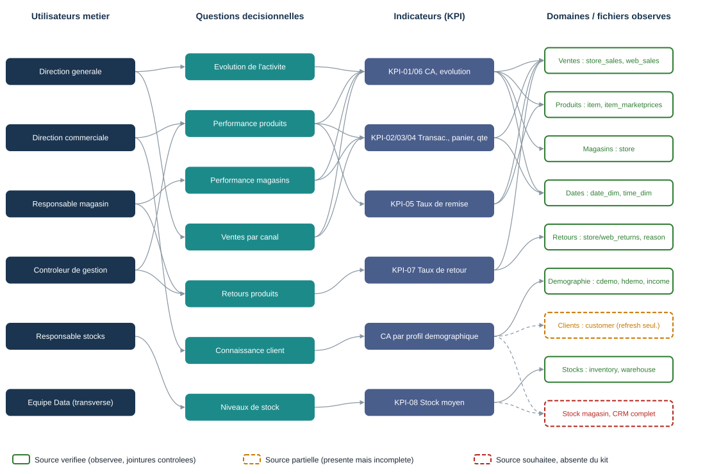

# UC-01 – Questions décisionnelles

Retail Intelligence Platform · TP Jour 1 · 16/11/2026

## 1. Matrice profils, questions et décisions

| # | Profil | Question | Décision | KPI | Couverture | Priorité |
|---|---|---|---|---|---|---|
| Q1 | Direction générale | Comment évolue le CA d'une année sur l'autre ? | Réviser les objectifs | KPI-01, 06 | Couvert | Indispensable |
| Q2 | Direction générale | Quel est le poids de chaque canal ? | Réallouer les investissements | KPI-01, 02 | Couvert | Indispensable |
| Q3 | Direction commerciale | Quels produits et catégories vendent le plus ? | Ajuster l'assortiment | KPI-01, 04 | Couvert | Indispensable |
| Q4 | Direction commerciale | Quels profils achètent quelles catégories ? | Cibler les campagnes | KPI-01 + démographie | Partiel | Utile |
| Q5 | Responsable magasin | Comment se situe mon magasin par rapport aux autres ? | Plan d'action local | KPI-01, 02, 03 | Couvert | Indispensable |
| Q6 | Responsable magasin | Quels articles sont le plus retournés, et pourquoi ? | Retirer un article | KPI-07 | Couvert | Utile |
| Q7 | Contrôleur de gestion | Quel est le niveau de remise par catégorie ? | Revoir la politique de prix | KPI-05 | Couvert | Utile |
| Q8 | Contrôleur de gestion | Quelle part du CA est annulée par les retours ? | Fiabiliser le reporting | KPI-01, 07 | Couvert | Indispensable |
| Q9 | Responsable stocks | Quel est le stock hebdomadaire par article et par entrepôt ? | Réapprovisionner | KPI-08 | Couvert | Utile |
| Q10 | Responsable stocks | Quel est le stock disponible en magasin ? | Transférer du stock | – | **Non couvert** | Complémentaire |
| Q11 | Équipe Data | Les lots reçus sont-ils complets et cohérents ? | Accepter ou rejeter un lot | Contrôles | Couvert | Indispensable |
| Q12 | Équipe Data | Le lot `data_refresh` s'intègre-t-il sans doublon ? | Valider l'incrément | Contrôles de clés | Couvert | Indispensable |

## 2. Questions de l'énoncé et réponse des données

| Question | Réponse |
|---|---|
| Produits qui vendent le plus ? | Oui (9 catégories, Books en tête) |
| Évolution dans le temps ? | Oui, de 2001 à 2005 (2005 s'arrête au 13/12) |
| Meilleurs magasins ? | Oui, 12 magasins, écarts faibles (±3 %) |
| Volumes par canal ? | Oui, magasin et web |
| Produits retournés ? | Oui, avec le motif |
| Caractériser les clients ? | Partiel : démographie seulement |
| Niveaux de stock ? | Partiel : entrepôts, photos hebdomadaires |
| Navigation web ? | Partiel : 9,9 % des clics sont liés à une vente ; pas de session |

## 3. Schéma fonctionnel

Légende : vert = source vérifiée, orange = source partielle, rouge = source absente.

