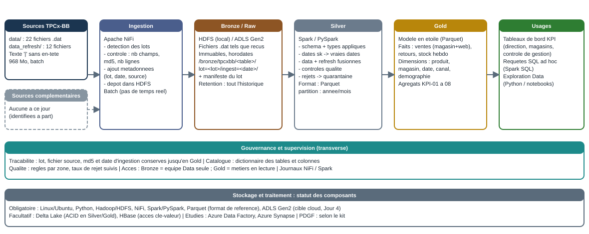

# UC-02 – Architecture logique cible

Retail Intelligence Platform · TP Jour 1 · 16/11/2026

## 1. Rôle des zones

| Zone | Rôle | Contenu | Format | Qui y accède |
|---|---|---|---|---|
| **Bronze / Raw** | Garder les données exactement comme reçues, avec leur provenance | Fichiers `.dat` des lots `data` et `data_refresh`, plus un manifeste (md5, nombre de lignes, date) | `.dat` d'origine | Équipe Data |
| **Silver** | Nettoyer, typer, harmoniser et contrôler | Tables typées avec noms de colonnes, dates résolues, lots fusionnés ; quarantaine des rejets | Parquet, partitionné par année et mois | Équipe Data, analystes |
| **Gold** | Données prêtes pour les KPI | Modèle en étoile et agrégats KPI-01 à KPI-08 | Parquet | Métiers (lecture) |

## 2. Modèle Gold (étoile)

| Table | Type | Grain | Origine |
|---|---|---|---|
| fait_ventes | Fait | 1 ligne de vente (canal = magasin ou web) | store_sales + web_sales |
| fait_retours | Fait | 1 article retourné | store_returns + web_returns |
| fait_stock | Fait | article × entrepôt × semaine | inventory |
| dim_produit, dim_magasin, dim_date, dim_demographie, dim_canal | Dimensions | 1 membre | item, store, date_dim, customer_demographics… |

## 3. Justification

- **Les besoins sont couverts :** les KPI de UC-01 se calculent tous sur Gold.
- **Le brut est conservé :** on peut recharger un lot ou corriger une règle sans redemander les fichiers.
- **Batch uniquement :** les données arrivent par lots (`data_refresh`), le temps réel n'est pas justifié.
- **Parquet :** format colonnaire, compressé et lisible par Spark comme par Azure.
- **Limite :** le référentiel client est absent de l'historique, donc la dimension client reste limitée au lot refresh.
