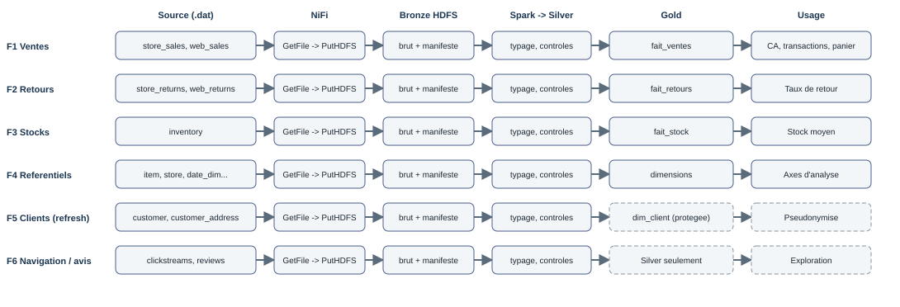

# UC-02 – Schéma des flux de données

Retail Intelligence Platform · TP Jour 1 · 16/11/2026

## Description des flux

Tous les flux sont en **batch**, déclenchés à l'arrivée d'un lot. Aucun flux temps réel n'est justifié par les données.

| Flux | Source et format | Ingestion | Destination | Contrôles | Transformations | Résultat | Consommateur |
|---|---|---|---|---|---|---|---|
| F1 Ventes | store_sales, web_sales (.dat `\|`) | NiFi | Bronze → Silver → Gold | Nombre de champs, clés présentes, quantité > 0, montants recalculés | Typage, date sk → date, union des 2 canaux | fait_ventes | Direction, magasins |
| F2 Retours | store_returns, web_returns | NiFi | Bronze → Silver → Gold | Vente d'origine trouvée (sinon quarantaine) | Rattachement à la vente | fait_retours | Magasins, contrôle de gestion |
| F3 Stocks | inventory (23 M lignes) | NiFi | Bronze → Silver → Gold | Pas de doublon (date, article, entrepôt) ; quantité ≥ 0 | Partitionnement par semaine | fait_stock | Responsable stocks |
| F4 Référentiels | item, store, date_dim, démographie… | NiFi | Bronze → Silver → Gold | Clé unique, non nulle | Exclusion des champs incohérents (`s_closed_date_sk`) | Dimensions | Tous |
| F5 Clients | customer, customer_address (refresh) | NiFi | Bronze → Silver (accès restreint) | Clé unique | **Pseudonymisation** (nom, e-mail) | dim_client protégée | Équipe Data |
| F6 Navigation et avis | web_clickstreams, product_reviews | NiFi | Bronze → Silver | Clés connues | Typage | Tables Silver | Exploration, data science |

**Ordre de chargement :** référentiels (F4) en premier, puis les faits, et enfin le lot `data_refresh`. Les deux lots sont nécessaires pour que tous les articles du stock existent (UC-01).
