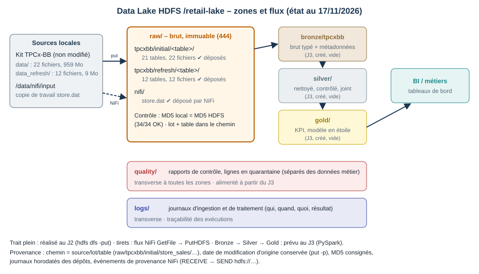
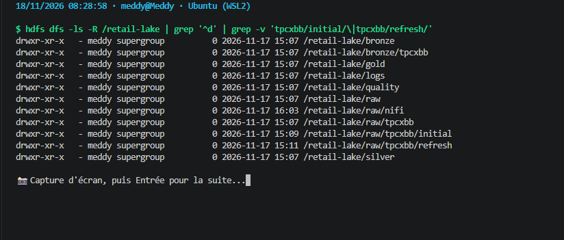

# UC-03 – Étape 3 : arborescence du Data Lake

<p class="meta">Retail Intelligence Platform · TP Jour 2 · 17/11/2026 · Livrable 4</p>

Preuves : `preuves/03_arborescence_datalake.txt` (création, `hdfs dfs -ls -R`), et les captures
`preuves/captures/etape3_explorer_retail-lake.png` et `etape3_explorer_raw.png`.

## 1. Arborescence créée dans HDFS

```
/retail-lake/
├── raw/                    zone brute : copie fidèle des sources, jamais modifiée
│   ├── tpcxbb/
│   │   ├── initial/<table>/   lot initial du kit (dossier data/)          → 21 tables déposées
│   │   └── refresh/<table>/   lot de rafraîchissement (data_refresh/)     → 12 tables déposées
│   └── nifi/               dépôts réalisés par le flux NiFi (UC-04), séparés du dépôt manuel
├── bronze/
│   └── tpcxbb/             données brutes structurées (typées, avec métadonnées d'ingestion) – J3
├── silver/                 données nettoyées, contrôlées, dédoublonnées – J3
├── gold/                   données prêtes pour le métier (KPI, modèle en étoile) – J3
├── quality/                rapports de contrôle qualité et quarantaine
└── logs/                   journaux d'ingestion et de traitement
```

Cette organisation suit l'architecture cible de l'UC-02 (médaillon Bronze, Silver, Gold). Nous avons fait trois
adaptations, toutes justifiées :
- **`raw/tpcxbb/{initial,refresh}/<table>/`** : un sous-dossier par table. Spark (J3) lit un *répertoire* par
  table, ce qui permettra de recevoir plusieurs fichiers ou plusieurs dates pour une même table sans changer le code.
- **`raw/nifi/`** : c'est la destination imposée par le sujet pour l'UC-04. Elle évite d'écraser le dépôt manuel
  de l'UC-03 et permet de comparer les deux méthodes.
- `data/customer` et `data/customer_address` sont **vides** dans le kit. Ils n'ont pas de dossier dans
  `initial/` : nous n'avons pas créé de faux fichiers (consigne du §8.3).





## 2. Explications demandées

**Pourquoi conserver les données sources ?**
- **Rejouabilité** : si une règle de nettoyage Silver est fausse, on la corrige et on relance le traitement à partir
  de Raw, sans redemander les fichiers à la source.
- **Preuve et audit** : on peut toujours montrer ce qui a été reçu, à quelle date, et prouver par le MD5 que rien
  n'a été modifié.
- **Usages futurs** : des colonnes inutiles aujourd'hui peuvent servir demain (*schema on read*).
- En pratique, la zone est en **lecture seule** (fichiers en `444`, voir l'étape 5).

**Différence entre Raw et Bronze**

| | Raw | Bronze |
|---|---|---|
| Contenu | Fichiers **identiques octet pour octet** à la source (`.dat`, séparateur `\|`, sans en-tête) | Mêmes données, mais **structurées** : schéma de colonnes appliqué, format colonne (Parquet/Delta), colonnes techniques ajoutées (`_lot`, `_fichier_source`, `_date_ingestion`) |
| Transformation | Aucune | Aucune règle métier, seulement de la mise en forme technique |
| Rôle | Archive et preuve | Point de départ efficace pour les traitements |

**Rôle des zones Silver et Gold**
- **Silver** : données **fiables**. Types corrects, clés non nulles, doublons supprimés (0,6 % de doublons
  ticket-article relevés au J1), rattachements vérifiés, règles métier appliquées. Les lignes en erreur partent en
  quarantaine (`quality/`).
- **Gold** : données **prêtes pour la décision**. Modèle en étoile (faits ventes, retours, stock ; dimensions
  produit, magasin, date…) et KPI du dictionnaire du J1, consommés par la BI.

**Pourquoi séparer données métier, contrôles qualité et journaux ?**
- **Droits différents** : les métiers lisent Gold, l'équipe Data lit `quality/` et `logs/`.
- **Pas de pollution** : un rapport de contrôle ou un journal n'est pas une donnée métier. Les mélanger fausserait
  les traitements qui lisent tout un répertoire.
- **Cycles de vie différents** : les journaux peuvent être purgés après N mois, alors que Raw est conservé.
- **Supervision** : `quality/` donne le taux de rejet par lot, `logs/` dit qui a fait quoi et quand.

**Comment la provenance est conservée**
1. **Dans le chemin** : source (`tpcxbb`), lot (`initial`/`refresh`), table, et outil de dépôt (`nifi/`).
2. **Dans les métadonnées HDFS** : `put -p` conserve la date de modification d'origine (16/11/2026 14:36).
3. **Dans les preuves de dépôt** : journal horodaté de chaque `put` et inventaire avant dépôt (taille, lignes,
   colonnes), avec le MD5 de chaque fichier source et HDFS (`preuves/05_controle_integrite_md5.csv`).
4. **Dans NiFi** : événements de provenance `RECEIVE file:/data/nifi/input/store.dat` → `SEND hdfs://…/raw/nifi/store.dat`,
   avec l'UUID du FlowFile et l'horodatage (UC-04).
5. **Au J3** : colonnes techniques `_lot`, `_fichier_source`, `_date_ingestion` ajoutées en Bronze et
   propagées jusqu'en Gold (règle de gouvernance de l'UC-02).
