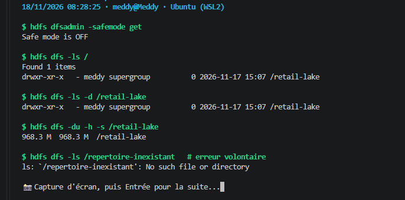

# UC-03 – Étape 2 : commandes HDFS exécutées

Retail Intelligence Platform · TP Jour 2 · 17/11/2026 · Livrable 5

Environnement : HDFS 3.5.0 mono-nœud (`hdfs://localhost:9000`), utilisateur Linux `meddy`.
Les sorties complètes et horodatées se trouvent dans `preuves/02_commandes_hdfs.txt`. Les captures d'écran
correspondantes sont dans `preuves/captures/`.

## 1. Les six opérations demandées

| # | Opération | Commande | Résultat obtenu | Interprétation |
|---|---|---|---|---|
| 1 | Consulter l'état du système | `hdfs dfsadmin -safemode get` | `Safe mode is OFF` | Le NameNode accepte les écritures. En *safe mode*, HDFS serait en lecture seule, ce qui arrive le temps que les DataNodes déclarent leurs blocs au démarrage |
| 2 | Informations sur les nœuds | `hdfs dfsadmin -report -live` | `Live datanodes (1)` : `127.0.0.1:9866`, *Normal*, 1 006,85 Go configurés | Un seul DataNode actif : c'est un environnement mono-nœud |
| 3 | Lister les répertoires | `hdfs dfs -ls /` | Vide au départ (le système de fichiers venait d'être formaté) | – |
| 4 | Créer un répertoire de travail | `hdfs dfs -mkdir -p /retail-lake` | Code retour 0 | `-p` crée aussi les parents et ne renvoie pas d'erreur si le répertoire existe déjà |
| 5 | Vérifier les permissions | `hdfs dfs -ls -d /retail-lake` | `drwxr-xr-x - meddy supergroup` | Propriétaire `meddy` (rwx), groupe et autres en lecture/parcours seulement. `-d` affiche le répertoire lui-même, pas son contenu |
| 6 | Taille des données stockées | `hdfs dfs -du -h -s /retail-lake` | `0` à la création ; **968,3 Mo** après le dépôt de l'étape 4 | `-s` donne le total, `-h` un format lisible |

## 2. Erreur rencontrée et documentée

| Commande | Message | Cause | Ce qu'on en retient |
|---|---|---|---|
| `hdfs dfs -ls /repertoire-inexistant` (test volontaire) | `ls: '/repertoire-inexistant': No such file or directory`, code retour 1 | Chemin absent de l'espace de noms HDFS | Le message vient du NameNode. Il faut toujours vérifier les chemins avant une opération (consigne 5) |

Aucune erreur de droits n'est apparue : l'utilisateur qui exécute les commandes, `meddy`, est aussi celui qui a
démarré HDFS. C'est donc le **super-utilisateur HDFS**.

## 3. Autres commandes utilisées pendant le TP

| Commande | Usage |
|---|---|
| `hdfs dfs -put -p <local> <hdfs>` | Dépôt en conservant la date de modification d'origine (étape 4) |
| `hdfs dfs -ls -R -h`, `hdfs dfs -count -h` | Lister de façon récursive, compter les dossiers, fichiers et octets |
| `hdfs dfs -cat`, `hdfs dfs -get` | Lire un fichier, ou le récupérer en local (étape 5) |
| `hdfs dfs -stat %b` | Taille exacte en octets (comparaison avec la source) |
| `hdfs dfs -chmod`, `hdfs dfs -chgrp` | Correction des permissions de la zone Raw (étape 5) |
| `hdfs fsck <chemin> -files -blocks` | Découpage en blocs, réplication, santé (`Status: HEALTHY`) |
| `hdfs getconf -confKey <clé>` | Lire la configuration effective (`dfs.blocksize` = 128 Mo, `dfs.replication` = 1) |
| `jps` | Processus Java en cours (NameNode, DataNode, SecondaryNameNode, NiFi) |

## 4. Différence avec les commandes Linux

Les commandes `hdfs dfs -ls/-mkdir/-cat` ressemblent à `ls/mkdir/cat`, mais elles agissent sur **l'espace de noms
HDFS**, géré par le NameNode, et pas sur le disque local. `/retail-lake` n'existe pas pour `ls` sous Linux. À
l'inverse, `~/tpcxbb_kit` n'existe pas pour `hdfs dfs -ls`. Seules les commandes `-put` et `-get` font le pont entre
les deux mondes.
