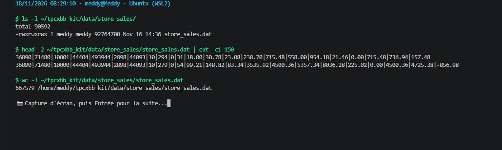
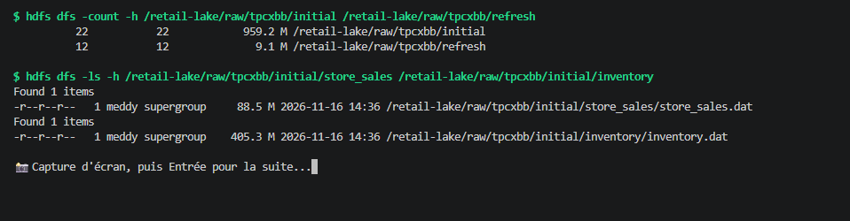
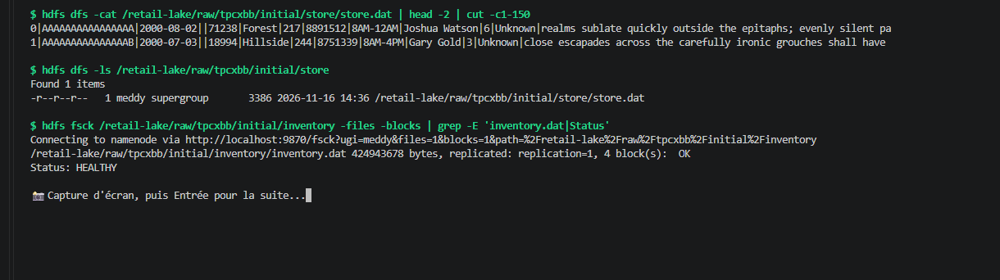
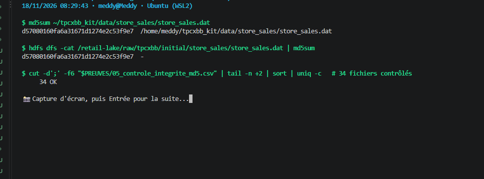

# UC-03 – Étapes 4 et 5 : inventaire, dépôt TPCx-BB et vérification du stockage

<p class="meta">Retail Intelligence Platform · TP Jour 2 · 17/11/2026 · Livrables 3 et 6</p>

Preuves :
- `preuves/04_inventaire_avant_depot.csv` : inventaire produit par la commande, avant le dépôt ;
- `preuves/04_depot_tpcxbb.txt` : dépôt réussi ;
- `preuves/04_depot_tentative1_ECHEC_chemin_avec_espaces.txt` : première tentative en échec ;
- `preuves/05_verification_stockage.txt` et `preuves/05_controle_integrite_md5.csv` : vérifications ;
- `preuves/06_correction_permissions.txt` : correction des droits ;
- `preuves/captures/etape4_*.png`, `etape5_*.png` (interface NameNode) et `terminal*.png` (terminal) : captures d'écran.

## 1. Inventaire des fichiers réellement disponibles (livrable 3)

**Provenance** : kit TPCx-BB (*TPC Express BigBench*) fourni pour la formation. Il s'agit d'un **jeu
synthétique**, généré par l'outil du benchmark, et non de données réelles. Il est stocké en local dans
`J1/retail_project/retail_project/` et vu depuis Ubuntu par le lien `~/tpcxbb_kit`. Les fichiers sont datés du
16/11/2026 14:36 (date de mise à disposition). La version exacte du générateur n'est pas indiquée dans le kit.

**Format constaté** : texte délimité par `|`, **sans ligne d'en-tête** (les noms des colonnes viennent du schéma
TPCx-BB documenté au J1), encodage ASCII, **fins de ligne Windows (CRLF)** dans les 34 fichiers. Le nombre de
colonnes a été mesuré sur la première ligne. Les lignes ont été comptées avec `wc -l`.

| Lot | Table | Fichier | Taille | Lignes | Col. |
|---|---|---|---:|---:|---:|
| initial | customer_demographics | customer_demographics.dat | 77,8 Mo | 1 920 800 | 9 |
| initial | date_dim | date_dim.dat | 15,4 Mo | 109 573 | 28 |
| initial | household_demographics | household_demographics.dat | 155 Ko | 7 200 | 5 |
| initial | income_band | income_band.dat | 327 o | 20 | 3 |
| initial | inventory | inventory.dat | 424,9 Mo | 23 255 100 | 4 |
| initial | item | item.dat | 6,8 Mo | 17 820 | 22 |
| initial | item_marketprices | item_marketprices.dat | 4,2 Mo | 89 100 | 6 |
| initial | item_marketprices | item_marketprices_audit.csv | 273 o | 5 | 8 ¹ |
| initial | product_reviews | product_reviews.dat | 56,4 Mo | 89 991 | 8 |
| initial | promotion | promotion.dat | 46 Ko | 300 | 19 |
| initial | reason | reason.dat | 3 Ko | 35 | 3 |
| initial | ship_mode | ship_mode.dat | 1 Ko | 20 | 6 |
| initial | store | store.dat | 3,4 Ko | 12 | 29 |
| initial | store_returns | store_returns.dat | 4,3 Mo | 37 902 | 20 |
| initial | store_sales | store_sales.dat | 92,8 Mo | 667 579 | 23 |
| initial | time_dim | time_dim.dat | 5,1 Mo | 86 400 | 10 |
| initial | warehouse | warehouse.dat | 584 o | 5 | 14 |
| initial | web_clickstreams | web_clickstreams.dat | 178,7 Mo | 6 770 550 | 6 |
| initial | web_page | web_page.dat | 8 Ko | 60 | 14 |
| initial | web_returns | web_returns.dat | 5,4 Mo | 38 487 | 24 |
| initial | web_sales | web_sales.dat | 133,8 Mo | 668 052 | 34 |
| initial | web_site | web_site.dat | 8,8 Ko | 30 | 26 |
| refresh | customer | customer.dat | 134 Ko | 1 000 | 18 |
| refresh | customer_address | customer_address.dat | 55 Ko | 500 | 13 |
| refresh | inventory | inventory.dat | 4,3 Mo | 234 900 | 4 |
| refresh | item | item.dat | 69 Ko | 180 | 22 |
| refresh | item_marketprices | item_marketprices.dat | 43 Ko | 900 | 6 |
| refresh | item_marketprices | item_marketprices_audit.csv | 151 Ko | 17 986 | 8 ¹ |
| refresh | product_reviews | product_reviews.dat | 574 Ko | 909 | 8 |
| refresh | store_returns | store_returns.dat | 49 Ko | 426 | 20 |
| refresh | store_sales | store_sales.dat | 922 Ko | 6 632 | 23 |
| refresh | web_clickstreams | web_clickstreams.dat | 1,8 Mo | 68 988 | 6 |
| refresh | web_returns | web_returns.dat | 56 Ko | 400 | 24 |
| refresh | web_sales | web_sales.dat | 1,4 Mo | 6 879 | 34 |
| **Total** | | **34 fichiers** | **968,3 Mo** | | |

**Limites et anomalies constatées** (aucun fichier n'a été modifié ni ajouté) :
1. `data/customer/` et `data/customer_address/` sont **vides** : le lot initial ne contient pas de clients. Ces
   tables n'existent que dans `refresh`, avec 1 000 et 500 lignes. Cela confirme l'intégrité référentielle « client
   100 % sans correspondance » relevée au J1.
2. ¹ `item_marketprices_audit.csv` n'est pas un fichier de données comme les autres. C'est un **rapport du
   générateur** : séparateur virgule, **ligne vide en tête**, en-tête de 8 colonnes en 2ᵉ ligne, puis des lignes de
   texte libre (`List of item ID's with competitor count = 0:`). Le script a d'abord compté 1 colonne à cause de la
   ligne vide ; après inspection manuelle, le bon chiffre est 8. Ce fichier sera exclu des traitements Silver.
3. **Fins de ligne CRLF** dans les 34 fichiers : au J3, il faudra retirer le `\r` final, sinon la dernière colonne
   de chaque ligne sera polluée (par exemple `net_profit` dans `store_sales`).
4. Les colonnes ne sont ni nommées ni typées dans les fichiers (*schema on read*). Les types seront appliqués en
   Bronze, à partir du schéma TPCx-BB.

## 2. Dépôt dans HDFS (étape 4)

**Fichiers sélectionnés** : les 34 fichiers du kit, en deux lots, car le lot initial seul ne contient pas de clients.

**Contrôles avant dépôt** (pour chaque fichier, colonne `lisible` de l'inventaire) : chemin local vérifié, nom,
format, taille, structure, lisibilité. Les 34 fichiers sont lisibles (`oui`).

**Commande utilisée** (une par table, voir le journal) :
```bash
hdfs dfs -mkdir -p /retail-lake/raw/tpcxbb/initial/store_sales
hdfs dfs -put -p ~/tpcxbb_kit/data/store_sales/* /retail-lake/raw/tpcxbb/initial/store_sales/
```
- `-p` conserve la date de modification d'origine : c'est un élément de provenance.
- Nous n'avons **pas** utilisé `-f` : un fichier déjà présent n'est jamais écrasé, et la commande échoue à la place.

**Incident et correction** : la première tentative a échoué pour tous les fichiers, avec le message `put: '/mnt/c/.../Data
Lake Warehouse Lakehouse/...': No such file or directory`. Le client Hadoop ne gère pas les **espaces** des chemins
locaux. Pour corriger, nous avons créé un lien symbolique sans espace, `~/tpcxbb_kit`, vers le kit, puis relancé.
Résultat : 34 dépôts, tous avec le code retour 0, entre 15:12 et 15:16.





## 3. Vérification du stockage (étape 5)

| Contrôle | Méthode | Résultat |
|---|---|---|
| Présence des répertoires attendus | `hdfs dfs -ls /retail-lake /retail-lake/raw /retail-lake/raw/tpcxbb` | ✅ 6 zones et sous-dossiers présents |
| Présence des fichiers déposés | `hdfs dfs -count -h` | ✅ `initial` : 22 dossiers, 22 fichiers, 959,2 Mo · `refresh` : 12 dossiers, 12 fichiers, 9,1 Mo |
| Taille | `stat -c %s` (local) comparé à `hdfs dfs -stat %b` (HDFS), à l'octet près | ✅ 34/34 identiques |
| Permissions | `hdfs dfs -ls` | ⚠️ puis ✅ : voir §4 |
| Lecture | `hdfs dfs -cat .../store/store.dat \| head` | ✅ contenu lisible |
| Récupération contrôlée | `hdfs dfs -get .../store.dat /tmp/` puis `cmp` avec la source | ✅ « Fichier récupéré identique à la source » |
| **Intégrité (somme de contrôle)** | **MD5 de la source locale** comparé au **MD5 du contenu relu depuis HDFS** (`hdfs dfs -cat \| md5sum`), pour chaque fichier | ✅ **34/34 OK** (`05_controle_integrite_md5.csv`). Exemple : `store_sales.dat` donne `d57080160fa6a31671d1274e2c53f9e7` des deux côtés |
| Santé et blocs | `hdfs fsck /retail-lake/raw/tpcxbb -files -blocks` | ✅ `HEALTHY`. `inventory.dat` (405 Mo) occupe 4 blocs, chacun des autres fichiers 1 bloc. Réplication de 1 |
| Source originale conservée | `ls -la` sur le kit après dépôt | ✅ fichiers inchangés, toujours datés du 16/11 14:36 |

**Pourquoi MD5 et pas `hdfs dfs -checksum` ?** HDFS calcule son propre checksum (par défaut un « MD5 de MD5 de CRC32C », calculé par bloc), et ce
résultat n'est pas comparable à un `md5sum` local. Relire le fichier depuis HDFS et calculer son MD5 compare
vraiment ce qui est stocké avec la source. Limite : il faut relire tout le volume (968 Mo), ce qui reste acceptable ici.





## 4. Permissions : constat et correction

**Constat** (captures de l'étape 4) : les 34 fichiers étaient en `-rwxrwxrwx`, avec le groupe `meddy`. Cause :
`put -p` recopie aussi les **droits** d'origine, et WSL présente les fichiers du disque Windows (`/mnt/c`) en `777`.
Une zone Raw modifiable par tout le monde contredit son principe d'immuabilité.

**Correction** (`scripts/uc03_permissions.sh`, preuve `06_correction_permissions.txt`) :
```bash
hdfs dfs -chgrp -R supergroup /retail-lake/raw/tpcxbb
hdfs dfs -chmod -R 755 /retail-lake/raw/tpcxbb          # dossiers : parcours et lecture
hdfs dfs -chmod 444 '/retail-lake/raw/tpcxbb/*/*/*'     # fichiers : lecture seule
```
Résultat : 34 fichiers en `-r--r--r--` et 34 dossiers en `drwxr-xr-x`, tous dans le groupe `supergroup`.

**Limite** : `meddy` a démarré le NameNode, il est donc **super-utilisateur HDFS**, et les permissions ne
s'appliquent pas à lui. En production, il faudrait des comptes distincts : un compte technique d'ingestion seul
autorisé à écrire dans Raw, des comptes de lecture pour les traitements, et Kerberos pour l'authentification.
Retenir aussi pour les prochains dépôts : utiliser `put` **sans** `-p`, ou appliquer `chmod` juste après.
