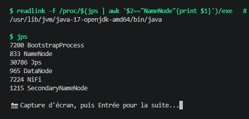

# UC-03 – Fiche d'environnement technique

Retail Intelligence Platform · TP Jour 2 · 17/11/2026 · Livrable 1

> **Environnement réellement utilisé** : Ubuntu 24.04 exécuté dans **WSL2** sur un PC Windows 11 (pas de machine
> Ubuntu native). Déploiement **local mono-nœud** (pseudo-distribué), à usage pédagogique : ce n'est pas un cluster
> de production. Preuve brute : `preuves/01_environnement_hadoop.txt`.

## 1. Système et versions

| Élément | Valeur relevée | Commande de vérification |
|---|---|---|
| Système hôte | Windows 11 Famille (10.0.26300), 12 cœurs logiques | `winver`, `nproc` |
| Virtualisation | WSL 2.6.1, noyau `6.6.87.2-microsoft-standard-WSL2`, systemd activé | `wsl --version`, `uname -r` |
| Système invité | Ubuntu 24.04.4 LTS | `grep PRETTY_NAME /etc/os-release` |
| Ressources WSL | 7,6 Go de RAM, disque virtuel de 1 To (948 Go libres) | `free -h`, `df -h /` |
| Java (Hadoop) | OpenJDK 17, `/usr/lib/jvm/java-17-openjdk-amd64` | `readlink -f /proc/<pid NameNode>/exe` |
| Java (NiFi) | OpenJDK 21.0.13, `/usr/lib/jvm/java-21-openjdk-amd64` | `readlink -f /proc/<pid NiFi>/exe` |
| Hadoop | **3.5.0** (commit `dbcc7cd`, compilé le 24/03/2026) | `hadoop version` |
| Apache NiFi | **2.12.0**, avec les extensions `nifi-hadoop-nar` et `nifi-hadoop-libraries-nar` 2.12.0 | `ls /opt/nifi/lib` |
| Python | 3.12.3 (Ubuntu) ; 3.11 côté Windows (scripts du J1) | `python3 --version` |

**Point d'attention Java.** La commande `java -version` affiche Java 21, car c'est le `java` par défaut du système
(`/usr/bin/java → java-21`). Hadoop ne l'utilise pas : `hadoop-env.sh` force `JAVA_HOME` sur Java 17. On l'a vérifié
sur les processus en cours d'exécution : NameNode, DataNode et SecondaryNameNode tournent sous Java 17, NiFi sous Java 21.

## 2. Chemins d'installation

| Élément | Chemin |
|---|---|
| Hadoop (`HADOOP_HOME`) | `/opt/hadoop` |
| Configuration Hadoop (`HADOOP_CONF_DIR`) | `/opt/hadoop/etc/hadoop` (`core-site.xml`, `hdfs-site.xml`, `hadoop-env.sh`) |
| Métadonnées du NameNode | `/home/meddy/hadoop-data/namenode` |
| Blocs du DataNode | `/home/meddy/hadoop-data/datanode` |
| Journaux Hadoop | `/opt/hadoop/logs` |
| NiFi | `/opt/nifi` (journaux `/opt/nifi/logs`, configuration `/opt/nifi/conf`) |
| Dossiers d'entrée NiFi | `/data/nifi/input`, `/data/nifi/archive`, `/data/nifi/error` |
| Kit TPCx-BB (Windows) | `C:\Users\meddy\Desktop\Data Lake Warehouse Lakehouse\J1\retail_project\retail_project` |
| Kit TPCx-BB (vu d'Ubuntu) | `~/tpcxbb_kit` (lien symbolique vers `/mnt/c/.../retail_project`, voir §6) |

## 3. Configuration HDFS

| Paramètre | Valeur | Rôle |
|---|---|---|
| `fs.defaultFS` | `hdfs://localhost:9000` | Adresse du NameNode utilisée par les clients |
| `dfs.replication` | `1` | Une seule copie par bloc (il n'y a qu'un DataNode) |
| `dfs.blocksize` | 134 217 728 octets (128 Mo, valeur par défaut) | Taille de découpage des fichiers |
| `dfs.namenode.name.dir` / `dfs.datanode.data.dir` | `file:///home/meddy/hadoop-data/...` | Stockage local des métadonnées et des blocs |

## 4. Services actifs et ports

| Service | Processus (`jps`) | Port | Accès |
|---|---|---|---|
| NameNode (RPC) | `NameNode` | 9000 (127.0.0.1) | `hdfs dfs ...` |
| NameNode (interface Web) | `NameNode` | 9870 | http://localhost:9870 |
| DataNode | `DataNode` | 9866 (transfert), 9864 (Web) | – |
| Secondary NameNode | `SecondaryNameNode` | – | – |
| NiFi | `NiFi`, `BootstrapProcess` | 8443 (HTTPS, 127.0.0.1) | https://localhost:8443/nifi |

État au 17/11/2026 à 15:06 : 1 DataNode vivant, aucun bloc manquant ou corrompu, aucune erreur ERROR ou FATAL dans les journaux Hadoop.

## 5. Contraintes réseau, permissions et sécurité

- **Réseau** : les services n'écoutent que sur la machine locale (`127.0.0.1` / `localhost`). Le relais localhost
  de WSL rend les interfaces accessibles depuis le navigateur Windows. Rien n'est exposé sur le réseau.
- **Utilisateur** : tous les services tournent sous le compte Linux `meddy`, qui est aussi propriétaire de
  `/retail-lake` dans HDFS (`drwxr-xr-x meddy supergroup`). NiFi écrit donc dans HDFS sous l'identité `meddy`.
- **Sécurité HDFS** : mode simple, sans Kerberos (acceptable en local, pas en production).
- **NiFi** : HTTPS avec un certificat auto-signé et un utilisateur unique (identifiants générés au premier démarrage).
  **Les identifiants ne sont pas versionnés.**
- **`sudo`** : il demande un mot de passe. Les opérations root de l'installation ont été lancées avec `wsl -u root`.
- **Durée de vie** : WSL arrête la VM quand aucune session n'est ouverte, et HDFS et NiFi s'arrêtent avec elle.
  Il faut garder un terminal Ubuntu ouvert et relancer `scripts/start_env.sh` si besoin.

## 6. Écarts par rapport à la procédure de référence et adaptations

| Écart constaté | Cause | Adaptation |
|---|---|---|
| Pas de poste Ubuntu natif | Poste personnel sous Windows | Ubuntu 24.04 sous WSL2 (déjà présent sur le poste) |
| `PutHDFS` absent de NiFi 2.x | Les composants Hadoop ne sont plus livrés dans la distribution de base | Ajout des NAR officiels `nifi-hadoop-nar` et `nifi-hadoop-libraries-nar` 2.12.0 (Maven Central, SHA-1 vérifié) dans `/opt/nifi/lib` |
| Interface NiFi inaccessible depuis Windows (`ConnectionAborted`) | NiFi écoutait sur une socket IPv6 que le relais localhost de WSL ne transmet pas | `java.arg.ipv4=-Djava.net.preferIPv4Stack=true` dans `conf/bootstrap.conf` |
| `hdfs dfs -put` échoue (`No such file or directory`) | Hadoop ne gère pas les espaces du chemin local (`Data Lake Warehouse Lakehouse`) | Lien symbolique sans espace `~/tpcxbb_kit` → kit TPCx-BB (source non modifiée) |

Intégrité des archives installées : SHA-512 vérifié pour Hadoop et NiFi, SHA-1 pour les NAR.

## 7. Reproduction

Les scripts versionnés dans `scripts/` sont :
- `setup_env_wsl.sh` : installe et configure Hadoop et NiFi ;
- `start_env.sh` : démarre HDFS (Java 17) puis NiFi (Java 21) ;
- `stop_env.sh` : arrête NiFi puis HDFS ;
- `uc03_hdfs.sh` : exécute les étapes 1 à 5 de l'UC-03 et produit les preuves.
