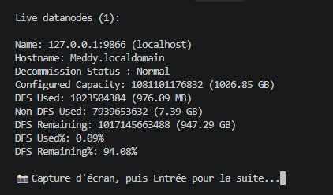

# UC-03 – Étape 1 : fiche de découverte Hadoop et HDFS

Retail Intelligence Platform · TP Jour 2 · 17/11/2026 · Livrable 2

Preuve : `preuves/01_environnement_hadoop.txt` (commandes horodatées, avec sortie et code retour).

## 1. Relevés demandés

| Élément | Constat |
|---|---|
| Version de Hadoop | 3.5.0 (`hadoop version`) |
| Chemin d'installation | `/opt/hadoop` |
| Configuration utilisée | `/opt/hadoop/etc/hadoop` : `fs.defaultFS=hdfs://localhost:9000`, `dfs.replication=1`, blocs de 128 Mo |
| État du NameNode | **Actif** : processus `NameNode` présent dans `jps`, RPC sur le port 9000, interface Web sur le port 9870. `hdfs dfsadmin -safemode get` → *Safe mode is OFF* (écriture autorisée) |
| État des DataNodes | **1 DataNode vivant** (`Live datanodes (1)`, `127.0.0.1:9866`), état *Normal*, capacité 1 006,85 Go dont 948 Go disponibles |
| Autres processus | `SecondaryNameNode` (points de contrôle des métadonnées) ; `NiFi` et `BootstrapProcess` (UC-04) |
| Santé du stockage | 0 bloc sous-répliqué, corrompu ou manquant |
| Erreurs de démarrage | Aucune ligne ERROR ou FATAL dans `/opt/hadoop/logs`. Seul avertissement : la clé SSH de l'hôte a été ajoutée à `known_hosts` au premier `start-dfs.sh`, ce qui est normal |

## 2. Composants de HDFS

| Composant | Rôle | Sur notre environnement |
|---|---|---|
| **NameNode** | Le « chef d'orchestre » : il gère l'espace de noms (arborescence, noms, permissions, propriétaires) et sait **quels blocs composent chaque fichier et sur quels DataNodes ils se trouvent**. Il ne stocke pas les données elles-mêmes. Toute opération commence par lui (`ls`, `mkdir`, ouverture d'un fichier) | 1 NameNode, métadonnées dans `~/hadoop-data/namenode` (fichiers `fsimage` et `edits`) |
| **DataNode** | Stocke physiquement les **blocs** sur son disque, sert les lectures et les écritures des clients, envoie régulièrement au NameNode un *heartbeat* (« je suis vivant ») et un *block report* (« voici mes blocs ») | 1 DataNode, blocs dans `~/hadoop-data/datanode` |
| **Secondary NameNode** | Fusionne périodiquement le journal `edits` dans l'image `fsimage` pour éviter que le journal grossisse indéfiniment. **Ce n'est pas un NameNode de secours** : il ne prend pas le relais en cas de panne | 1 instance, sur la même machine |
| **Client HDFS** | Les commandes `hdfs dfs` : elles demandent au NameNode où lire ou écrire, puis échangent les données **directement** avec les DataNodes | Terminal Ubuntu, puis NiFi (`PutHDFS`) |

**En résumé** : le NameNode sait *où* sont les données, les DataNodes les *détiennent*. Par exemple, après le dépôt,
`hdfs fsck` montre que `inventory.dat` (405 Mo) est découpé en **4 blocs de 128 Mo au plus**. Le NameNode connaît
cette liste de blocs, et le DataNode stocke les 4 blocs.

## 3. Mono-nœud ou distribué ?

**Déploiement local mono-nœud, en mode pseudo-distribué.** Les services HDFS (NameNode, DataNode et
SecondaryNameNode) sont de vrais processus séparés qui communiquent par le réseau, mais **ils tournent tous sur
la même machine** (`localhost`). Les éléments qui le prouvent :
- `hdfs getconf -namenodes` → `localhost` ;
- `hdfs dfsadmin -report` → **un seul** DataNode (`127.0.0.1`) ;
- `dfs.replication = 1` : impossible de faire mieux avec un seul DataNode.

Limites de cet environnement :
- **aucune tolérance aux pannes** : si la machine (ou WSL) s'arrête, tout HDFS est indisponible, et chaque bloc
  n'a qu'une copie ;
- **pas de parallélisme réel** : les lectures ne sont pas réparties entre plusieurs machines ;
- le NameNode est un **point unique de défaillance** (pas de haute disponibilité) ;
- les performances dépendent d'un seul disque, et en plus d'un disque virtuel WSL.

→ C'est un environnement **pédagogique**, qui sert à apprendre les commandes et les mécanismes. **Ce n'est pas un
cluster de production hautement disponible.** En production, on aurait au moins 3 DataNodes (réplication 3) et deux
NameNodes en haute disponibilité (actif et standby), ou un service managé (par exemple ADLS Gen2 sur Azure, voir UC-02).

## 4. Précautions appliquées

- `hdfs namenode -format` n'a été exécuté **qu'une seule fois**, à l'installation, sur un espace vide. Cette commande
  efface toutes les métadonnées, donc toutes les données deviennent inaccessibles : elle ne doit jamais servir à
  « réparer » un problème.
- Les répertoires `~/hadoop-data` ne doivent pas être supprimés.
- L'ordre de démarrage est HDFS puis NiFi ; l'ordre d'arrêt est flux NiFi, NiFi, puis HDFS (`scripts/start_env.sh`
  et `scripts/stop_env.sh`).
