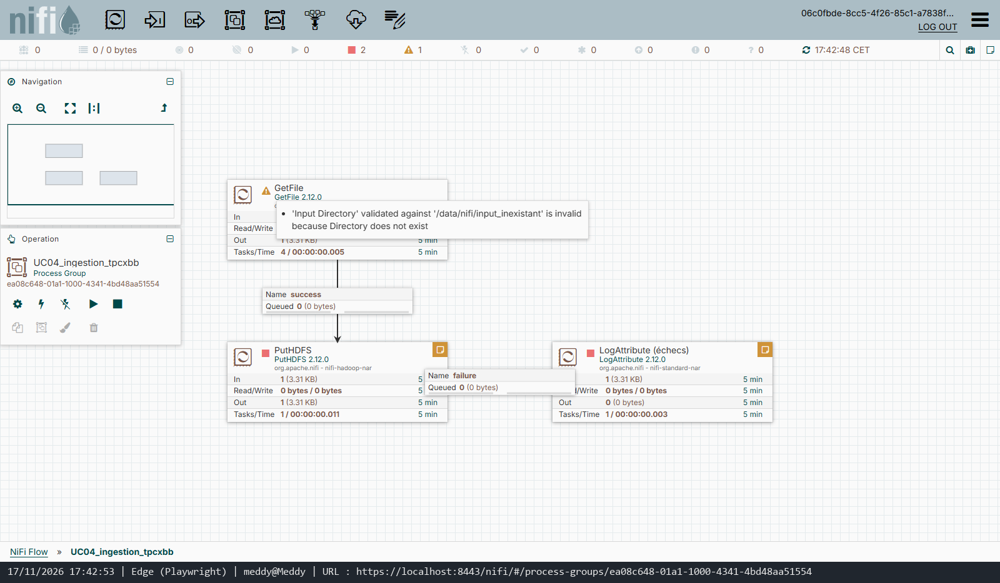
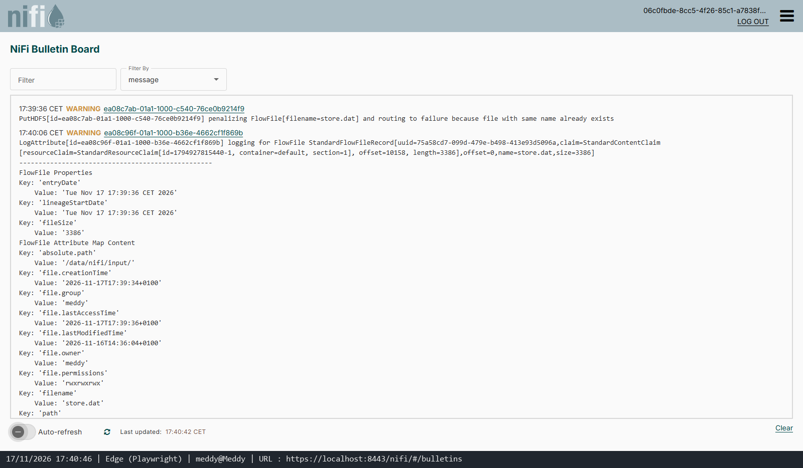
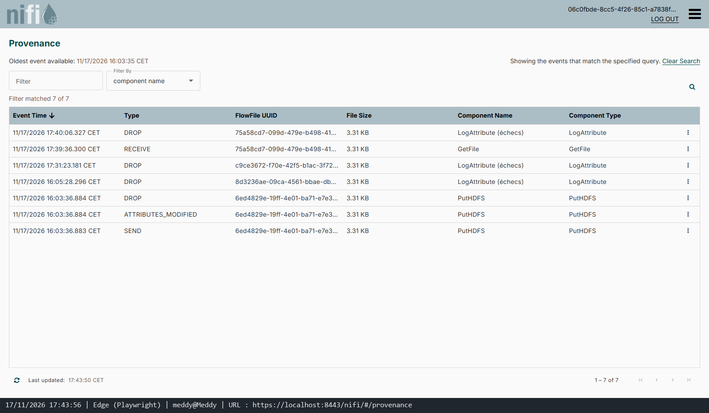
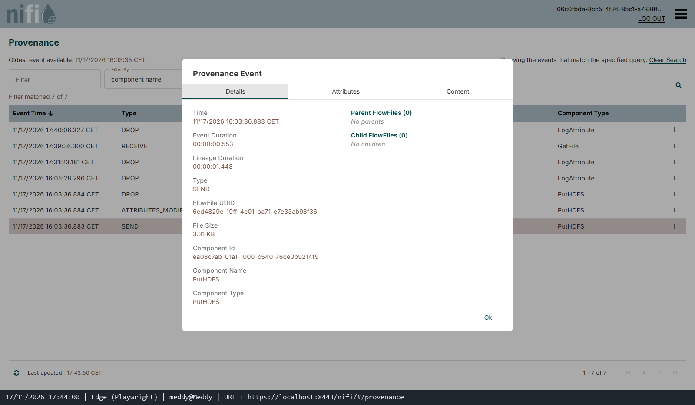
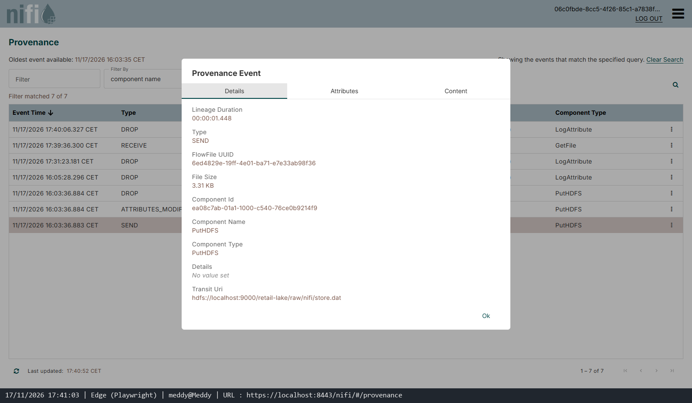
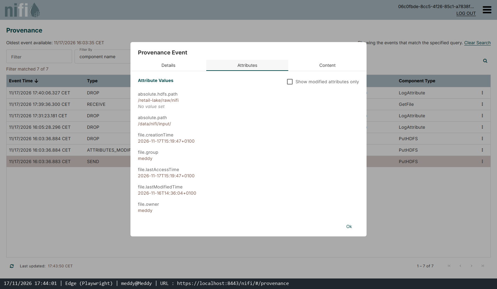
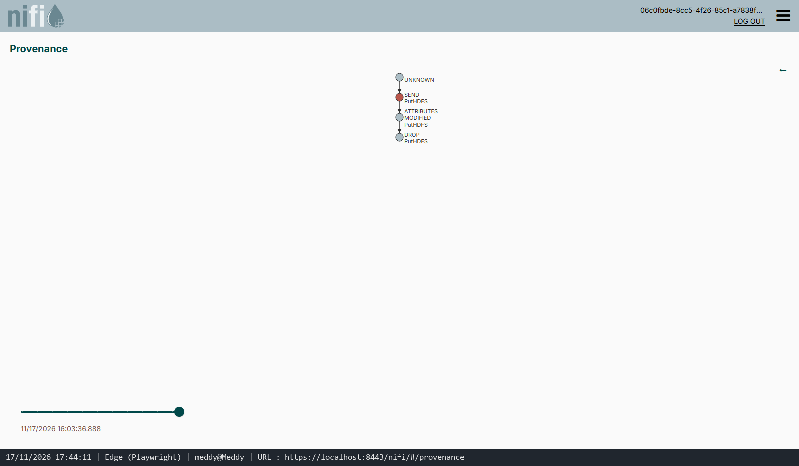
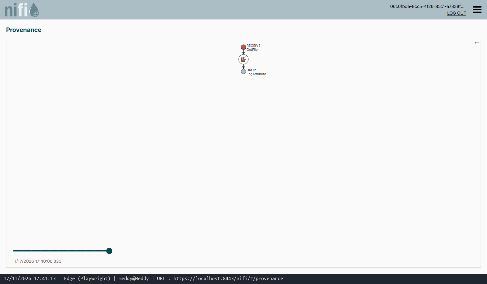

# UC-04 – Étapes 10 et 11 : erreurs, corrections et provenance

Retail Intelligence Platform · TP Jour 2 · 17/11/2026 · Livrables 10 et 11

Preuves :
- `preuves/03_erreur_dossier.txt` : test A ;
- `preuves/04_erreur_conflit.txt` : test B ;
- `preuves/05_provenance.txt` et `preuves/provenance_evenements.json` : provenance ;
- `preuves/captures/` : captures d'écran.

## 1. Tests d'erreur contrôlés (étape 10)

### Test A – dossier source inexistant dans GetFile
| | |
|---|---|
| Action | GetFile arrêté, puis `Input Directory` réglé sur `/data/nifi/input_inexistant` (16:03:58) |
| Comportement observé | Le processeur passe immédiatement en **INVALID** : `'Input Directory' validated against '/data/nifi/input_inexistant' is invalid because Directory does not exist`. Sur le canvas, une icône ⚠ apparaît à la place de ▶. Une demande de démarrage (16:04:01) est **refusée** par NiFi, comme le montre `nifi-app.log` : `Cannot start GetFile[…] because Processor is currently not valid (Validation State is INVALID …)`. Aucune tâche n'a tourné et aucun FlowFile n'a été créé |
| Type d'échec | **Erreur de configuration**, détectée *avant* l'exécution (validation) |
| Correction | `Input Directory` remis à `/data/nifi/input` (16:04:14), et le processeur repasse en **VALID** |

### Test B – conflit de nom dans HDFS
| | |
|---|---|
| Action | Une deuxième copie de travail de `store.dat` est placée dans `/data/nifi/input` alors que `/retail-lake/raw/nifi/store.dat` existe déjà, puis GetFile est démarré (16:04:19) |
| Comportement observé | 16:04:58 : bulletin **WARNING** de PutHDFS : `penalizing FlowFile[filename=store.dat] and routing to failure because file with same name already exists`. Le FlowFile attend **30 s** dans la file `failure` (pénalité, *Penalty Duration* = 30 sec), puis LogAttribute le journalise à 16:05:28 (`logging for FlowFile … uuid=8d3236ae-…`) |
| Vérification HDFS | `hdfs dfs -ls /retail-lake/raw/nifi` montre **toujours un seul fichier**, avec l'heure du 1er dépôt (16:03). **Rien n'a été écrasé et aucun doublon n'a été créé** |
| Type d'échec | **Échec à l'exécution**, routé et visible (relation `failure`), sans perte de données |
| Ce qu'on en retient | La stratégie `fail` protège la zone Raw. En exploitation, la relation `failure` doit mener à une action : alerte, et dépôt dans `/data/nifi/error` pour analyse |

Pour les captures, le test B a été **rejoué deux fois** (17:30 et 17:39), avec le même résultat : WARNING,
journalisation par LogAttribute, et toujours un seul fichier dans `/retail-lake/raw/nifi`.

Le test « retirer le droit de lecture » n'a pas été retenu : l'utilisateur de NiFi est le propriétaire du fichier,
et sous WSL les fichiers copiés depuis `/mnt/c` sont en `777`. Le test aurait donc été peu démonstratif. Aucune
erreur de permissions n'a été provoquée sur HDFS (consigne du §12.3.6).

## 2. Tableau des erreurs et des corrections (livrable 10)

| # | Étape | Erreur constatée | Composant | Cause | Correction | Preuve |
|---|---|---|---|---|---|---|
| 1 | Install. | Pas de poste Ubuntu | Environnement | Poste personnel sous Windows 11 | Utilisation d'Ubuntu 24.04 sous WSL2, déjà présent | `UC03_fiche_environnement.md` |
| 2 | Install. | `sudo` demande un mot de passe, impossible à saisir en exécution non interactive | Ubuntu | Politique sudo par défaut | Commandes root lancées avec `wsl -u root` | – |
| 3 | Install. | PutHDFS absent de la distribution NiFi 2.x | NiFi | Les extensions Hadoop ne sont plus livrées par défaut depuis NiFi 2 | Ajout de `nifi-hadoop-nar` et `nifi-hadoop-libraries-nar` 2.12.0 (Maven Central, SHA-1 vérifié) dans `/opt/nifi/lib` | `01_build.txt` (PutHDFS VALID) |
| 4 | Install. | NiFi arrêté par erreur en même temps qu'une commande `wsl` interrompue | NiFi / WSL | Le processus NiFi était rattaché à la session WSL de la commande | Démarrage détaché (`setsid nohup nifi.sh start`) dans `start_env.sh` | – |
| 5 | Étape 6 | Interface NiFi inaccessible depuis le navigateur Windows (`ConnectionAborted` / erreur TLS) alors qu'elle répondait 200 dans Ubuntu | NiFi / réseau WSL | NiFi écoutait sur une socket IPv6 (`[::ffff:127.0.0.1]:8443`) que le relais localhost de WSL ne transmet pas | `java.arg.ipv4=-Djava.net.preferIPv4Stack=true` dans `conf/bootstrap.conf`. L'écoute passe à `127.0.0.1:8443`, et l'interface répond 200 depuis Windows | – |
| 6 | Étape 1 | `java -version` affiche Java 21 alors que Hadoop doit utiliser Java 17 | Java | `/usr/bin/java` pointe vers Java 21 (alternative système) | Pas une erreur : `hadoop-env.sh` force Java 17. Vérifié sur les processus (`/proc/<pid>/exe`) | `UC03_fiche_environnement.md` |
| 7 | Étape 2 | `ls: '/repertoire-inexistant': No such file or directory` | HDFS | Test volontaire | – | `02_commandes_hdfs.txt` |
| 8 | Étape 4 | `put: '/mnt/c/…/Data Lake Warehouse Lakehouse/…': No such file or directory` pour tous les fichiers | Client HDFS | Chemin local contenant des espaces, mal géré par Hadoop | Lien symbolique sans espace `~/tpcxbb_kit`, puis nouveau dépôt : 34/34 OK | `04_depot_tentative1_ECHEC_….txt`, `04_depot_tpcxbb.txt` |
| 9 | Étape 4 | Fichier d'audit compté à 1 colonne au lieu de 8 | Données | `item_marketprices_audit.csv` commence par une ligne vide et contient du texte libre | Inspection manuelle, anomalie documentée, fichier à exclure en Silver | `UC03_depot_et_verification.md` |
| 10 | Étape 5 | Fichiers Raw en `-rwxrwxrwx`, groupe `meddy` | HDFS | `put -p` recopie les droits `777` des fichiers Windows vus par WSL | `chgrp supergroup` ; `chmod 755` sur les dossiers et `444` sur les fichiers | `06_correction_permissions.txt` |
| 11 | Étape 10 | GetFile INVALID : `Directory does not exist` | NiFi GetFile | Test volontaire (dossier inexistant) | Configuration rétablie | `03_erreur_dossier.txt` |
| 12 | Étape 10 | PutHDFS → `failure` : `file with same name already exists` | NiFi PutHDFS | Test volontaire (même nom, stratégie `fail`) | Aucune correction nécessaire : comportement attendu. Le FlowFile est journalisé par LogAttribute | `04_erreur_conflit.txt` |
| 13 | Scripts | Variables Hadoop absentes dans les scripts lancés hors terminal interactif | Bash | Le `~/.bashrc` d'Ubuntu s'arrête en mode non interactif | Variables exportées directement dans chaque script | `scripts/*.sh` |
| 14 | Captures | GetFile **supprimé par erreur** (17:33), puis PutHDFS INVALID : `Processor requires an upstream connection` | NiFi (interface) | Pendant la prise automatisée des captures, un clic sur la dernière icône du panneau *Operation* (la corbeille) alors que GetFile était sélectionné | GetFile et sa connexion recréés à l'identique (17:37), 3 processeurs VALID, export refait. Les événements RECEIVE de l'ancien GetFile ne sont plus visibles dans l'interface (voir §3) | `07_recreation_getfile.txt` |

L'erreur 14 est une **erreur de manipulation**. Elle montre l'intérêt de l'export du flux, qui permet de le
reconstruire, et de la provenance exportée, qui conserve la trace même quand un composant disparaît.

**Distinguer un échec technique d'un rejet métier** : les erreurs 8, 11 et 12 sont **techniques** (le transfert
n'a pas pu se faire ou a été refusé). L'erreur 9 est un **constat sur les données** : le transfert a réussi, mais le
contenu ne respecte pas la structure attendue. Ce cas relève des contrôles qualité (J3), traités en quarantaine, et
non de la relation `failure`.

## 3. Provenance (étape 11, livrable 11)

Requête : menu ☰ → *Data Provenance*, recherche `Filename = store.dat`. On obtient **6 événements** :

| eventId | Date / heure | Type | Composant | FlowFile UUID | Détail |
|---|---|---|---|---|---|
| 0 | 17/11/2026 16:03:35.458 | **RECEIVE** | GetFile | `6ed4829e-19ff-4e01-ba71-e7e33ab98f36` | `file:/data/nifi/input/store.dat` (3,31 Ko) |
| 1 | 16:03:36.883 | **SEND** | PutHDFS | `6ed4829e-…` | `hdfs://localhost:9000/retail-lake/raw/nifi/store.dat` |
| 2 | 16:03:36.884 | ATTRIBUTES_MODIFIED | PutHDFS | `6ed4829e-…` | ajout de `absolute.hdfs.path=/retail-lake/raw/nifi`, `hadoop.file.url=hdfs://localhost:9000/retail-lake/raw/nifi/store.dat`, `target.dir.created=false` |
| 3 | 16:03:36.884 | DROP | PutHDFS | `6ed4829e-…` | *Auto-Terminated by success Relationship* |
| 4 | 16:04:58.257 | RECEIVE | GetFile | `8d3236ae-09ca-4561-bbae-db3db07c3958` | 2ᵉ copie (test B) |
| 5 | 16:05:28.296 | DROP | LogAttribute (échecs) | `8d3236ae-…` | après le passage par `failure` : **aucun SEND**, donc pas d'écriture HDFS |

**Attributs du FlowFile `6ed4829e-…`** : `filename=store.dat`, `absolute.path=/data/nifi/input/`,
`file.owner=meddy`, `file.group=meddy`, `file.permissions=rwxrwxrwx`, `file.lastModifiedTime=2026-11-16T14:36:04+0100`
(date d'origine du kit), `file.creationTime=2026-11-17T15:19:47+0100` (création de la copie de travail).

**Comment reconstituer le parcours.** L'UUID relie tous les événements d'un même FlowFile.
- Pour le 1er fichier, on lit : *reçu depuis `/data/nifi/input/store.dat` à 16:03:35.458 → envoyé vers
  `hdfs://…/raw/nifi/store.dat` à 16:03:36.883 → terminé*. On sait **quoi** (nom, taille, contenu rejouable depuis le
  content repository), **d'où**, **vers où**, **quand** et **par quel composant**.
- Pour le 2ᵉ, l'absence de SEND entre RECEIVE et DROP, avec un DROP effectué par LogAttribute, prouve que le fichier
  n'a **pas** été écrit dans HDFS.
- Le graphe de lignage (*Show Lineage*) affiche la même chaîne visuellement.

### Dans l'interface, après l'incident n° 14

Le tableau ci-dessus vient de l'export fait par l'API à 16:06 (`provenance_evenements.json`), **avant** la
suppression accidentelle de GetFile. Depuis, NiFi refuse d'afficher les événements d'un composant qui n'existe plus
(*« component … no longer part of the data flow »*). Dans l'interface :
- les RECEIVE de l'ancien GetFile n'apparaissent plus dans la recherche ;
- dans le lignage du SEND, le nœud de départ s'affiche **UNKNOWN** au lieu de RECEIVE.

Les relances du test B ont ajouté des événements. La recherche `Filename = store.dat` en affiche maintenant 7,
dont un RECEIVE du GetFile recréé (17:39:36) suivi de son DROP par LogAttribute (17:40:06). Leur lignage montre la
chaîne complète RECEIVE → DROP.

Limite : la provenance est conservée **30 jours / 10 Go** (`nifi.properties`). Pour un audit à long terme, il
faudrait l'exporter (par exemple avec un reporting task vers `/retail-lake/logs`).
