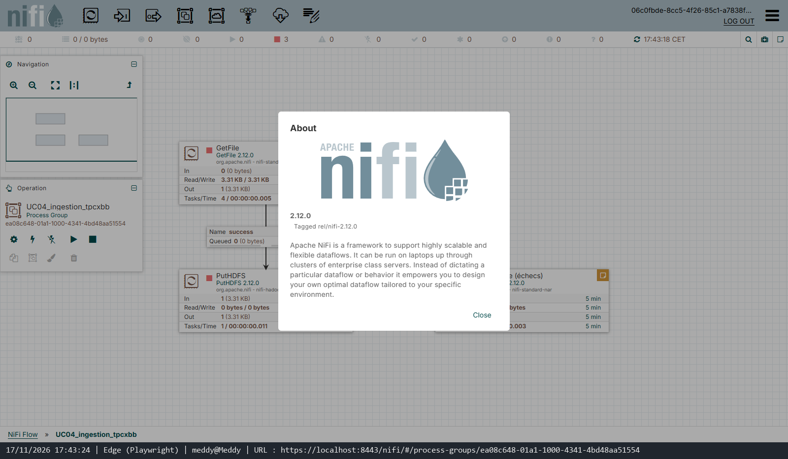
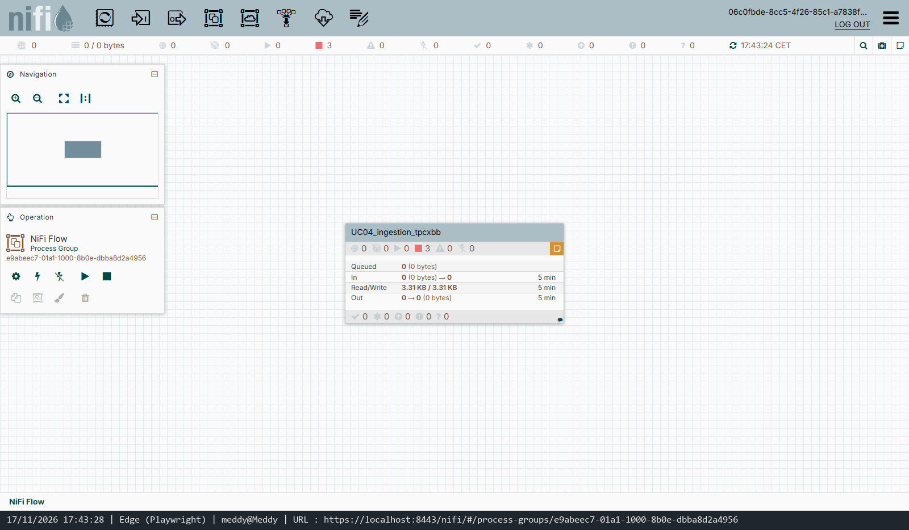

# UC-04 – Étapes 6 et 7 : fiche de découverte de NiFi

Retail Intelligence Platform · TP Jour 2 · 17/11/2026

## 1. Relevés sur l'instance

| Élément | Constat |
|---|---|
| Version | **Apache NiFi 2.12.0** (`/nifi-api/flow/about`) sous OpenJDK 21.0.13, Linux 6.6 (WSL2) |
| Adresse | **https://localhost:8443/nifi** (`nifi.web.https.host=localhost`, port 8443) |
| Démarrage / état | `nifi.sh status` → `Status: UP`. Mémoire : 254 Mo utilisés sur 1 024 Mo de heap. 0 thread actif, 0 FlowFile en attente au repos |
| Composants disponibles | **304 types de processeurs** et **125 types de Controller Services**. Les processeurs Hadoop (PutHDFS, GetHDFS, ListHDFS, FetchHDFS…) ne sont présents que grâce à l'ajout de `nifi-hadoop-nar` et `nifi-hadoop-libraries-nar`, que NiFi 2.x ne livre plus par défaut |
| Services nécessaires à l'ingestion | **Aucun Controller Service n'est requis** pour ce flux : PutHDFS lit directement `core-site.xml` et `hdfs-site.xml`. Il faut en revanche que **HDFS tourne** (NameNode `localhost:9000`), que l'utilisateur NiFi (`meddy`) puisse **lire** `/data/nifi/input` et **écrire** dans `/retail-lake/raw/nifi` |
| Dépôts internes | FlowFile repository `./flowfile_repository`, content repository `./content_repository`, provenance repository `./provenance_repository` (conservation 30 jours / 10 Go), tous dans `/opt/nifi` |
| Sécurité | HTTPS obligatoire avec un **certificat auto-signé**, d'où l'avertissement du navigateur. Authentification **single-user** (`single-user-provider`, `single-user-authorizer`) avec un identifiant et un mot de passe **générés au premier démarrage**, lus dans `nifi-app.log` et **non versionnés**. Écoute limitée à `localhost`, rien n'est exposé sur le réseau |
| Contrainte propre à WSL | Il a fallu forcer IPv4 (`-Djava.net.preferIPv4Stack=true`) pour que l'interface soit accessible depuis le navigateur Windows (voir le tableau des erreurs) |

## 2. Les concepts de NiFi

| Concept | Définition | Dans notre flux |
|---|---|---|
| **FlowFile** | L'unité de données qui circule dans NiFi : un **contenu** (les octets du fichier) et des **attributs** (clé/valeur : `filename`, `path`, `uuid`, dates…). Le contenu est stocké une seule fois dans le content repository ; le FlowFile n'en garde qu'une référence | Un FlowFile par fichier lu : `filename=store.dat`, `absolute.path=/data/nifi/input/`, `uuid=6ed4829e-…` |
| **Processor** | Un composant qui **réalise une opération** sur les FlowFiles : lire, transformer, router, écrire. Il a des propriétés, une planification (*Run Schedule*) et des **relations** de sortie (`success`, `failure`…) | `GetFile` (lit le disque), `PutHDFS` (écrit dans HDFS), `LogAttribute` (journalise les échecs) |
| **Connection** | Le **lien** entre deux composants pour une ou plusieurs relations. C'est aussi une **file d'attente** (*queue*) qui tamponne les FlowFiles quand la destination est plus lente ou arrêtée, avec un seuil de *back-pressure* (10 000 FlowFiles / 1 Go par défaut) | `GetFile –success→ PutHDFS` et `PutHDFS –failure→ LogAttribute` |
| **Process Group** | Un **conteneur** qui regroupe les composants d'un flux. Il permet d'organiser le canvas, de démarrer ou arrêter un flux d'un bloc, d'exporter une *flow definition* et de gérer des droits | `UC04_ingestion_tpcxbb` |
| **Controller Service** | Un **service partagé** configuré une fois et utilisé par plusieurs processeurs : pool de connexions JDBC, contexte SSL, lecteur/écrivain CSV/JSON (Record Reader/Writer), identifiants cloud… | Aucun ici. Au J3, un `CSVReader` avec séparateur `\|` servirait à valider la structure |
| **Provenance Repository** | Le **registre de traçabilité** : chaque action sur un FlowFile produit un événement horodaté (RECEIVE, SEND, ATTRIBUTES_MODIFIED, ROUTE, DROP…), avec l'UUID, les attributs et l'URI de transit. Il permet de reconstituer le parcours (lignage) et de rejouer un contenu | 6 événements relevés pour `store.dat` (voir `UC04_erreurs_et_provenance.md`) |

**Autres éléments repérés sur le canvas (étape 7)** :
- **barre d'outils** : ajout de Processor, Input/Output Port, Process Group, Funnel, Label ;
- **barre d'état** : threads actifs, FlowFiles en file d'attente, composants démarrés, arrêtés, invalides ;
- **icône d'état de chaque processeur** : ▶ démarré, ■ arrêté, ⚠ invalide (avec le message au survol) ;
- **compteurs sur 5 minutes** : *In*, *Read/Write*, *Out*, *Tasks/Time* ;
- **bulletins** : carré rouge ou jaune sur le processeur en cas d'erreur ou d'avertissement ;
- **menu ☰** : *Data Provenance*, *Bulletin Board*, *Summary*, *Controller Settings*.

## 3. Pourquoi NiFi après le dépôt manuel ?

`hdfs dfs -put` est **manuel** : quelqu'un doit lancer la commande pour chaque fichier, et la trace dépend de ce qu'il
note lui-même. NiFi **automatise** le transfert : un fichier qui arrive dans `/data/nifi/input` est pris en charge
au passage suivant (toutes les 10 s). Les erreurs sont **routées** (relation `failure`) au lieu d'être perdues dans un
terminal, et chaque transfert est **tracé automatiquement** (provenance). Les deux méthodes ont des destinations
distinctes (`raw/tpcxbb/…` pour `put`, `raw/nifi/` pour NiFi), ce qui évite tout écrasement et permet de les comparer.
