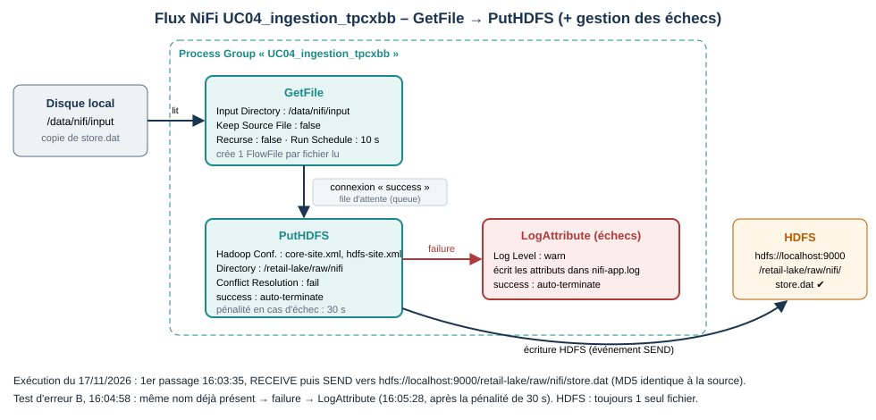
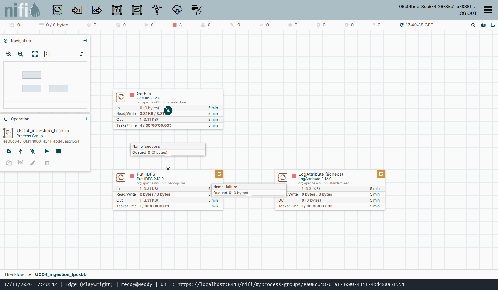
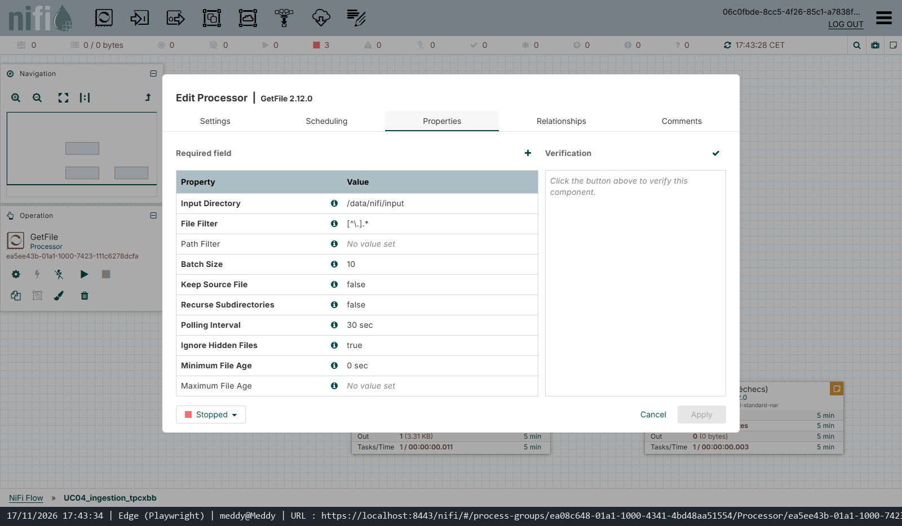
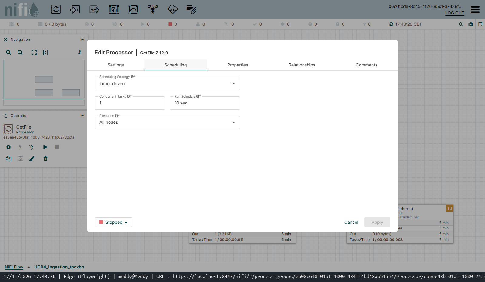
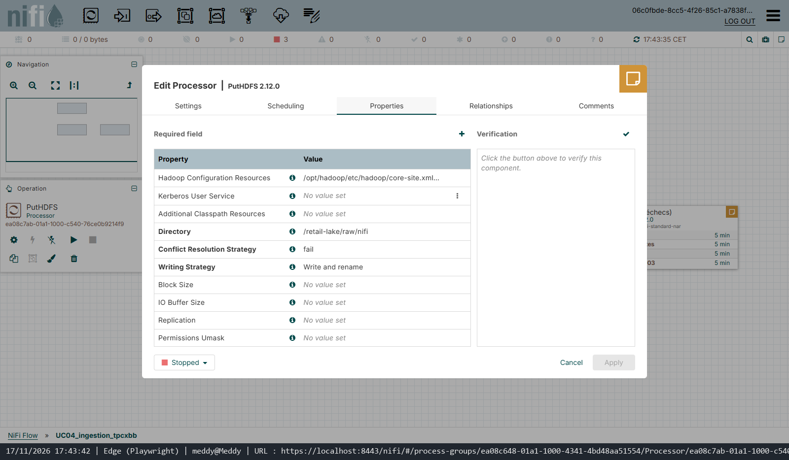
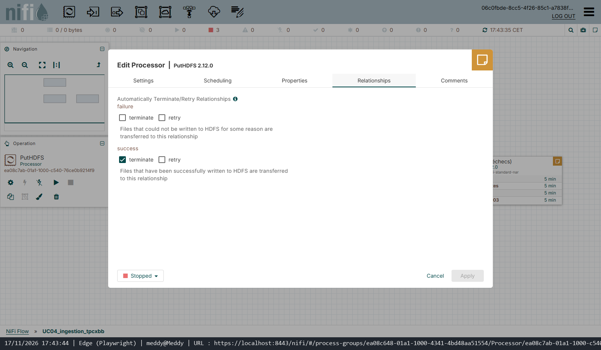

# UC-04 – Étapes 8 et 9 : flux d'ingestion GetFile → PutHDFS

<p class="meta">Retail Intelligence Platform · TP Jour 2 · 17/11/2026 · Livrables 7, 8 et 9</p>

Preuves :
- `preuves/00_preparation.txt` : préparation ;
- `preuves/01_build.txt` : construction ;
- `preuves/02_run.txt` : exécution ;
- `UC04_ingestion_tpcxbb.json` : export du flux ;
- `preuves/captures/` : captures d'écran.

> **Mode de construction.** Le flux a été créé dans NiFi par son **API REST** (`scripts/uc04_nifi.py`), qui est
> utilisée aussi par l'interface Web. Les objets obtenus sont identiques à ceux d'une construction à la souris : ils
> sont visibles et modifiables sur le canvas, et les captures de l'interface ont été prises sur ce flux. La procédure
> manuelle équivalente est décrite dans `UC04_guide_pas_a_pas.md`. **Tout ce qui est présenté ici a réellement été
> exécuté** : ce n'est pas une simulation.

## 1. Schéma du flux (livrable 7)



## 2. Préparation

| Élément | Valeur |
|---|---|
| Dossiers locaux | `/data/nifi/input`, `/data/nifi/archive`, `/data/nifi/error` (propriétaire `meddy`, qui est aussi l'utilisateur qui exécute NiFi) |
| Fichier d'essai | **Copie de travail** de `store.dat` (fichier réel du kit, 12 lignes, 3 386 octets, MD5 `426235bb…`). L'original du kit et le dépôt de l'UC-03 sont conservés |
| Destination HDFS | `/retail-lake/raw/nifi`, distincte de l'UC-03 |

## 3. Configuration des processeurs (livrable 8)

| Processeur | Propriété | Valeur | Justification |
|---|---|---|---|
| **GetFile** | Input Directory | `/data/nifi/input` | Dossier d'entrée dédié, qui ne contient que le fichier de test |
| | Keep Source File | `false` | Le fichier est retiré après sa prise en charge, ce qui évite de le relire en boucle. L'original reste dans le kit |
| | Recurse Subdirectories | `false` | Pas de sous-dossiers à parcourir |
| | Run Schedule | `10 sec` | Évite de scruter le disque en continu (par défaut : 0 s) |
| **PutHDFS** | Hadoop Configuration Resources | `/opt/hadoop/etc/hadoop/core-site.xml,/opt/hadoop/etc/hadoop/hdfs-site.xml` | Indique à NiFi où se trouve le NameNode (`fs.defaultFS=hdfs://localhost:9000`) |
| | Directory | `/retail-lake/raw/nifi` | Destination imposée |
| | Conflict Resolution Strategy | **`fail`** | **N'écrase jamais** un fichier existant. Un conflit part en `failure`, ce qui le rend visible et traçable (les autres valeurs possibles sont `replace`, `ignore` et `append`) |
| | Relation `success` | auto-terminate | Le dépôt est terminé, le FlowFile peut être supprimé de NiFi |
| | Relation `failure` | → LogAttribute | Conservée et examinée, **jamais supprimée sans examen** |
| **LogAttribute (échecs)** | Log Level | `warn` | Les échecs ressortent dans `nifi-app.log` |
| | Relation `success` | auto-terminate | |

État après construction : **3 processeurs VALID**, 2 connexions, 0 avertissement.

> **Incident (17:33) :** GetFile a été supprimé par erreur pendant la prise automatisée des captures. Il a été
> **recréé à 17:37 avec exactement la même configuration** (nouvel identifiant `ea5ee43b-…`), avec sa connexion
> `success` vers PutHDFS. Les détails sont dans `preuves/07_recreation_getfile.txt` et dans l'erreur n° 14 de
> `UC04_erreurs_et_provenance.md`. L'export `UC04_ingestion_tpcxbb.json` a été refait après la recréation.











## 4. Exécution et contrôle (étape 9, livrable 9)

Ordre de démarrage : PutHDFS, LogAttribute, puis GetFile (la destination doit être prête avant que la source envoie).

| Heure | Événement |
|---|---|
| 16:03:32 | Avant le test : `/data/nifi/input/store.dat` présent (MD5 `426235bb…`), `/retail-lake/raw/nifi` vide |
| 16:03:35 | Démarrage des processeurs. GetFile lit le fichier (événement RECEIVE) |
| 16:03:36 | PutHDFS écrit dans HDFS (SEND), puis le FlowFile est supprimé via `success` (DROP) |
| 16:03:41 | Fichier présent dans HDFS → **GetFile est arrêté** pour éviter toute relance en boucle |

**Compteurs NiFi** : GetFile Out = 1 (3 386 octets) · PutHDFS In = 1 · files d'attente vides · LogAttribute In = 0 (aucun échec).

**Contrôles dans le terminal** :

| Contrôle | Résultat |
|---|---|
| `hdfs dfs -ls -h /retail-lake/raw/nifi` | `-rw-r--r-- meddy supergroup 3.3 K 2026-11-17 16:03 /retail-lake/raw/nifi/store.dat` ✅ |
| `hdfs dfs -du -h /retail-lake/raw/nifi` | `3.3 K` ✅ |
| MD5 du fichier HDFS et MD5 de l'original | `426235bbcc3e6ed3c8a8f788102927b6` des deux côtés ✅ |
| `ls -l /data/nifi/input` | vide : la copie de travail a été consommée (`Keep Source File=false`) ✅ |
| Dépôt UC-03 `/retail-lake/raw/tpcxbb/initial/store/store.dat` | toujours présent, non écrasé ✅ |

**Comparaison des deux méthodes** : le fichier déposé par NiFi est créé en `644` (`-rw-r--r--`), avec la date du dépôt
et le groupe `supergroup`. NiFi applique les droits par défaut de HDFS et ne recopie pas les droits locaux.
`put -p`, lui, avait recopié les droits `777` (voir l'UC-03).

## 5. Export du flux

`UC04_ingestion_tpcxbb.json` (12,6 Ko) : *flow definition* du Process Group, obtenue par *Download flow definition*
(`GET /process-groups/{id}/download`). Elle se réimporte sur une autre instance NiFi avec *Upload flow definition*.
Nous avons vérifié qu'elle ne contient **ni mot de passe ni jeton**.

## 6. Étape 12 (approfondissement) : conception du flux enrichi

**Non exécuté** : le flux ci-dessous est conçu, pas réalisé. Le sujet demande de valider d'abord le flux simple.

```
GetFile ─success→ UpdateAttribute ─success→ RouteOnAttribute ─dat→ PutHDFS ─success→ (fin)
                  source=tpcxbb               dat : ${filename:endsWith('.dat')}      └failure→ LogAttribute
                  lot=initial                 unmatched → PutFile /data/nifi/error (rejet documenté)
                  date_ingestion=${now():format('yyyy-MM-dd')}
                  Directory de PutHDFS : /retail-lake/raw/nifi/${source}/${date_ingestion}
```
- **UpdateAttribute** ajoute des attributs de suivi, que l'on retrouve ensuite dans la provenance.
- **RouteOnAttribute** sépare les fichiers de données (`.dat`) du reste. Par exemple, `item_marketprices_audit.csv`
  partirait dans `unmatched`, puis dans le dossier d'erreur.
- Le chemin HDFS **daté** évite les conflits de nom quand le même fichier revient un autre jour.
