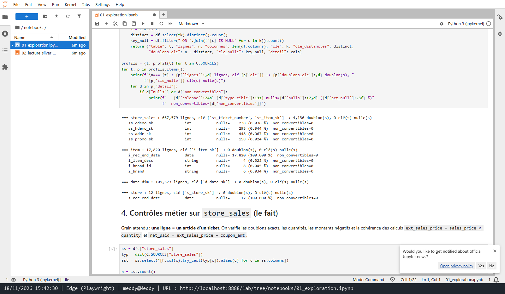
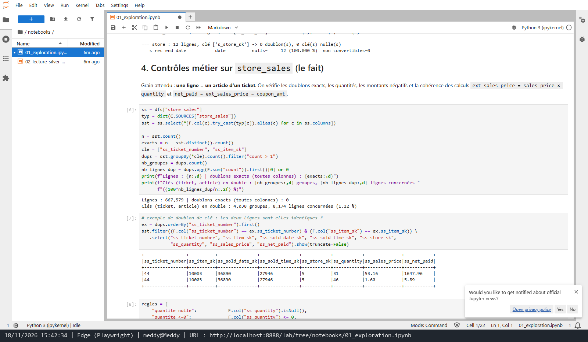
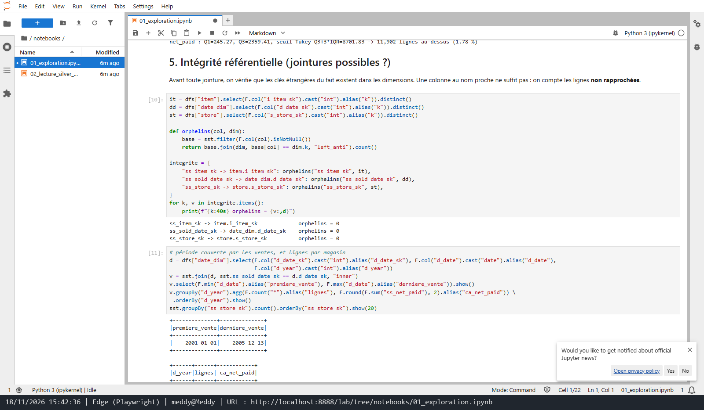
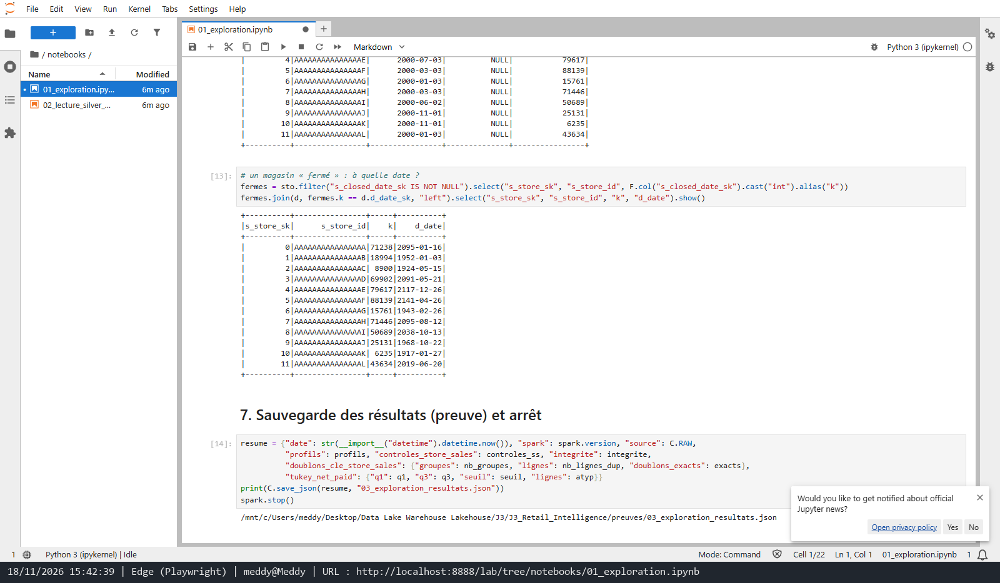

# UC-06 – Étapes 2 et 3 : inventaire technique et exploration des sources

Retail Intelligence Platform · TP Jour 3 · 18/11/2026 · Livrables 2 et 3

Preuves :
- `notebooks/01_exploration.ipynb` : notebook exécuté, avec ses sorties ;
- `preuves/03_exploration_resultats.json` : tous les comptages.

## 1. Choix des sources

L'inventaire du J2 recense 34 fichiers TPCx-BB réellement déposés dans HDFS. Nous en retenons **4**, du **lot
`initial`**, choisis pour répondre aux questions du J1 :
- **Q1** : évolution du CA ;
- **Q3** : produits et catégories qui vendent le plus ;
- **Q5** : comparaison des magasins.

| Source | Pourquoi |
|---|---|
| `store_sales` | Le fait : les ventes en magasin, avec les montants et les quantités |
| `item` | La catégorie du produit (Q3) |
| `date_dim` | La date réelle de la vente (Q1, par mois et par année) |
| `store` | Le nom et la localisation du magasin (Q5) |

Le lot `data_refresh` (6 632 ventes) est **hors périmètre** : l'intégrer sans doublon fait l'objet de la stratégie
incrémentale (partie avancée).

## 2. Tableau d'inventaire

| Information | `store_sales` | `item` | `date_dim` | `store` |
|---|---|---|---|---|
| Nom réel du fichier | `store_sales.dat` | `item.dat` | `date_dim.dat` | `store.dat` |
| Emplacement | `hdfs:///retail-lake/raw/tpcxbb/initial/store_sales/` | `…/item/` | `…/date_dim/` | `…/store/` |
| Format | Texte délimité `\|`, **sans en-tête**, UTF-8 | idem | idem | idem |
| Taille | 92,8 Mo | 6,8 Mo | 15,4 Mo | 3,4 Ko |
| Lignes | **667 579** | 17 820 | 109 573 | 12 |
| Colonnes | 23 | 22 | 28 | 29 |
| Colonnes principales | `ss_ticket_number`, `ss_item_sk`, `ss_store_sk`, `ss_sold_date_sk`, `ss_quantity`, `ss_sales_price`, `ss_net_paid`, `ss_net_profit` | `i_item_sk`, `i_item_id`, `i_category`, `i_class`, `i_brand`, `i_current_price` | `d_date_sk`, `d_date`, `d_year`, `d_moy`, `d_dom` | `s_store_sk`, `s_store_id`, `s_store_name`, `s_city`, `s_state`, `s_closed_date_sk` |
| Types observés | Clés entières, montants à 2 décimales (Spark propose `double`) | Clés entières, dates `yyyy-MM-dd`, prix décimaux, textes | Entiers, une date, indicateurs `Y`/`N` | Entiers, dates, textes, décimaux |
| Clé candidate | (`ss_ticket_number`, `ss_item_sk`) **non unique** | `i_item_sk`, unique | `d_date_sk` (et `d_date`), unique | `s_store_sk`, unique |
| Granularité | 1 ligne = **1 article d'un ticket de caisse** | 1 ligne = 1 version de produit | 1 ligne = 1 jour (1900 → 2100) | 1 ligne = 1 version de magasin |
| Anomalies | 8 174 lignes partagent une clé ; 74,3 % de marges négatives ; 1,78 % de montants atypiques ; 3 954 ventes à 0 ; 2005 s'arrête au 13/12 | 6 marques, 8 `brand_id` et 4 descriptions vides | Aucune | Dates de fermeture incohérentes pour les 12 magasins |

**Provenance.** Ces fichiers proviennent du kit TPCx-BB fourni (`J1/retail_project`), copiés tels quels dans HDFS au J2
avec un contrôle MD5 (34 fichiers sur 34 identiques). Les noms de colonnes viennent du schéma public TPC-DS /
TPCx-BB : ils ont été validés au J1, car le nombre de champs de chaque fichier correspond au schéma.

## 3. Résultats de l'exploration PySpark (étape 3)

| Contrôle | `store_sales` | `item` | `date_dim` | `store` |
|---|---|---|---|---|
| Valeurs nulles | Clés facultatives seulement : `ss_cdemo_sk` 238, `ss_hdemo_sk` 295, `ss_addr_sk` 448, `ss_promo_sk` 158 (< 0,07 %) | `i_rec_end_date` 100 % ; marque 6 ; `brand_id` 8 ; description 4 | 0 | `s_rec_end_date` 100 % |
| Valeurs non convertibles dans le type cible | **0** | 0 | 0 | 0 |
| Doublons exacts | **0** | 0 | 0 | 0 |
| Doublons de la clé candidate | **4 136 lignes en surplus** (4 038 clés, 8 174 lignes) | 0 | 0 | 0 |
| Orphelins vers les dimensions | 0 vers `item`, 0 vers `date_dim`, 0 vers `store` | – | – | – |

## 4. Réponses aux questions techniques

1. **Structurés, semi-structurés ou non structurés ?** Les 4 fichiers sont **structurés** : nombre de colonnes fixe,
   séparateur `|`. Mais ils n'ont **pas d'en-tête** : le schéma est **imposé à la lecture** (*schema on read*).
2. **Colonnes correctement typées ?** Le fichier texte n'a **aucun type**. `inferSchema` propose `int` et `double`, mais
   `double` est approximatif pour de l'argent. Nous imposons des types explicites : `int` et `bigint` pour les clés,
   **`decimal(7,2)`** pour les montants, `date` pour les dates. Toutes les valeurs se convertissent (0 échec).
3. **Valeurs nulles ?** Oui, mais seulement dans des colonnes **facultatives** (clés démographiques, promotion,
   marque, date de fin de validité). Aucun champ nécessaire au calcul du CA n'est vide.
4. **Identifiants uniques ?** Les clés des dimensions sont uniques. Dans `store_sales`, le couple (ticket, article)
   **ne l'est pas** : 4 038 couples apparaissent 2 fois ou plus. Ce ne sont **pas des copies**. Par exemple, le
   ticket 44 contient deux fois l'article 10003, avec des quantités (31 et 46) et des prix (53,16 et 1,60) différents.
   Ce sont donc deux lignes de vente distinctes.
5. **Granularité connue ?** Oui : 1 ligne = 1 article d'un ticket (environ 7,5 lignes par ticket, mesuré au J1). Elle est
   confirmée par `ss_ext_sales_price = ss_sales_price × ss_quantity` (0 écart) et
   `ss_net_paid = ss_ext_sales_price − ss_coupon_amt` (0 écart).
6. **Adaptées aux questions du J1 ?** Oui pour Q1, Q3 et Q5 :
   - les ventes couvrent du **01/01/2001 au 13/12/2005**, soit environ 135 000 lignes par an ;
   - il y a 12 magasins, de 54 600 à 57 600 lignes chacun ;
   - les produits se répartissent en 9 catégories.

   Deux limites : **2005 est incomplète**, et les données sont **synthétiques** (montants et marges peu réalistes).

## 5. Points d'exploration notables

- **Marge négative sur 74,3 % des lignes** (`ss_net_profit < 0`). C'est irréaliste pour un commerce, mais c'est le
  comportement du générateur TPCx-BB. Constat déjà fait au J1.
- **Montants atypiques.** Le seuil de Tukey (Q3 + 3 × IQR) vaut 8 701 $ pour `ss_net_paid`, et 1,78 % des lignes le
  dépassent. Ce sont des ventes de 100 articles à près de 200 $ : elles sont cohérentes avec le calcul.
- **Dates de fermeture des magasins.** Elles convertissent `s_closed_date_sk` grâce à `date_dim` :
  - 5 dates sont **antérieures** aux ventes (1917, 1924, 1943, 1952, 1968) ;
  - 7 dates sont **postérieures** (2019, 2038, puis jusqu'en 2141).

  Or les 12 magasins vendent tous de 2001 à 2005 : cette colonne n'est pas exploitable.
- **Pas d'historique réel dans `item` et `store`.** Une seule version par produit ou magasin : `rec_end_date` est
  toujours vide.

## Captures (18/11/2026, Edge piloté par script, bandeau date et URL)

*Profil des 4 sources lues dans HDFS : nulls par colonne, 0 valeur non convertible, doublons de clé.*

*store_sales : 0 doublon exact, mais 4 038 clés (ticket, article) en double. Exemple du ticket 44 : mêmes ticket et article, mais quantités et prix différents, donc deux ventes distinctes.*

*Contrôles métier : 0 quantité ≤ 0, 0 montant négatif, calculs cohérents ; 74,3 % de marges négatives.*

*Intégrité référentielle (0 orphelin), période couverte (01/01/2001 → 13/12/2005) et lignes par année.*

*Dates de fermeture des magasins converties avec date_dim : de 1917 à 2141, incohérentes avec les ventes de 2001-2005.*
