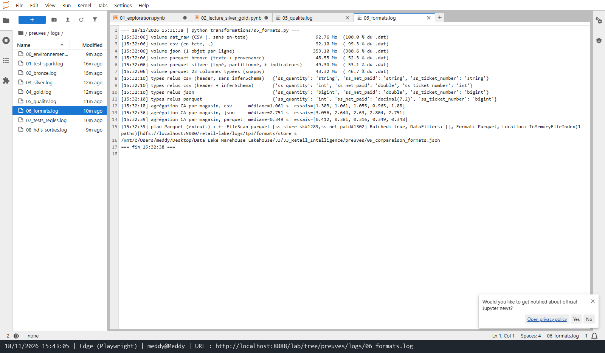
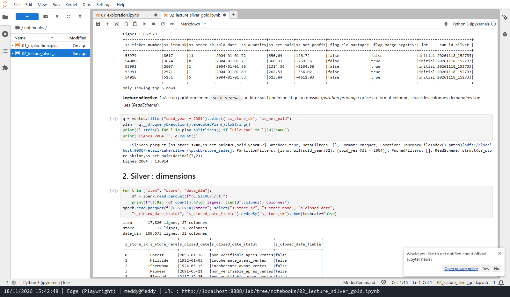

# UC-06 – Étape 8 : format Parquet et comparaison des formats

Retail Intelligence Platform · TP Jour 3 · 18/11/2026 · Livrable 8

Code : `transformations/05_formats.py`.

Preuves :
- `preuves/09_comparaison_formats.json` et `preuves/logs/06_formats.log` ;
- `notebooks/02_lecture_silver_gold.ipynb`.

## 1. Écriture et relecture Parquet

Tous les résultats Bronze, Silver et Gold sont en **Parquet** (compression `snappy`). Chaque écriture est **relue**
aussitôt par le script qui l'a produite, puis une seconde fois dans le notebook 02.

| Vérification (§4.11.2) | Résultat |
|---|---|
| La lecture fonctionne | ✅ `spark.read.parquet()` sur les 4 jeux Silver et les 2 jeux Gold |
| Le schéma est conservé | ✅ `decimal(7,2)`, `date`, `boolean` et `bigint` sont relus à l'identique, sans fournir de schéma |
| Le nombre de lignes est cohérent | ✅ Silver : 667 579 (= Bronze = Raw) ; G1 : 540 (= 5 × 12 × 9) ; G2 : 60 (= 5 × 12) |
| Les valeurs sont exploitables | ✅ La somme du CA dans le Gold est égale, au centime près, à celle du Silver : 1 150 529 586,37 $ |
| Le répertoire de sortie est identifié | ✅ Un dossier par jeu ; des partitions `sold_year=` et `annee=` visibles avec `hdfs dfs -ls -R` |

## 2. Comparaison mesurée : les mêmes 667 579 ventes, les mêmes 23 colonnes

Mesures faites sur ce poste, en Spark local, en relisant depuis HDFS. Les temps sont la médiane de 5 essais après un
préchauffage, pour l'agrégation « CA par magasin », qui n'utilise que 2 colonnes sur 23.

| Format | Volume dans HDFS | % du `.dat` | Types relus **sans schéma** | Temps de l'agrégation |
|---|---:|---:|---|---:|
| `.dat` source (texte `\|`, sans en-tête) | 92,8 Mo | 100 % | aucun (`_c0`… en texte) | – |
| CSV (en-tête, `,`) | 92,1 Mo | 99 % | tout en `string` ; avec `inferSchema` : `int` et **`double`** | 1,06 s |
| JSON (1 objet par ligne) | **353,1 Mo** | **381 %** | `bigint` et **`double`** (décimal perdu) | **2,75 s** |
| Parquet (23 colonnes typées) | **43,3 Mo** | **47 %** | **`int`, `decimal(7,2)`, `bigint` exacts** | **0,35 s** |
| Parquet Bronze (texte + 5 colonnes de provenance) | 48,6 Mo | 52 % | `string` (choix volontaire) | – |
| Parquet Silver (typé, partitionné, + indicateurs) | 49,3 Mo | 53 % | types exacts | – |

**Lecture sélective prouvée par le plan Spark** :
`FileScan parquet [ss_store_sk, ss_net_paid] … ReadSchema: struct<ss_store_sk:int, ss_net_paid:decimal(7,2)>`.
Spark ne lit que les 2 colonnes demandées. Avec un filtre `sold_year = 2004`, il ne lit en plus que le dossier de 2004
(*partition pruning*, voir le notebook 02).

## 3. Analyse

| Critère | CSV | JSON | Parquet |
|---|---|---|---|
| Organisation | Par lignes, texte | Par lignes, objets clé-valeur (le nom de colonne est répété à chaque ligne, d'où 3,8 fois le volume) | **Par colonnes**, binaire, découpé en *row groups* avec statistiques min/max |
| Lisibilité | Lisible par un humain (`cat`, Excel) | Lisible, structure imbriquée possible | Illisible sans outil (`spark`, `parquet-tools`) |
| Gestion des types | Aucune : tout est texte, à deviner (`inferSchema`) ou à imposer | Types JSON limités : nombre, texte, booléen. **Pas de décimal ni de date** | **Schéma stocké dans le fichier**, types riches et exacts (decimal, date, timestamp) |
| Volume observé | ≈ source | 3,8 × la source | **0,47 ×** la source |
| Lecture analytique | Lit tout le fichier, puis convertit | Lit et analyse tout, le plus lent (2,75 s) | Lit seulement les colonnes utiles (0,35 s, **3 fois plus rapide** que le CSV) |
| Usages adaptés | Échange simple, import dans un tableur, fichiers sources | API, données semi-structurées, imbriquées, évolutives (avis, clics) | **Stockage analytique** : Silver, Gold, requêtes d'agrégation |
| Limites | Pas de schéma, séparateur et encodage fragiles | Verbeux, types approximatifs | Pas modifiable à la main ; ajout possible, mais **pas de mise à jour ni de suppression d'une ligne** |

**Point important pour l'argent** : en CSV ou en JSON, `ss_net_paid` revient en `double`, un nombre flottant
approximatif. Une somme de 667 579 montants en `double` peut produire des écarts de quelques centimes. Parquet conserve
le `decimal(7,2)` : la réconciliation au centime entre Silver et Gold n'est possible que grâce à cela.

## 4. Ce que Parquet ne garantit pas

Parquet est un **format de fichier**, pas une **table transactionnelle**. Nos dossiers Parquet n'ont pas de propriétés
ACID :
- un `overwrite` interrompu laisserait un dossier à moitié écrit, visible par un lecteur ;
- il n'y a pas d'historique de versions : la version précédente est écrasée ;
- il n'y a pas de `UPDATE` ou `DELETE` d'une ligne : il faut réécrire tout le dossier ou toute la partition ;
- aucun contrôle n'empêche d'ajouter un fichier au mauvais schéma dans le dossier.

Ces garanties demandent un format de table (Delta Lake, Iceberg, Hudi), étudié dans la partie avancée
(`UC06_avance_lakehouse.md`). **Nous ne présentons donc pas nos dossiers Parquet comme un Lakehouse transactionnel.**

> Limite de mesure : un seul poste, cache disque de l'OS, Spark local. Les temps sont **indicatifs**. Ils montrent un
> ordre de grandeur, pas une performance de production.

## Captures (18/11/2026, Edge piloté par script, bandeau date et URL)

*Mesures réelles : volumes (Parquet = 47 % du .dat, JSON = 381 %), types relus sans schéma et temps de l'agrégation.*

*Plan Spark : PartitionFilters sold_year = 2004 et ReadSchema limité à 2 colonnes. Seules les données utiles sont lues.*
