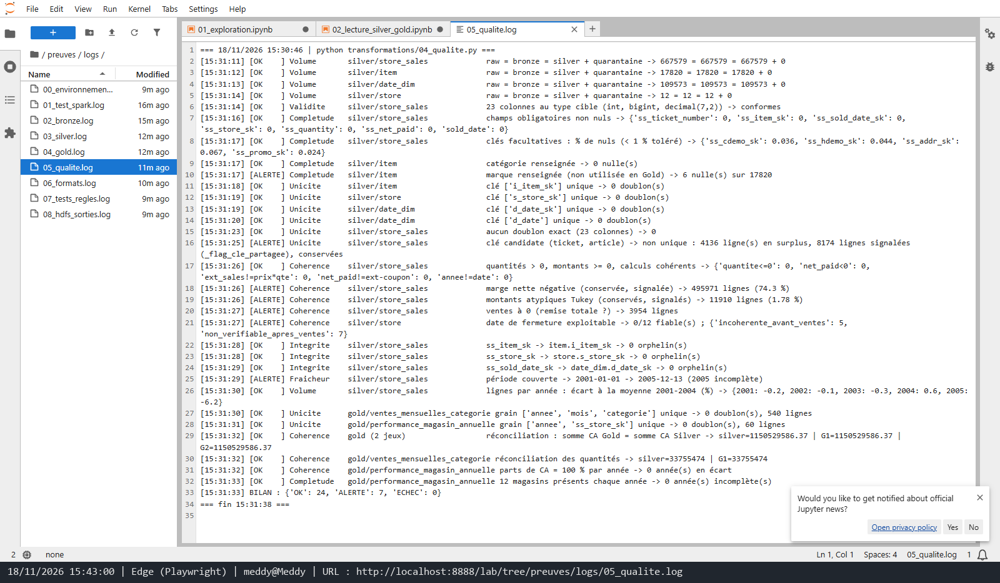
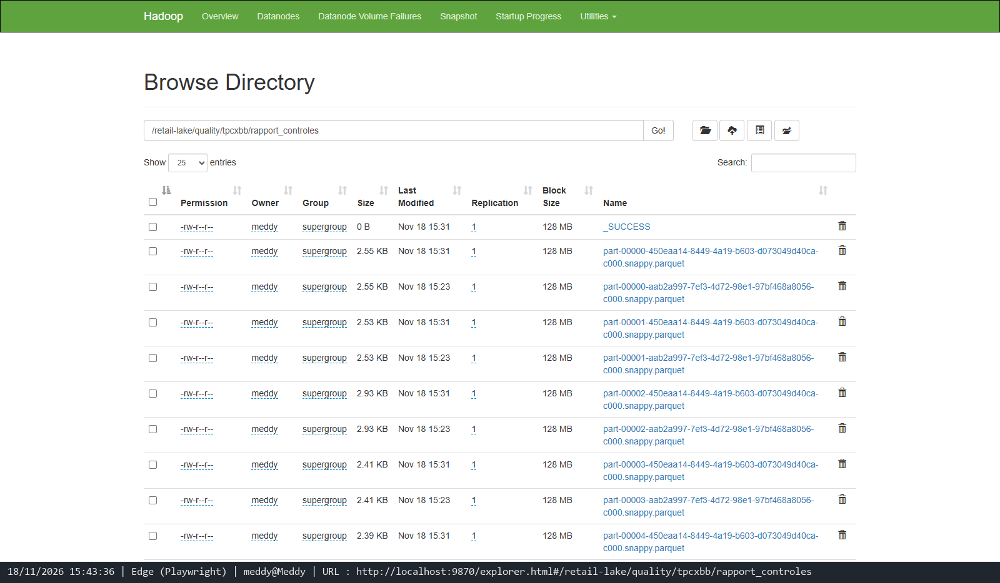

# UC-06 – Étape 9 : rapport de qualité des données

Retail Intelligence Platform · TP Jour 3 · 18/11/2026 · Livrable 9

Code : `transformations/04_qualite.py`.

Résultats :
- `preuves/08_rapport_qualite.csv` et `.json` ;
- `preuves/logs/05_qualite.log` ;
- historique de toutes les exécutions : `hdfs:///retail-lake/quality/tpcxbb/rapport_controles` (Parquet, mode
  `append`).

**Statuts** :
- **OK** : la règle est respectée.
- **ALERTE** : anomalie connue, documentée et conservée. Elle n'empêche pas l'usage mais limite l'interprétation.
- **ECHEC** : une règle bloquante n'est pas respectée. Le script s'arrête avec un code d'erreur et le jeu ne doit pas
  être publié.

**Bilan de l'exécution du 18/11/2026 à 15:31 : 31 contrôles, 24 OK, 7 ALERTE et 0 ECHEC.**

## 1. Tableau des contrôles

| Dimension | Jeu | Règle | Résultat | Statut |
|---|---|---|---|---|
| Volume | silver/store_sales | Raw = Bronze = Silver + quarantaine | 667 579 = 667 579 = 667 579 + 0 | OK |
| Volume | silver/item | idem | 17 820 = 17 820 = 17 820 + 0 | OK |
| Volume | silver/date_dim | idem | 109 573 = 109 573 = 109 573 + 0 | OK |
| Volume | silver/store | idem | 12 = 12 = 12 + 0 | OK |
| Volume | silver/store_sales | Lignes par an : écart à la moyenne 2001-2004 < 10 % | −0,2 / −0,1 / −0,3 / +0,6 / −6,2 % (2005) | OK |
| Validité | silver/store_sales | 23 colonnes au type cible | conformes | OK |
| Complétude | silver/store_sales | Champs obligatoires non nuls (7) | 0 nul | OK |
| Complétude | silver/store_sales | Clés facultatives : < 1 % de nuls | 0,024 à 0,067 % | OK |
| Complétude | silver/item | Catégorie renseignée | 0 nulle | OK |
| Complétude | silver/item | Marque renseignée | 6 nulles sur 17 820 | ALERTE |
| Complétude | gold/performance_magasin_annuelle | 12 magasins chaque année | 0 année incomplète | OK |
| Unicité | silver/item, store, date_dim | Clés `i_item_sk`, `s_store_sk`, `d_date_sk`, `d_date` uniques | 0 doublon (4 contrôles) | OK |
| Unicité | silver/store_sales | Aucun doublon exact (23 colonnes) | 0 | OK |
| Unicité | silver/store_sales | Clé candidate (ticket, article) | non unique : 4 136 lignes en surplus ; 8 174 lignes signalées et conservées | ALERTE |
| Unicité | gold (2 jeux) | Grain unique | 0 doublon (540 et 60 lignes) | OK |
| Cohérence | silver/store_sales | Quantités > 0, montants ≥ 0, calculs cohérents, année = date | 0 écart sur les 5 règles | OK |
| Cohérence | silver/store_sales | Marge nette négative | 495 971 lignes (74,3 %) | ALERTE |
| Cohérence | silver/store_sales | Montants atypiques (Tukey) | 11 910 lignes (1,78 %) | ALERTE |
| Cohérence | silver/store_sales | Ventes à 0 | 3 954 lignes | ALERTE |
| Cohérence | silver/store | Date de fermeture exploitable | 0 sur 12 fiable (5 avant les ventes, 7 après) | ALERTE |
| Cohérence | gold (2 jeux) | Somme CA Gold = somme CA Silver | 1 150 529 586,37 des deux côtés | OK |
| Cohérence | gold/ventes_mensuelles_categorie | Somme des quantités Gold = Silver | 33 755 474 = 33 755 474 | OK |
| Cohérence | gold/performance_magasin_annuelle | Parts de CA = 100 % chaque année | 0 écart | OK |
| Intégrité | silver/store_sales | `ss_item_sk`, `ss_store_sk`, `ss_sold_date_sk` → dimensions | 0 orphelin (3 contrôles) | OK |
| Fraîcheur | silver/store_sales | Période couverte | 01/01/2001 → 13/12/2005 | ALERTE |

## 2. Bilan (§4.12.3)

**Règles respectées.**
- Aucune perte de lignes : volumes réconciliés de Raw jusqu'à Gold.
- Types conformes, champs obligatoires complets et clés des dimensions uniques.
- Intégrité référentielle complète.
- Calculs internes cohérents.
- Le Gold est **réconcilié au centime** avec le Silver.

**Anomalies restantes (les 7 alertes).**

1. **Clé (ticket, article) non unique.** Ces lignes sont conservées, car ce sont des ventes différentes. Il ne faut donc
   pas utiliser ce couple comme clé primaire : au J4, un identifiant de ligne technique serait nécessaire.
2. **Marge négative sur 74 % des lignes.** C'est un artefact du générateur synthétique. Tout indicateur de marge serait
   trompeur : **nous ne publions pas d'analyse de rentabilité**. `marge_nette` est présente en Gold, mais à interpréter
   avec cette réserve.
3. **Montants atypiques (1,78 %).** Ils sont cohérents avec le calcul et conservés. L'indicateur permet de vérifier si
   une conclusion en dépend.
4. **3 954 ventes à 0 $.** Le prix de vente est de 0 (remise de 100 %). Elles sont conservées : elles comptent dans les
   quantités, et pas dans le CA.
5. **Marque absente pour 6 produits.** Sans effet, car le Gold agrège par catégorie.
6. **Date de fermeture des magasins inutilisable** (`s_closed_date_fiable = false`). Elle ne doit pas servir à filtrer
   les magasins « ouverts ».
7. **2005 incomplète** (arrêt au 13/12). Les comparaisons annuelles doivent porter sur 2001-2004, ou être faites
   à période égale. Elle est signalée dans le Gold par `mois_complet` et `annee_complete`.

**Données mises à l'écart.** Aucune (quarantaine vide). Le mécanisme de quarantaine a été testé sur des lignes
synthétiques (8 cas sur 8 conformes, voir `UC06_regles_nettoyage.md`).

**Limites des contrôles.**
- Ils vérifient la **cohérence interne** des données, **pas leur exactitude** : rien ne permet de comparer à une
  réalité, puisque les données sont synthétiques.
- Le seuil de Tukey et la tolérance de 1 % sur les clés facultatives sont des choix, pas des normes.
- Le contrôle de volume par année ne détecte que les écarts importants (> 10 %).
- Les retours (`store_returns`) ne sont pas pris en compte : le CA est un CA brut de retours.

**Corrections éventuellement nécessaires.**
- Demander à la source la signification de `s_closed_date_sk`.
- Ajouter un identifiant de ligne de vente.
- Traiter les retours (Q8) avant de publier un CA net de retours.
- Intégrer `data_refresh` avec un contrôle anti-doublon (partie avancée).

## Captures (18/11/2026, Edge piloté par script, bandeau date et URL)

*Journal de 04_qualite.py : 31 contrôles, BILAN OK 24, ALERTE 7, ECHEC 0 ; réconciliation du CA au centime.*

*Zone quality : le rapport est ajouté à chaque exécution (historique).*
