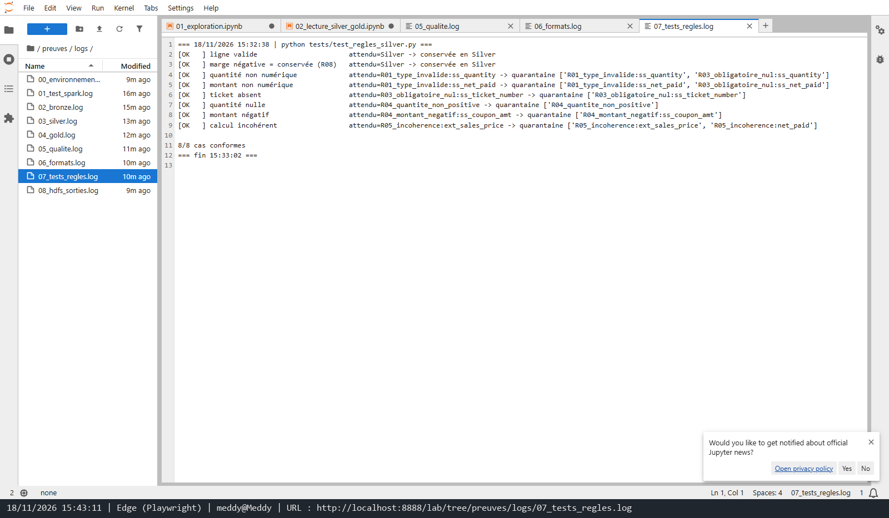
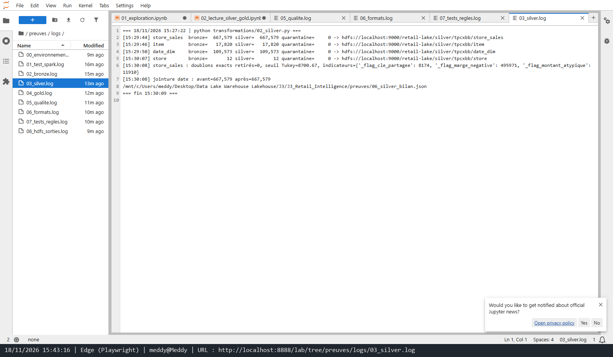

# UC-06 – Étape 4 : règles de nettoyage

Retail Intelligence Platform · TP Jour 3 · 18/11/2026 · Livrable 4

Mise en œuvre : `transformations/02_silver.py`. Chaque règle porte le même identifiant dans le code et dans les motifs
de quarantaine. Test : `tests/test_regles_silver.py`. Résultats : `preuves/06_silver_bilan.json`.

**Principe retenu : ne rien effacer en silence.**
- Une ligne **invalide**, inutilisable pour le calcul, part en **quarantaine**
  (`/retail-lake/quality/tpcxbb/quarantaine/<table>`), avec la liste de ses motifs.
- Une ligne **valide mais surprenante** reste en Silver avec un **indicateur** `_flag_…`. C'est l'analyste qui décide
  de l'exclure ou non, en connaissance de cause.
- La zone Raw n'est jamais modifiée.

## 1. Tableau des règles

| Id | Anomalie | Règle | Action appliquée | Justification | Lignes concernées |
|---|---|---|---|---|---|
| R01 | **Type incorrect** | Chaque colonne est convertie dans son type cible avec `try_cast`. Une valeur présente mais non convertible est une erreur | Quarantaine, motif `R01_type_invalide:<colonne>` | Un montant illisible ne peut pas entrer dans un calcul. `try_cast` plutôt que `cast` : voir l'erreur n° 5 | 0 |
| R02 | Espaces, texte vide | `trim` sur tous les champs ; texte vide → `null` | Normalisation | Un champ vide du `.dat` signifie « absent », pas « chaîne vide » | – |
| R03 | **Valeur manquante** obligatoire | Ticket, article, date, magasin, quantité et `net_paid` doivent être renseignés (clé de chaque dimension aussi) | Quarantaine | Sans ces champs, la vente ne peut être ni rattachée ni comptée | 0 |
| R03b | Valeur manquante **facultative** | `ss_cdemo_sk`, `ss_hdemo_sk`, `ss_addr_sk`, `ss_promo_sk` ; marque et description du produit | **Conservées à `null`**, sans imputation | Inutiles au calcul du CA. Inventer une valeur fausserait les analyses futures | 1 139 valeurs vides (ventes) et 18 (produits) |
| R04 | **Valeur hors domaine** | `ss_quantity > 0` ; montants (prix, remise, coupon, `net_paid`, taxes) `>= 0` | Quarantaine | Un prix ou une quantité négative est impossible pour une vente. Les retours sont dans `store_returns` | 0 |
| R05 | **Calcul incohérent** | `ext_sales_price = sales_price × quantity` et `net_paid = ext_sales_price − coupon_amt` (tolérance 0,01) | Quarantaine | Des montants qui se contredisent rendent le CA douteux | 0 |
| R06 | **Identifiant invalide** (orphelin) | L'article, la date et le magasin doivent exister dans leur dimension | Quarantaine | Une vente sans produit ni date ne peut pas être analysée par catégorie ni par période | 0 |
| R07 | **Doublon** | Doublon **exact** (les 23 colonnes identiques) : supprimé. Clé (ticket, article) **partagée** par des lignes différentes : **conservée** | `dropDuplicates` sur les 23 colonnes ; indicateur `_flag_cle_partagee` | Deux lignes différentes sur le même couple sont deux ventes (quantités et prix distincts). Les supprimer retirerait du vrai CA | 0 doublon exact ; 8 174 lignes signalées |
| R08 | **Valeur atypique** : marge négative | `ss_net_profit < 0` | Conservée ; indicateur `_flag_marge_negative` | Une marge négative peut être réelle (promotion, déstockage). Ici, c'est un artefact du générateur synthétique, à signaler et non à supprimer | 495 971 (74,3 %) |
| R09 | **Valeur atypique** : montant | `ss_net_paid > Q3 + 3 × IQR` (seuil 8 700,67 $) | Conservée ; indicateur `_flag_montant_atypique` | Ces montants sont cohérents (jusqu'à 100 articles à 199 $). Grosse vente ne veut pas dire erreur | 11 910 (1,78 %) |
| R10 | **Normalisation des dates** | La clé `ss_sold_date_sk` est convertie en vraie date par jointure avec `date_dim` | Ajout de `sold_date`, `sold_year`, `sold_month` ; partition par `sold_year` | Une clé technique n'est pas lisible. La jointure est vérifiée : 0 orphelin, 667 579 lignes avant et après | 667 579 |
| R11 | Valeur manquante (produit) | `i_category` obligatoire | Quarantaine sinon | La catégorie est l'axe d'analyse de Q3 | 0 |
| R12 | **Date incohérente** | `s_closed_date_sk` est comparée aux ventes réellement observées du magasin | La clé est gardée ; ajout de `s_closed_date`, `s_closed_date_statut` et `s_closed_date_fiable = false` | 5 magasins « fermés » avant leurs propres ventes (1917-1968), 7 « fermés » après 2005 (jusqu'en 2141). La colonne ne doit pas être utilisée | 12 sur 12 |
| R13 | Historique des dimensions | `rec_end_date` vide = version courante | Ajout de `i_version_courante` | Il n'y a qu'une version par produit aujourd'hui, mais la règle restera valable si des versions arrivent | 17 820 |

Les noms de colonnes TPCx-BB sont **conservés en Silver**. Ce sont les noms officiels documentés, et les renommer
couperait le lien avec la source. Les colonnes ajoutées sont en français, et les colonnes techniques commencent par `_`.

## 2. Test des règles bloquantes

Les vraies données ne déclenchent **aucune** quarantaine : les règles bloquantes R01 à R06 sont toutes respectées. Pour
prouver que le mécanisme fonctionne, `tests/test_regles_silver.py` fait passer **8 lignes synthétiques**, inventées
pour le test et marquées `TEST_SYNTHETIQUE`. Elles ne sont écrites nulle part.

| Cas | Attendu | Obtenu |
|---|---|---|
| Ligne valide | Silver | ✅ conservée |
| Marge négative | Silver (R08) | ✅ conservée |
| `ss_quantity = "abc"` | R01 | ✅ quarantaine `R01_type_invalide:ss_quantity` + `R03_obligatoire_nul` |
| `ss_net_paid = "12,50"` (virgule) | R01 | ✅ quarantaine `R01_type_invalide:ss_net_paid` |
| Ticket vide | R03 | ✅ quarantaine `R03_obligatoire_nul:ss_ticket_number` |
| Quantité 0 | R04 | ✅ quarantaine `R04_quantite_non_positive` |
| Coupon négatif | R04 | ✅ quarantaine `R04_montant_negatif:ss_coupon_amt` |
| `ext_sales_price` faux | R05 | ✅ quarantaine `R05_incoherence:ext_sales_price` |

Résultat : **8 cas conformes sur 8** (`preuves/logs/07_tests_regles.log`).

## 3. Bilan du nettoyage

| Table | Bronze | Silver | Quarantaine | Doublons exacts retirés | Réconciliation |
|---|---:|---:|---:|---:|---|
| `store_sales` | 667 579 | 667 579 | 0 | 0 | ✅ |
| `item` | 17 820 | 17 820 | 0 | – | ✅ |
| `date_dim` | 109 573 | 109 573 | 0 | – | ✅ |
| `store` | 12 | 12 | 0 | – | ✅ |

**Aucune ligne n'a été supprimée.** Le nettoyage a surtout **typé** les données, **normalisé** les dates et **signalé**
les anomalies. Ce résultat est cohérent avec la nature synthétique des données : le générateur produit des fichiers
techniquement propres, mais avec des valeurs métier peu réalistes. C'est pourquoi les indicateurs comptent plus ici que
la quarantaine.

## Captures (18/11/2026, Edge piloté par script, bandeau date et URL)

*Test des règles sur 8 lignes synthétiques : 6 lignes invalides partent en quarantaine avec leur motif, 2 restent en Silver.*

*Exécution de 02_silver.py : Bronze = Silver, 0 ligne en quarantaine, indicateurs posés, jointure des dates sans perte (667 579 → 667 579).*
