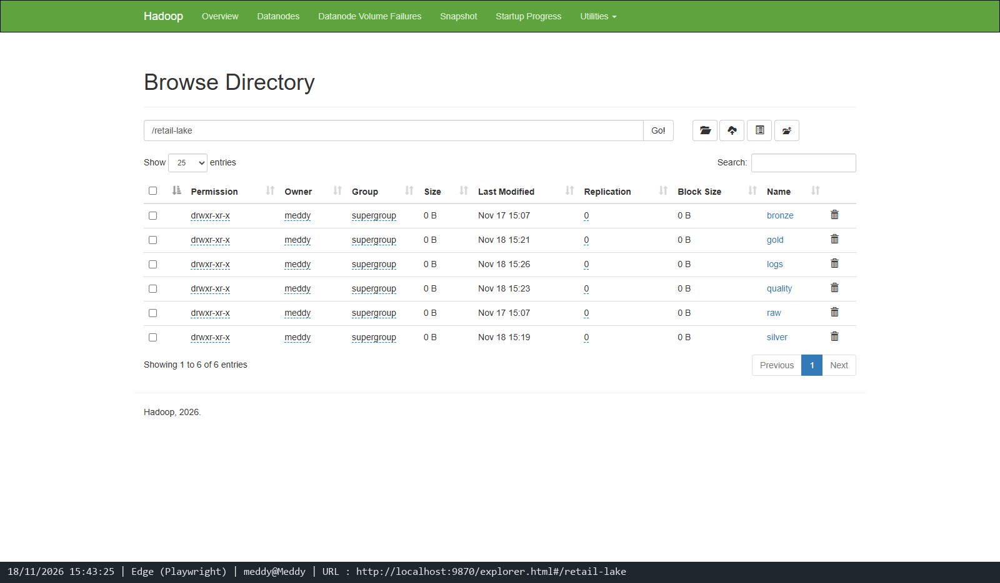
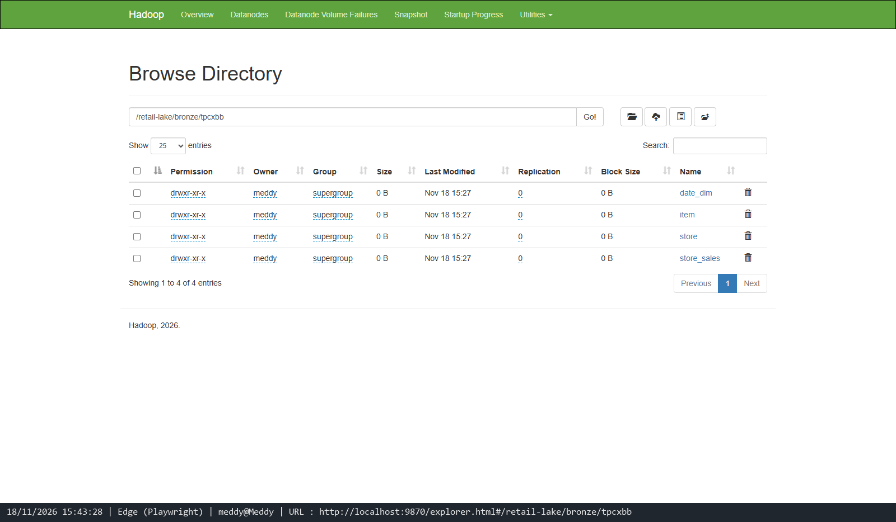
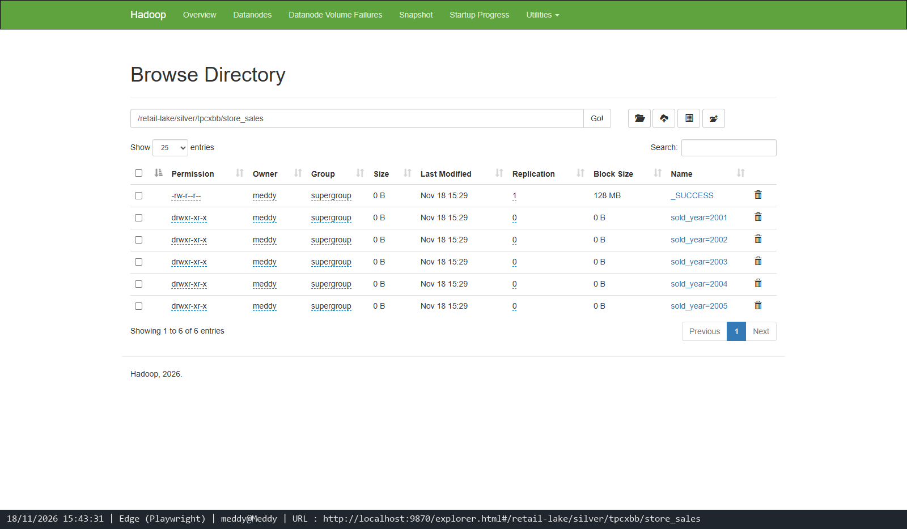
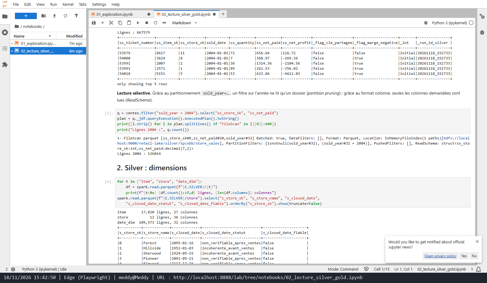
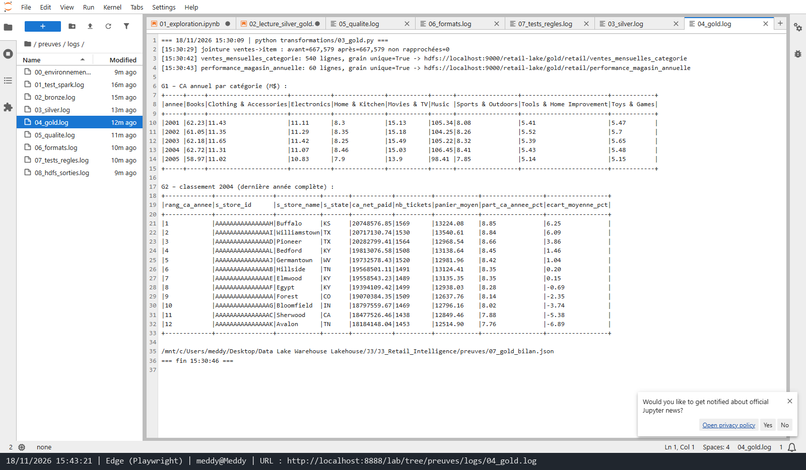
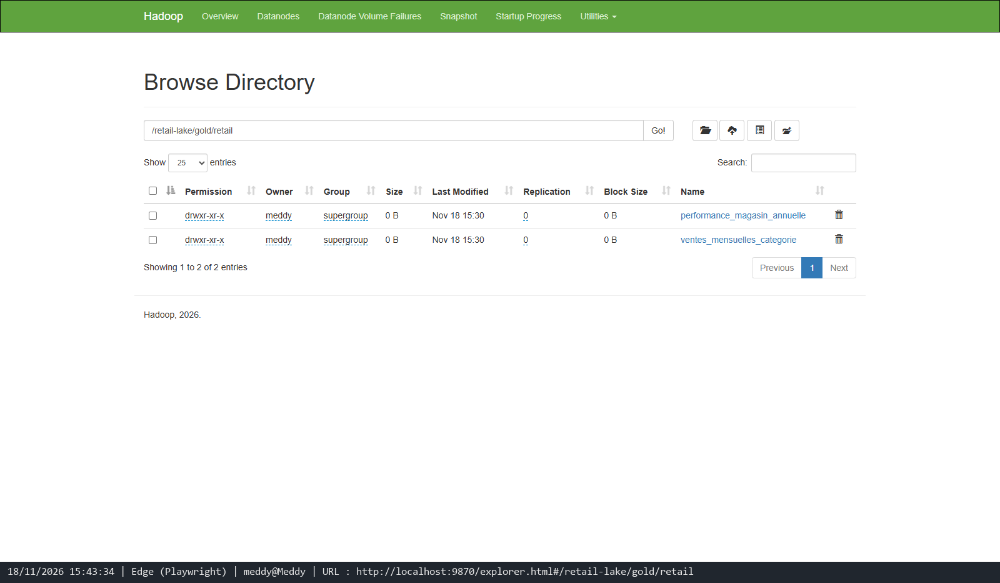
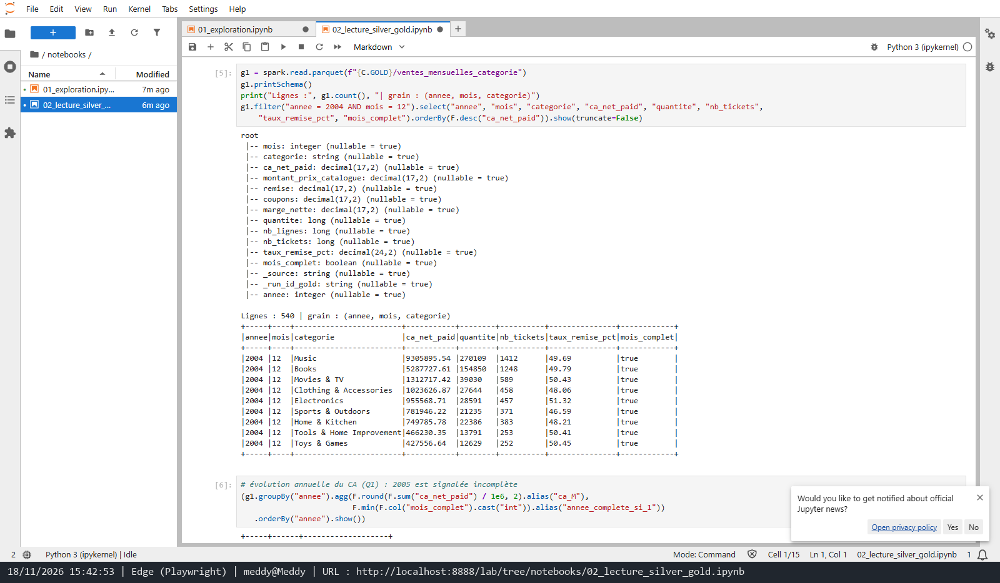
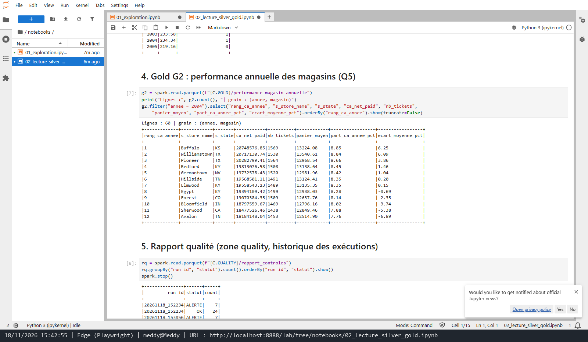

# UC-06 – Étapes 5, 6 et 7 : transformations, zones Silver et Gold

<p class="meta">Retail Intelligence Platform · TP Jour 3 · 18/11/2026 · Livrables 5, 6 et 7</p>

Code :
- `transformations/01_bronze.py` ;
- `transformations/02_silver.py` ;
- `transformations/03_gold.py`.

Preuves :
- `preuves/05_bronze_bilan.json`, `06_silver_bilan.json` et `07_gold_bilan.json` ;
- `notebooks/02_lecture_silver_gold.ipynb` (relecture).

## 1. Chaîne de traitement

```
HDFS /retail-lake/raw/tpcxbb/initial/*.dat           (J2, lecture seule)
   │ 01_bronze.py   lecture | sans en-tête, noms officiels, TOUT EN TEXTE, + provenance
   ▼
/retail-lake/bronze/tpcxbb/<table>     Parquet       = copie fidèle (même nombre de lignes)
   │ 02_silver.py   typage (R01), règles R02-R13, quarantaine, indicateurs, date (jointure), partition par année
   ▼
/retail-lake/silver/tpcxbb/<table>     Parquet       + /retail-lake/quality/tpcxbb/quarantaine/<table>
   │ 03_gold.py     jointures vérifiées + agrégations métier
   ▼
/retail-lake/gold/retail/<jeu>         Parquet       → analyses et visualisations du J4
   │ 04_qualite.py  31 contrôles → rapport (preuves/ + /retail-lake/quality/tpcxbb/rapport_controles)
```

**Pourquoi un Bronze tout en texte ?** Le Bronze doit rester **proche de la source** : on n'y convertit rien, donc on
n'y perd rien. Une valeur invalide reste visible en Bronze et c'est le Silver qui la détecte (R01). Le Bronze apporte
déjà deux choses : le format Parquet (fichier compressé et rapide à relire) et la **provenance**.

## 2. Convention de nommage

| Élément | Convention | Exemple |
|---|---|---|
| Chemin | `/retail-lake/<zone>/<source>/<table>` pour Bronze et Silver ; `/retail-lake/gold/<domaine>/<jeu_metier>` pour Gold | `/retail-lake/silver/tpcxbb/store_sales` |
| Partition | `<colonne>=<valeur>` (convention Hive, comprise par Spark) | `sold_year=2004/`, `annee=2004/` |
| Colonnes source | Noms officiels TPCx-BB, inchangés | `ss_net_paid` |
| Colonnes calculées | En minuscules, avec des `_` | `sold_date`, `ca_net_paid`, `panier_moyen` |
| Colonnes techniques | Préfixe `_` | `_source_file`, `_lot`, `_run_id_silver`, `_flag_marge_negative` |
| Identifiant d'exécution | `AAAAMMJJ_HHMMSS` | `20261118_152722` |

## 3. Provenance conservée (règle de traçabilité §3.3)

Chaque ligne Silver porte :
- `_source_file` : chemin HDFS exact du `.dat` d'origine ;
- `_lot` : `initial` ;
- `_run_id_bronze` et `_run_id_silver` : les exécutions qui l'ont produite.

Chaque jeu Gold porte `_source`, qui indique les jeux Silver utilisés, et `_run_id_gold`. Le traitement appliqué
correspond au script du même nom, et les règles sont documentées dans `UC06_regles_nettoyage.md`. Les contrôles sont
dans le rapport qualité, et le format comme l'emplacement apparaissent dans le chemin.

## 4. Jeux Silver

| Jeu | Lignes | Taille | Partition | Contenu |
|---|---:|---:|---|---|
| `silver/tpcxbb/store_sales` | 667 579 | 47,0 Mo | `sold_year` (5 dossiers) | 23 colonnes typées + `sold_date`, `sold_year`, `sold_month` + 3 indicateurs + provenance |
| `silver/tpcxbb/item` | 17 820 | 3,4 Mo | – | 22 colonnes typées + `i_version_courante` |
| `silver/tpcxbb/date_dim` | 109 573 | 3,5 Mo | – | 28 colonnes typées. Dimension complète, de 1900 à 2100 : **on ne filtre pas une dimension** |
| `silver/tpcxbb/store` | 12 | 13,6 Ko | – | 29 colonnes typées + `s_closed_date`, `s_closed_date_statut`, `s_closed_date_fiable` |

**Schéma Silver de `store_sales`** (relu dans HDFS) :
- clés en `int`, sauf `ss_ticket_number` en `bigint` ;
- `ss_quantity` en `int` ;
- les 12 montants en `decimal(7,2)` ;
- `sold_date` en `date`, `sold_month` et `sold_year` en `int` ;
- indicateurs `_flag_*` en `boolean` ;
- provenance en `string`.

**Contrôles après écriture (§4.9.3)** :
- présence des dossiers et format Parquet : `preuves/logs/08_hdfs_sorties.log` ;
- lisibilité et schéma : relecture dans `02_silver.py` et dans le notebook 02 ;
- nombre de lignes : Bronze = Silver + quarantaine pour les 4 tables ;
- cohérence : contrôles du rapport qualité.

## 5. Jointures

| Jointure | Sources et colonnes | Relation | Cardinalité attendue | Lignes avant → après | Non rapprochées |
|---|---|---|---|---|---|
| Ventes → dates (Silver, R10) | `store_sales.ss_sold_date_sk = date_dim.d_date_sk` | Chaque vente a 1 date ; une date a 0 à N ventes | N-1 (`d_date_sk` unique) | 667 579 → 667 579 | 0 |
| Ventes → produits (Gold G1) | `store_sales.ss_item_sk = item.i_item_sk` | Chaque vente porte sur 1 produit | N-1 (`i_item_sk` unique) | 667 579 → 667 579 | 0 |
| Ventes agrégées → magasins (Gold G2) | `ss_store_sk = store.s_store_sk` | Chaque vente a lieu dans 1 magasin | N-1 (`s_store_sk` unique) | 60 → 60 | 0 |

**Pourquoi ces jointures sont fiables** :
- les noms des clés (`_sk`) suivent le schéma officiel TPC-DS ;
- l'unicité côté dimension a été vérifiée (0 doublon), ce qui garantit qu'une jointure ne peut pas multiplier les
  lignes ;
- l'existence côté fait a été vérifiée (0 orphelin) ;
- le nombre de lignes reste identique avant et après la jointure.

Les jointures sont des jointures **gauches** : si une vente n'était pas rapprochée, elle serait conservée et visible,
pas perdue.

**Jointure volontairement non réalisée** : `ss_customer_sk → customer`. Au J1, nous avions constaté que 100 % des
clients des ventes `initial` sont absents du fichier `customer`, qui n'existe que dans `data_refresh` et contient
1 000 lignes. Une jointure ne rattacherait aucune vente : c'est le cas « clé supposée » du sujet.

## 6. Jeux Gold

### G1 – `gold/retail/ventes_mensuelles_categorie` (540 lignes, partition `annee`)

| Élément | Description |
|---|---|
| Finalité métier | Suivre l'évolution du CA (**Q1**), identifier les catégories qui vendent le plus (**Q3**), suivre le niveau de remise (**Q7**) |
| Sources | `silver/tpcxbb/store_sales` + `silver/tpcxbb/item` |
| Granularité | **1 ligne = 1 catégorie × 1 mois** (5 ans × 12 mois × 9 catégories = 540) |
| Dimensions | `annee`, `mois`, `categorie` |
| Mesures | `ca_net_paid`, `montant_prix_catalogue`, `remise`, `coupons`, `marge_nette`, `quantite`, `nb_lignes`, `nb_tickets`, `taux_remise_pct` |
| Règles de calcul | `ca_net_paid = Σ ss_net_paid` (prix de vente × quantité − coupons, **hors taxes**, KPI-01 du J1) ; `taux_remise_pct = 100 × Σ ss_ext_discount_amt / Σ ss_ext_list_price` ; `nb_tickets = COUNT(DISTINCT magasin, ticket)` |
| Indicateur | `mois_complet = false` pour décembre 2005 (ventes jusqu'au 13/12) |
| Limites | `nb_tickets` **ne s'additionne pas** entre catégories, car un ticket peut contenir plusieurs catégories. Données synthétiques : les écarts entre années sont faibles (±1,5 %) et ne traduisent pas une tendance réelle. Le CA n'inclut pas les retours (`store_returns`) |

**Résultat** : CA annuel stable autour de 232 M$ (2001 : 232,50 ; 2004 : 234,34 ; 2005 incomplète : 219,16). **Music**
(environ 105 M$ par an) et **Books** (environ 62 M$) font 72 % du CA, conformément au constat du J1. Le taux de remise
est proche de 50 % dans toutes les catégories.

### G2 – `gold/retail/performance_magasin_annuelle` (60 lignes)

| Élément | Description |
|---|---|
| Finalité métier | Comparer chaque magasin aux autres (**Q5**) |
| Sources | `silver/tpcxbb/store_sales` + `silver/tpcxbb/store` |
| Granularité | **1 ligne = 1 magasin × 1 année** (12 × 5 = 60) |
| Dimensions | `annee`, `ss_store_sk`, `s_store_id`, `s_store_name`, `s_city`, `s_state` |
| Mesures | `ca_net_paid`, `nb_tickets`, `quantite`, `nb_lignes`, `marge_nette`, `panier_moyen`, `part_ca_annee_pct`, `ecart_moyenne_pct`, `rang_ca_annee` |
| Règles de calcul | `panier_moyen = ca_net_paid / nb_tickets` ; `part_ca_annee_pct = 100 × CA du magasin / CA de l'année` ; `ecart_moyenne_pct = 100 × (CA / moyenne des 12 magasins − 1)` ; `rang` par CA décroissant dans l'année |
| Indicateur | `annee_complete = false` pour 2005 |
| Limites | Panier moyen d'environ 13 000 $, irréaliste (données synthétiques). Pas de surface ni d'effectif dans le calcul : un « petit » magasin n'est pas corrigé. Les écarts sont faibles (de −6,9 % à +6,3 % en 2004) |

**Résultat 2004** : Buffalo (KS) est 1er avec 20,75 M$ (+6,25 % par rapport à la moyenne) ; Avalon (TN) est 12e avec
18,18 M$ (−6,89 %).

## 7. Ordre d'exécution

`run_all.sh` lance `test_spark` → `01_bronze` → `02_silver` → `03_gold` → `04_qualite` → `05_formats` → tests. Chaque
étape relit ce que la précédente a écrit **dans HDFS** : on peut relancer une étape seule, puisque chaque sortie est
réécrite avec `overwrite` dans son propre répertoire. Le rapport qualité est le seul écrit en `append`, pour garder
l'historique.

## Captures (18/11/2026, Edge piloté par script, bandeau date et URL)



*Zones du Data Lake dans HDFS (explorateur du NameNode).*



*Zone Bronze : un dossier Parquet par table source.*



*Silver store_sales partitionné par année (sold_year=2001 à 2005).*



*Relecture des dimensions Silver ; statut de la date de fermeture des magasins (règle R12).*



*Exécution de 03_gold.py : jointure ventes → produits sans perte, 540 et 60 lignes, grain unique, CA par catégorie et classement 2004.*



*Zone Gold : les 2 jeux analytiques en Parquet.*



*G1 relu en Parquet : schéma typé, CA par catégorie en décembre 2004, et CA annuel (2005 signalée incomplète).*



*G2 relu en Parquet : classement des 12 magasins en 2004, panier moyen, part du CA, écart à la moyenne.*
