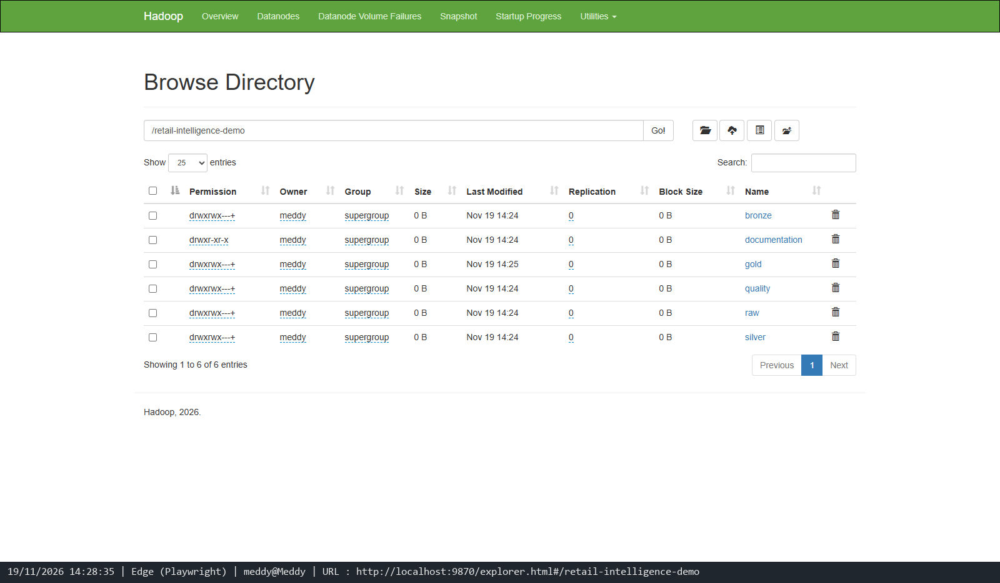
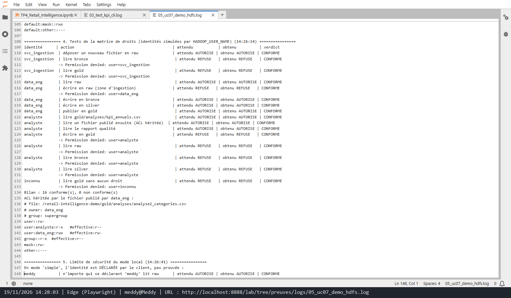

# UC-07 – Dossier de simulation Azure et preuves de réalisation

Retail Intelligence Platform · TP Jour 4 · 19/11/2026 · Livrable J4-10

> **Statut : SIMULATION.** Aucune ressource Azure n'a été créée, aucune commande `az` n'a été exécutée, et aucun moyen
> de paiement n'a été saisi. Le parcours B a été choisi au début de l'activité (§9.2.2 du sujet).
>
> Ce qui a été **réellement exécuté**, c'est la démonstration équivalente sur HDFS : section 3.

## 1. Organisation cible

Conteneur `retail-intelligence` d'un compte ADLS Gen2 (HNS activé), avec les zones `raw`, `bronze`, `silver`, `gold`,
`quality`, `logs` et `documentation`, aux mêmes chemins que `/retail-lake` (voir `docs/cloud/adls-organization.md`).

## 2. Ressources qui seraient nécessaires, et opérations prévues

Script : `azure/simulation/deploiement_adls_simulation.sh`. Il est **bloqué par un `exit 1` en tête** pour ne pas être
lancé par erreur. Ses paramètres sont dans `azure/configuration/parametres.exemple.env`, sans aucun secret.

| # | Ressource / opération | Commande prévue | Contrôle prévu | Coût potentiel | Statut |
|---|---|---|---|---|---|
| 0 | Choix de l'abonnement, groupe de ressources, **budget** | `az account set`, `az group create`, `az consumption budget create` | Bon abonnement à l'état *Enabled*, budget visible | Aucun | ❌ Non exécuté |
| 1 | Compte de stockage **StorageV2, LRS, HNS activé**, TLS 1.2, accès public et clés partagées désactivés | `az storage account create --hns true …` | `isHnsEnabled = true`, `kind = StorageV2` | Faible : stockage au Go et opérations | ❌ Non exécuté |
| 2 | Conteneur et 8 répertoires de zones | `az storage fs create`, `az storage fs directory create` | Listage récursif conforme à l'arborescence cible | Négligeable | ❌ Non exécuté |
| 3 | Dépôt de `kpi.csv` (agrégé, non sensible) | `az storage fs file upload` | Taille identique, puis `diff` entre le fichier téléchargé et l'original | Négligeable | ❌ Non exécuté |
| 4 | Rôle *Storage Blob Data Owner* aux administrateurs, sur le conteneur seulement ; **ACL** par zone pour les groupes | `az role assignment create`, `az storage fs access set / update-recursive` | Un analyste lit `gold/`, reçoit **403** sur `raw/` et en écriture sur `gold/` | Aucun | ❌ Non exécuté |
| 5 | Journaux de diagnostic (lectures, écritures, suppressions) | `az monitor diagnostic-settings create` | Événements visibles dans Log Analytics | Faible : ingestion des journaux | ❌ Non exécuté |
| 6 | **Suppression du groupe de ressources** en fin de TP | `az group delete` | `az group exists` = `false` | Arrête tous les coûts | ❌ Non exécuté |

Services seulement étudiés, **sans aucune commande prévue** : Azure Data Factory, Synapse (Studio, Spark pools, SQL
serverless) et Power BI. Leur création n'est pas exigée par le socle obligatoire (§9.2.3, étape 6).

## 3. Ce qui a été réellement exécuté : démonstration équivalente en local

| Élément démontré | Commande ou script | Résultat | Preuve |
|---|---|---|---|
| Zones dans un espace de noms hiérarchique | `scripts/uc07_demo_hdfs.sh`, section 1 | `/retail-intelligence-demo/{raw,bronze,silver,gold,quality,documentation}` créés, avec des échantillons réels copiés depuis `/retail-lake` (non modifié) | `preuves/logs/05_uc07_demo_hdfs.log` ; capture de l'explorateur HDFS |
| Dépôt et relecture d'un fichier de démonstration | section 1 | `kpi.csv` → `gold/analyses/kpi_annuels.csv`, relu avec `-cat` | Journal |
| Opérations de répertoire (HNS) | section 2 | Dossier de 5 fichiers renommé en **une** opération ; l'ancien chemin n'existe plus ; `du` par zone | Journal |
| ACL par zone + ACL par défaut | section 3 | `getfacl` de chaque zone : `other::---` partout | Journal, capture |
| Matrice de droits testée | section 4 | **16 tests sur 16 conformes** (autorisations et refus `Permission denied`) | Journal, capture |
| Limite d'authentification | section 5 | En mode `simple`, se déclarer `meddy` suffit pour lire Raw | Journal |
| Correspondance des chemins | section 6 | `hdfs://…/raw/…` → `abfss://retail-intelligence@<compte>.dfs.core.windows.net/raw/…` | Journal |

**Durée** : environ 2 minutes (chaque commande `hdfs` démarre une JVM). Pour supprimer le bac à sable :
`hdfs dfs -rm -r -skipTrash /retail-intelligence-demo`.

## 4. Ce que la simulation ne prouve pas

- Le comportement exact d'ADLS : codes d'erreur, délais de propagation des rôles, limites des comptes HNS.
- Le **RBAC** : il n'a pas d'équivalent dans HDFS. Seules les ACL ont été testées.
- Les coûts réels : aucune facture, aucune mesure.
- L'intégration ADF, Synapse et Power BI : non installée.

Un passage en parcours A demanderait l'accord du formateur, un abonnement autorisé et un budget. Il suffirait alors
d'exécuter le script de simulation (après avoir retiré le `exit 1`) et de prendre les captures des contrôles prévus.

## Captures (19/11/2026, Edge piloté par script, bandeau date et URL)

*Réalisé en local : zones du conteneur reproduites dans HDFS.*

*Réalisé en local : matrice de droits testée, 16 sur 16 conformes.*
