# UC-08 – Statistiques descriptives, analyses métier et visualisations

Retail Intelligence Platform · TP Jour 4 · 19/11/2026 · Livrables J4-03, J4-04, J4-05

Tout est calculé par `analytics/notebooks/TP4_Retail_Intelligence.ipynb`, exécuté de bout en bout avec ses sorties
conservées. **Spark agrège, puis seul le petit résultat passe dans Pandas** : 60 mois, 9 catégories, 12 magasins ou
33 tranches. Aucun `toPandas()` n'est appliqué aux 667 579 lignes.

> ⚠️ Données **synthétiques** TPCx-BB, canal magasin, 12 magasins, du 01/01/2001 au 13/12/2005. Les constats
> illustrent une démarche d'analyse. Ce ne sont pas des faits sur une entreprise réelle.

## 1. Statistiques descriptives (J4-03)

Export : `analytics/outputs/statistiques.csv`. Les quartiles sont **exacts** (`percentile`). La somme n'est donnée que
pour les mesures additives.

| Grain | Variable | n | Min | Q1 | Médiane | Moyenne | Q3 | Max | Somme |
|---|---|---:|---:|---:|---:|---:|---:|---:|---:|
| Ligne | `ss_quantity` (unités) | 667 579 | 1 | 26 | 51 | 50,56 | 76 | 100 | 33 755 474 |
| Ligne | `ss_sales_price` ($) | 667 579 | 0,00 | 10,25 | 27,69 | 37,86 | 56,78 | 199,30 | – |
| Ligne | `ss_ext_sales_price` ($) | 667 579 | 0,00 | 313,56 | 1 048,50 | 1 913,22 | 2 674,44 | 18 745,00 | 1 277 224 004,61 |
| Ligne | `ss_ext_discount_amt` ($) | 667 579 | 0,00 | 313,25 | 1 046,73 | 1 912,45 | 2 669,27 | 18 984,00 | 1 276 714 271,73 |
| Ligne | `ss_net_paid` ($) | 667 579 | 0,00 | 245,70 | 878,54 | 1 723,44 | 2 366,51 | 18 745,00 | 1 150 529 586,37 |
| Ticket | montant du ticket ($) | 89 100 | 0,00 | 5 572,46 | 11 645,15 | 12 912,79 | 18 791,10 | 64 785,95 | 1 150 529 586,37 |
| Ticket | lignes par ticket | 89 100 | 1 | 4 | 7 | 7,49 | 11 | 14 | – |
| Ticket | articles par ticket | 89 100 | 1 | 194 | 372 | 378,85 | 550 | 1 143 | 33 755 474 |

Aucune valeur nulle sur ces variables.

**KPI annuels** (`analytics/outputs/kpi.csv`) :

| Année | CA net payé ($) | Transactions | Lignes | Quantités | Panier net ($) | Remise | Évol. N/N-1 | Évol. à période égale |
|---|---:|---:|---:|---:|---:|---:|---:|---:|
| 2001 | 232 498 659,83 | 17 991 | 134 873 | 6 814 234 | 12 923,05 | 49,97 % | – | – |
| 2002 | 230 947 265,82 | 17 990 | 135 084 | 6 825 340 | 12 837,54 | 50,16 % | −0,67 % | −0,75 % |
| 2003 | 233 575 185,63 | 17 990 | 134 773 | 6 820 308 | 12 983,61 | 49,83 % | +1,14 % | +1,11 % |
| 2004 | 234 344 934,29 | 18 039 | 136 014 | 6 887 086 | 12 991,02 | 50,03 % | +0,33 % | +0,18 % |
| 2005* | 219 163 540,80 | 17 090 | 126 835 | 6 408 506 | 12 824,08 | 49,96 % | −6,48 % | **−1,53 %** |

\* 2005 s'arrête au 13/12. Évolution « à période égale » : chaque année est limitée au 01/01 → 13/12.

**Lecture.**
- Les montants sont **asymétriques** : la médiane est très inférieure à la moyenne, au grain ligne comme au grain
  ticket.
- La somme des remises est presque égale au CA brut, ce qui est cohérent avec un taux de remise de 50 %.
- 372 articles par ticket en médiane est **irréaliste** : c'est un effet du générateur, qui tire chaque quantité au
  hasard entre 1 et 100.

## 2. Analyse 1 – Q1 : comment évolue le CA dans le temps ? (J4-04)

| Élément | Contenu |
|---|---|
| Question (UC-01, Q1) | Direction générale : le CA progresse-t-il d'une année sur l'autre ? Y a-t-il une saisonnalité ? |
| Données | Gold `ventes_mensuelles_categorie`, sommé sur les 9 catégories (60 mois) |
| Méthode | CA net payé par mois ; CA par jour vendu ; indice saisonnier 2001-2004, brut puis ramené au nombre de jours ; N/N-1 à période égale |
| Résultats | CA mensuel de 17,6 M$ (02/2002) à 20,6 M$ (10/2003), sans tendance. Indice brut de 93,1 (février) à 102,9. **Indice par jour de 98,8 à 101,0.** CA par jour de 617 575 à 670 303 $. Décembre 2005 : 8,08 M$ en 13 jours, soit 621 401 $ par jour |
| Interprétation | Pas de saisonnalité : les écarts entre mois viennent du nombre de jours. La chute de décembre 2005 est un **artefact de coupure**, pas une baisse d'activité |
| Limites | Synthétique (un vrai disquaire ou libraire aurait un pic en décembre). Avant retours. Canal magasin seul |

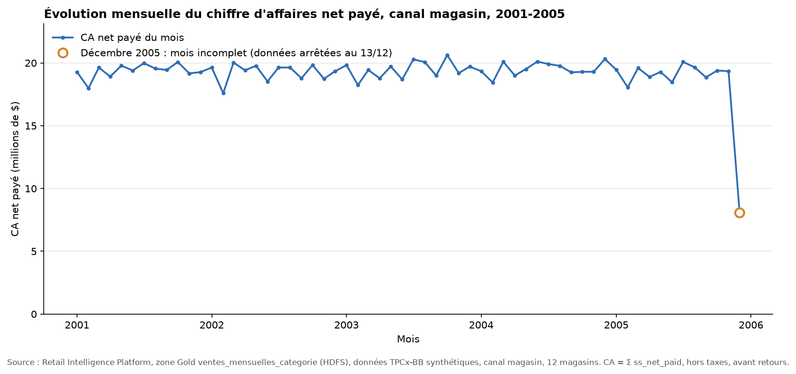

*Visualisation 1 : courbe du CA net payé mensuel, de 2001 à 2005. Le point orange signale le mois incomplet.*

**À retenir.** La courbe est plate, autour de 19 à 20 M$ par mois. La seule rupture, décembre 2005, s'explique
entièrement par les 13 jours de données.

## 3. Analyse 2 – Q3 : quelles catégories contribuent le plus au CA ?

| Élément | Contenu |
|---|---|
| Question (UC-01, Q3) | Direction commerciale : quels produits et catégories vendent le plus ? |
| Données | Gold G1, 2001-2004 (années complètes) ; Silver `item` (produits par catégorie) ; Silver `store_sales` (concentration par produit) |
| Méthode | CA, part du CA, part des quantités, CA par unité, taux de remise, nombre de produits et CA par produit, par catégorie ; parts cumulées du CA par produit |
| Résultats | Voir le tableau ci-dessous. 17 820 produits vendus sur 17 820. **1 % des produits font 39,4 % du CA, 6,1 % (1 087 produits) en font 50 %**, 20 % en font 61,7 % |

| Catégorie | CA net 2001-2004 ($) | Part du CA | Part des quantités | Part du catalogue | CA par unité | Remise | CA par produit ($) |
|---|---:|---:|---:|---:|---:|---:|---:|
| Music | 421 255 749,81 | **45,23 %** | 45,18 % | 45,70 % | 34,10 $ | 49,94 % | 51 732 |
| Books | 248 183 834,32 | **26,65 %** | 26,67 % | 29,94 % | 34,03 $ | 50,06 % | 46 520 |
| Movies & TV | 60 835 794,91 | 6,53 % | 6,50 % | 7,22 % | 34,22 $ | 50,00 % | 47 306 |
| Clothing & Accessories | 45 733 997,02 | 4,91 % | 4,83 % | 3,42 % | 34,62 $ | 49,52 % | 74 974 |
| Electronics | 44 888 929,48 | 4,82 % | 4,81 % | 3,88 % | 34,11 $ | 50,14 % | 64 868 |
| Home & Kitchen | 33 358 520,34 | 3,58 % | 3,63 % | 2,67 % | 33,61 $ | 50,22 % | 70 081 |
| Sports & Outdoors | 33 077 603,08 | 3,55 % | 3,58 % | 2,61 % | 33,74 $ | 49,86 % | 71 135 |
| Toys & Games | 22 289 388,44 | 2,39 % | 2,42 % | 2,27 % | 33,74 $ | 50,14 % | 55 036 |
| Tools & Home Improvement | 21 742 228,17 | 2,33 % | 2,38 % | 2,29 % | 33,40 $ | 50,75 % | 53 290 |

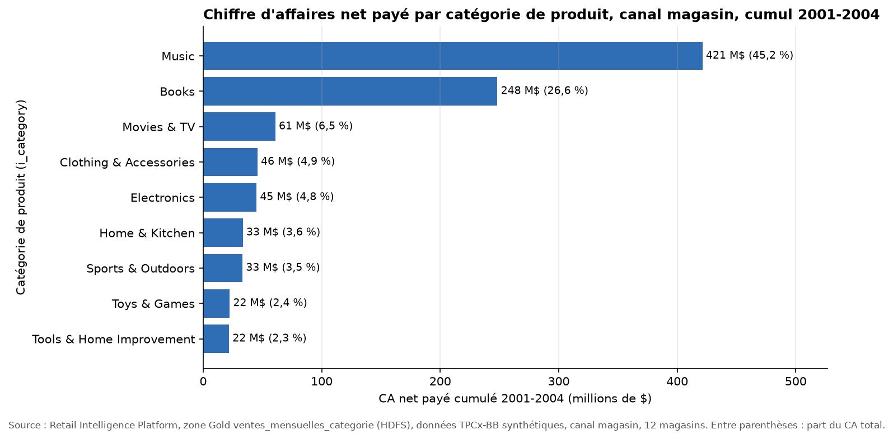

*Visualisation 2 : barres horizontales triées, CA cumulé 2001-2004 et part du total.*

**Interprétation.**
- Music et Books font **72 % du CA** parce qu'elles ont le plus grand **catalogue** (76 % des produits). Le prix par
  unité (≈ 34 $) et la remise (≈ 50 %) sont les mêmes partout.
- Rapporté au produit, le CA est même plus élevé dans les petites catégories (Clothing : 74 974 $ par produit).
- En revanche, le CA est **très concentré sur peu de produits**.

**Limites.** Avant retours. Pas de marge exploitable. Analyse non descendue aux classes (`i_class`) ni aux marques.

## 4. Analyse 3 – Q5 : quelles différences entre les magasins ?

| Élément | Contenu |
|---|---|
| Question (UC-01, Q5) | Responsable magasin : comment se situe mon magasin par rapport aux autres ? |
| Données | Gold `performance_magasin_annuelle`, 2001-2004 ; Silver `store` (surface, effectif) |
| Méthode | CA, transactions et panier cumulés sur 4 ans ; écart au magasin moyen ; corrélations CA / transactions / panier / surface / effectif ; corrélation de rang (Spearman) entre années |
| Résultats | CA de 75,9 M$ (Avalon, TN) à 80,8 M$ (Buffalo, KS) ; écarts de −2,15 % à +4,10 % ; **coefficient de variation de 1,67 %**. Corrélations du CA : avec les transactions 0,88 ; avec le panier 0,56 ; avec la surface 0,51 ; avec l'effectif −0,03. **Spearman entre années : de −0,42 à 0,52** |

| Magasin | CA 2001-2004 ($) | Écart à la moyenne | Transactions | Panier net ($) | Rangs 2001 / 02 / 03 / 04 |
|---|---:|---:|---:|---:|---|
| Buffalo (KS) | 80 797 199,00 | **+4,10 %** | 6 248 | 12 931,69 | 3 / **1 / 1 / 1** |
| Williamstown (TX) | 78 642 088,75 | +1,32 % | 6 016 | 13 072,16 | 6 / 12 / 3 / 2 |
| Elmwood (KY) | 78 377 409,29 | +0,98 % | 6 010 | 13 041,17 | 4 / 5 / 4 / 7 |
| Forest (CO) | 77 966 594,03 | +0,45 % | 6 014 | 12 964,18 | 5 / 6 / 2 / 9 |
| Pioneer (TX) | 77 919 308,95 | +0,39 % | 5 989 | 13 010,40 | 8 / 11 / 5 / 3 |
| Hillside (TN) | 77 366 456,69 | −0,32 % | 5 973 | 12 952,70 | 1 / 9 / 11 / 6 |
| Germantown (WV) | 77 333 072,69 | −0,36 % | 5 955 | 12 986,24 | 11 / 8 / 6 / 5 |
| Egypt (KY) | 77 060 201,51 | −0,71 % | 5 972 | 12 903,58 | 7 / 10 / 7 / 8 |
| Bedford (KY) | 77 021 626,01 | −0,76 % | 5 999 | 12 839,08 | 10 / 7 / 9 / 4 |
| Bloomfield (IN) | 76 825 614,39 | −1,02 % | 5 915 | 12 988,27 | 2 / 3 / 12 / 10 |
| Sherwood (CA) | 76 109 137,14 | −1,94 % | 5 960 | 12 769,99 | 9 / 4 / 10 / 11 |
| Avalon (TN) | 75 947 337,12 | −2,15 % | 5 959 | 12 744,98 | 12 / 2 / 8 / 12 |

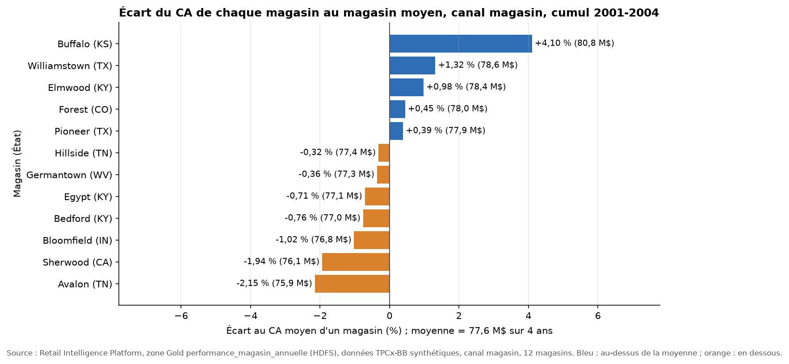

*Visualisation 3 : barres divergentes. En bleu, au-dessus de la moyenne ; en orange, en dessous.*

**Interprétation.**
- Les magasins sont **très homogènes**, et le classement annuel change presque au hasard.
- Seul **Buffalo** se distingue durablement. Il le doit au **nombre de transactions** (+4,1 % de tickets), pas au
  panier.
- L'effectif n'explique rien. La corrélation avec la surface (0,51) porte sur 12 points, avec des surfaces sans unité
  documentée : elle n'est pas concluante.
- Rien ne permet d'expliquer *pourquoi* Buffalo attire plus de clients : il manque les données de trafic et de zone
  de chalandise.

**Limites.** 12 magasins. Une corrélation n'est pas une causalité. La date de fermeture est inutilisable (J3, R12),
donc tous les magasins sont supposés ouverts sur toute la période.

## 5. Visualisation complémentaire : distribution du montant des tickets

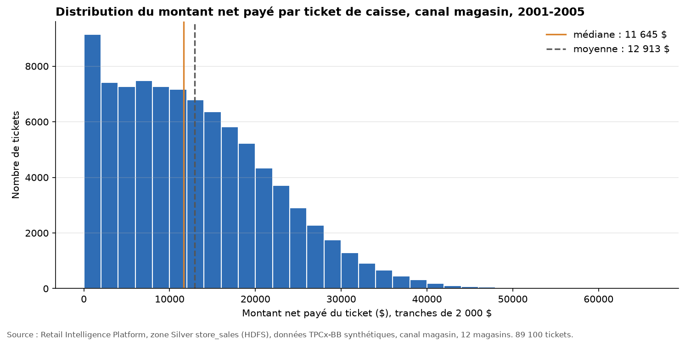

*Visualisation 4 : histogramme calculé dans Spark (tranches de 2 000 $, 33 tranches), avec la médiane et la moyenne.*

**Lecture.**
- La distribution est asymétrique à droite : médiane de 11 645 $, moyenne de 12 913 $, maximum de 64 786 $.
- La première tranche (environ 9 100 tickets) regroupe les tickets d'une ou deux lignes et les tickets entièrement
  remisés.
- Il vaut mieux suivre la **médiane** comme panier « typique ».

## 6. Conformité des visualisations (§1.12 et étape 5 du sujet)

| Règle | Application |
|---|---|
| Titre explicite | Mesure, périmètre et période dans chaque titre |
| Axes nommés, avec unité | « millions de $ », « % », « nombre de tickets » |
| Légende si nécessaire | Courbe : mois incomplet ; histogramme : médiane et moyenne ; barres divergentes : code couleur dans la source |
| Source | Pied de figure : zone, jeu, nature synthétique, définition du CA |
| Pas d'effet inutile | Pas de 3D, une couleur principale, une couleur d'alerte |
| Nombre de catégories lisible | 9 catégories et 12 magasins, triés |
| Interprétation | Sous chaque graphique, dans le notebook et dans ce document |

## Captures (19/11/2026, Edge piloté par script, bandeau date et URL)

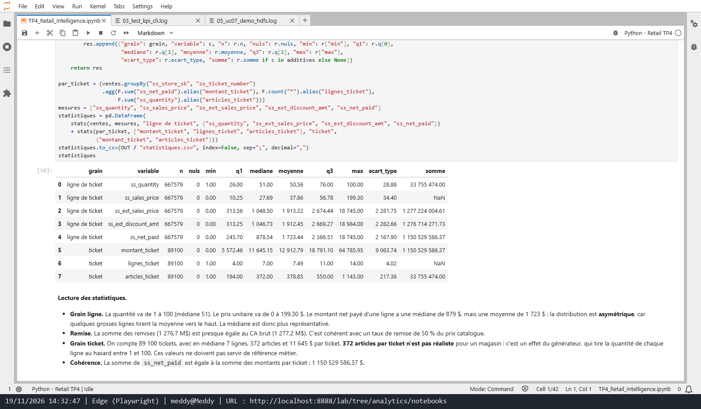

*Statistiques descriptives aux deux grains (ligne de ticket, ticket), avec quartiles exacts, puis lecture des résultats.*

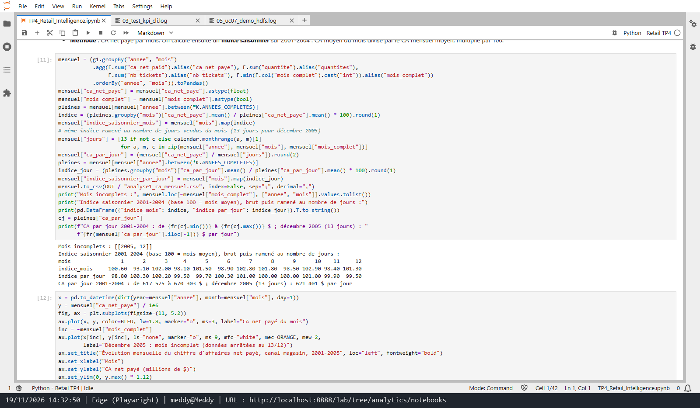

*Analyse 1 : l'indice saisonnier brut (93 à 103) devient 98,8 à 101,0 une fois ramené au nombre de jours ; CA par jour de décembre 2005 dans la norme.*

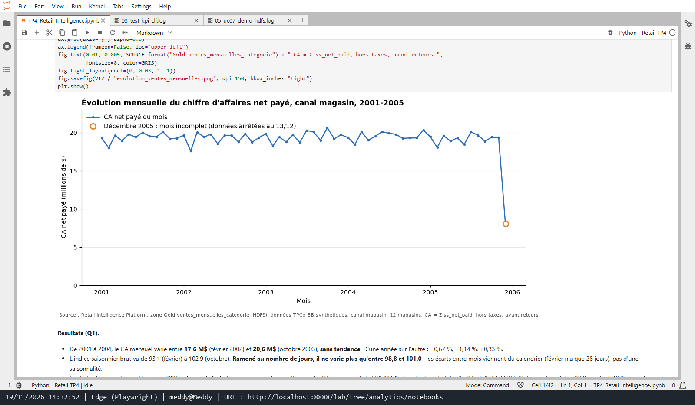

*Visualisation 1 dans le notebook : CA net payé mensuel, avec le mois incomplet signalé.*

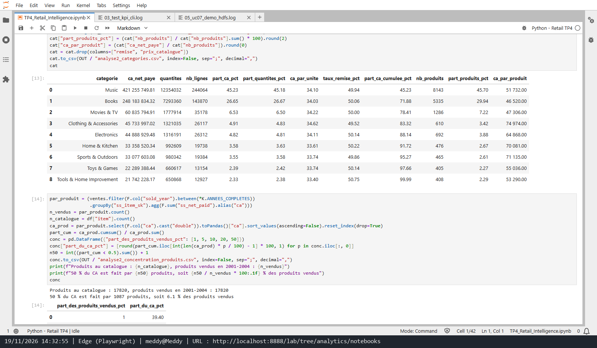

*Analyse 2 : parts du CA, des quantités et du catalogue par catégorie ; concentration (6,1 % des produits font 50 % du CA).*

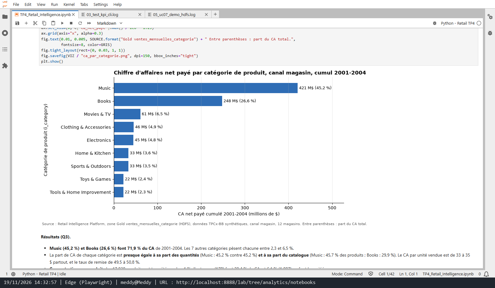

*Visualisation 2 : CA par catégorie, cumul 2001-2004.*

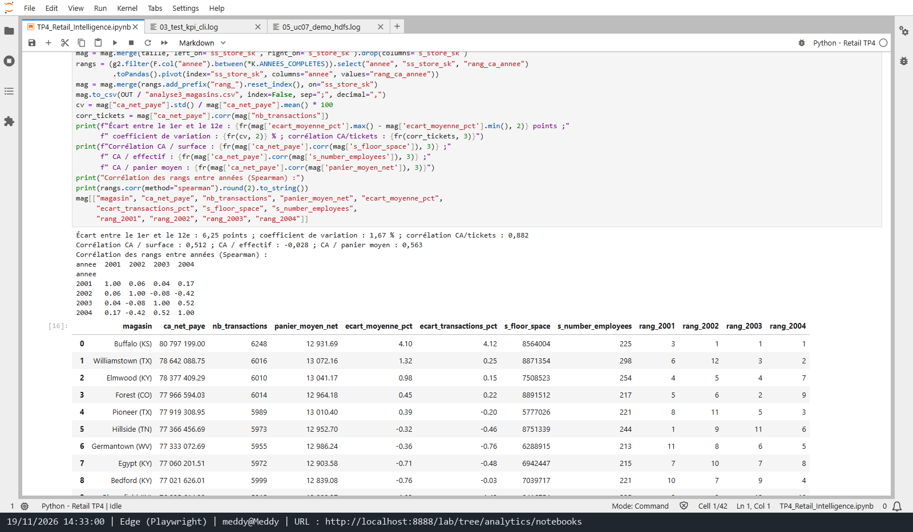

*Analyse 3 : dispersion (CV de 1,67 %), corrélations du CA (transactions 0,88 ; effectif −0,03), corrélations de rang entre années et tableau des magasins.*

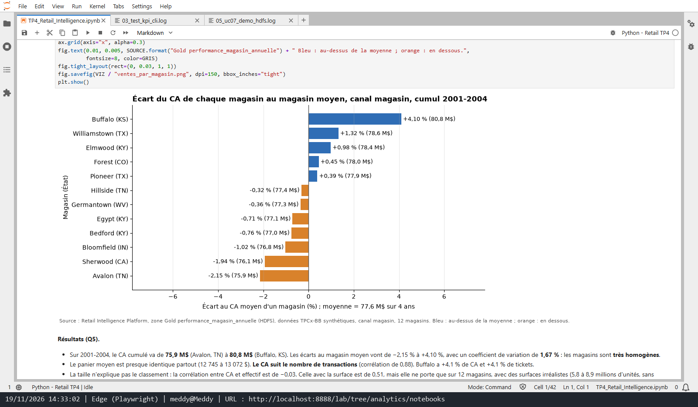

*Visualisation 3 : écart de chaque magasin au magasin moyen.*

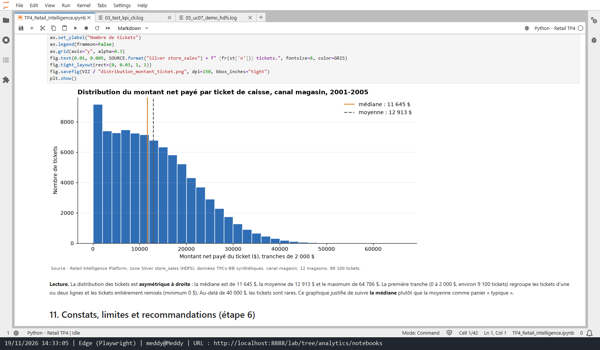

*Visualisation 4 : distribution des montants par ticket, histogramme calculé dans Spark.*

*Fin du notebook : liste des CSV et des PNG produits dans `analytics/outputs` et `analytics/visualizations`.*
