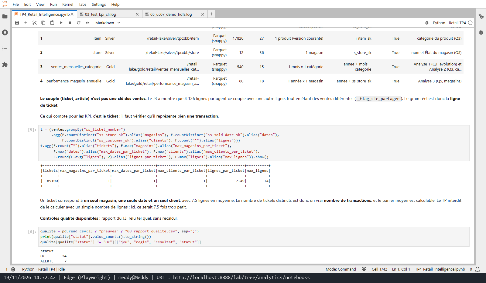

# UC-08 – Inventaire analytique des jeux utilisés

<p class="meta">Retail Intelligence Platform · TP Jour 4 · 19/11/2026 · Livrable J4-01</p>

Les analyses portent **uniquement** sur les jeux produits au J3 et réellement présents dans HDFS. Les volumes, schémas
et granularités ci-dessous ont été **relus et vérifiés** par le notebook
`analytics/notebooks/TP4_Retail_Intelligence.ipynb` (sections 3 et 4). Export : `analytics/outputs/inventaire_jeux.csv`.

## 1. Jeux sélectionnés

| Jeu | Zone | Chemin HDFS | Format | Lignes | Granularité vérifiée | Usage |
|---|---|---|---|---:|---|---|
| `store_sales` | Silver | `/retail-lake/silver/tpcxbb/store_sales` (partitions `sold_year=`) | Parquet snappy | 667 579 | 1 ligne d'article d'un ticket. **Pas de clé unique** : (ticket, article) est non unique | KPI, statistiques, distribution des tickets, concentration par produit |
| `item` | Silver | `/retail-lake/silver/tpcxbb/item` | Parquet snappy | 17 820 | 1 produit (`i_item_sk` unique) | Catégorie (Q3), nombre de produits par catégorie |
| `store` | Silver | `/retail-lake/silver/tpcxbb/store` | Parquet snappy | 12 | 1 magasin (`s_store_sk` unique) | Nom, État, surface, effectif (Q5) |
| `ventes_mensuelles_categorie` (G1) | Gold | `/retail-lake/gold/retail/ventes_mensuelles_categorie` (partitions `annee=`) | Parquet snappy | 540 | 1 mois × 1 catégorie (unique) | Analyse 1 (Q1), Analyse 2 (Q3) |
| `performance_magasin_annuelle` (G2) | Gold | `/retail-lake/gold/retail/performance_magasin_annuelle` | Parquet snappy | 60 | 1 année × 1 magasin (unique) | Analyse 3 (Q5) |

## 2. Provenance (lignage)

```
TPCx-BB lot « initial » (.dat, |)  →  NiFi (J2)  →  HDFS Raw (lecture seule)
   →  01_bronze.py (texte + provenance)  →  02_silver.py (typage, règles R01-R13, indicateurs)
   →  03_gold.py (G1, G2)  →  J4 : notebook UC-08 (lecture seule des zones Silver et Gold)
```

Chaque ligne Silver porte `_source_file`, `_lot`, `_run_id_bronze` et `_run_id_silver`. Chaque ligne Gold porte
`_source` et `_run_id_gold`, ce qui permet de remonter au fichier d'origine.

## 3. Vérifications préalables (§6.3 du sujet)

| Point | Constat |
|---|---|
| Nom exact, format | Vérifiés à la lecture : `spark.read.parquet`, schéma lu dans les fichiers |
| Colonnes et types | `printSchema()` dans le notebook. Montants en `decimal(7,2)` (Silver) et `decimal(17,2)` (Gold) |
| Granularité | Vérifiée par l'unicité de la clé du grain (`grain_unique` dans `inventaire_jeux.csv`) |
| **Transaction** | `ss_ticket_number` → 1 seul magasin, 1 seule date, 1 seul client (maximum = 1 pour les 89 100 tickets). Le ticket est donc une vraie transaction : **7,49 lignes par ticket en moyenne** |
| Relations | Ventes → `item`, `store`, `date_dim` : 0 orphelin (contrôles du J3) |
| Anomalies connues | 7 alertes du rapport qualité du J3, relu par le notebook : 2005 incomplète, marge négative à 74 %, clé (ticket, article) non unique, montants atypiques, ventes à 0, marque absente, date de fermeture inutilisable |
| Règles appliquées | `J3/.../docs/UC06_regles_nettoyage.md` (R01 à R13) |

## 4. Jeux non disponibles et conséquences

| Besoin | Jeu nécessaire | Situation | Conséquence |
|---|---|---|---|
| Poids des canaux (Q2) | `web_sales` en Silver | Non transformé au J3 | Q2 non traité au J4. La valeur du J1, calculée sur les données brutes, reste la référence |
| Taux de retour (KPI-07, Q6, Q8) | `store_returns` en Silver | Non transformé | KPI-07 non recalculé. Le CA est **avant retours** |
| Stock (KPI-08, Q9) | `inventory` en Silver | Non transformé | KPI-08 non calculé |
| Profil client (Q4) | `customer` et démographie | Jointure refusée au J3 (100 % de non-correspondance) | Q4 non traité |

**Aucune donnée complémentaire** (JSON, logs, données inventées) n'a été ajoutée : tout ce qui est analysé vient de
TPCx-BB.

## Captures (19/11/2026, Edge piloté par script, bandeau date et URL)

![Notebook exécuté avec le noyau « Python - Retail TP4 » : versions (Python 3.12.3, PySpark 4.3.0, Pandas 2.3.3, Matplotlib 3.11.2) et session Spark `local[*]` sur 12 cœurs.](../../preuves/captures/uc08_01_versions_session_spark.png)

*Notebook exécuté avec le noyau « Python - Retail TP4 » : versions (Python 3.12.3, PySpark 4.3.0, Pandas 2.3.3, Matplotlib 3.11.2) et session Spark `local[*]` sur 12 cœurs.*


*Inventaire calculé par le notebook : zone, chemin HDFS, format, lignes, granularité et unicité de la clé du grain. La clé (ticket, article) des ventes est bien non unique (`False`).*



*Vérification du ticket : 89 100 tickets, chacun lié à 1 magasin, 1 date et 1 client (maximum = 1). Rappel des contrôles qualité du J3 : 24 OK, 7 ALERTE.*
