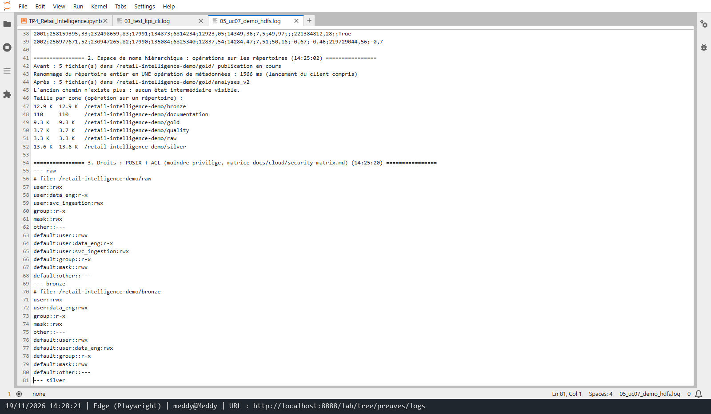

# UC-07 – Organisation ADLS Gen2 et rôle du Hierarchical Namespace

<p class="meta">Retail Intelligence Platform · TP Jour 4 · 19/11/2026 · Livrable J4-08</p>

**Principe retenu : même arborescence dans HDFS et dans ADLS.** Le conteneur ADLS reprend **exactement** les chemins
de `/retail-lake`, qui existent dans HDFS depuis le J2. Passer à Azure revient à changer la racine :

```
hdfs://localhost:9000/retail-lake/<chemin>   →   abfss://retail-intelligence@<compte>.dfs.core.windows.net/<chemin>
```

Aucun script ne change, sauf la variable de racine (`common.py` au J3, `TP4_HDFS` au J4). Cette organisation a été
**reproduite et testée en vrai** dans le bac à sable HDFS `/retail-intelligence-demo` (`scripts/uc07_demo_hdfs.sh`,
journal `preuves/logs/05_uc07_demo_hdfs.log`).

## 1. Organisation cible du conteneur `retail-intelligence`

```
retail-intelligence/                                  conteneur (« file system »), HNS activé
├── raw/
│   ├── tpcxbb/initial/<table>/<table>.dat            lot initial, tel que reçu (J2)
│   ├── tpcxbb/data_refresh/<table>/<table>.dat       lot 2 (à venir, contrôle anti-doublon)
│   └── nifi/                                         dépôts du flux d'ingestion (J2)
├── bronze/tpcxbb/<table>/                            Parquet, texte brut + 5 colonnes de provenance (J3)
├── silver/tpcxbb/
│   ├── store_sales/sold_year=<AAAA>/                 ventes typées, partitionnées par année (J3)
│   └── item/  store/  date_dim/                      dimensions typées (J3)
├── gold/
│   ├── retail/ventes_mensuelles_categorie/annee=<AAAA>/      jeu G1 (Q1, Q3)
│   ├── retail/performance_magasin_annuelle/                  jeu G2 (Q5)
│   └── analyses/                                     exports UC-08 : kpi.csv, statistiques.csv, PNG (J4)
├── quality/tpcxbb/
│   ├── quarantaine/<table>/                          lignes rejetées avec leurs motifs
│   └── rapport_controles/                            historique des contrôles (ajout à chaque exécution)
├── logs/                                             fichiers techniques (tests, mesures de formats)
└── documentation/                                    dictionnaires, schémas, README
```

## 2. Règles par zone

| Zone | Fonction | Données déposées | Qui écrit / qui lit | Conservation et traçabilité |
|---|---|---|---|---|
| `raw/` | Copie **fidèle et immuable** de ce qui a été reçu | `.dat` TPCx-BB, un dossier par lot | **Écrit** : identité d'ingestion (NiFi, ADF). **Lit** : Data Engineering | Jamais modifié ni écrasé (droits 555 dans HDFS depuis le J2 ; dans ADLS, ajout de lots seulement). Conservé pour pouvoir **tout reconstruire**. Passage en niveau *cool* après 30 jours |
| `bronze/` | Même contenu, en Parquet, avec la provenance | Tout en texte, plus `_source_file`, `_lot`, `_run_id`, `_ingested_at` | **Écrit** : Spark (`01_bronze.py`). **Lit** : Data Engineering | Reconstructible depuis Raw : réécrit en `overwrite`. Le `_run_id` relie chaque ligne à son exécution |
| `silver/` | Données **typées, nettoyées, contrôlées** | 4 tables, avec indicateurs `_flag_*` | **Écrit** : Spark (`02_silver.py`). **Lit** : Data Engineering, et les analystes **sur demande** | Version courante. `_run_id_bronze` et `_run_id_silver` assurent le lignage |
| `gold/` | Données **prêtes à l'usage métier** | Jeux G1 et G2 ; exports d'analyses | **Écrit** : Spark (`03_gold.py`, notebook UC-08). **Lit** : analystes, Power BI | Publiées après les contrôles qualité (`04_qualite.py`, 0 échec). `_run_id_gold` et `_source` |
| `quality/` | Preuves de qualité | Quarantaine, rapport de contrôles | **Écrit** : Spark. **Lit** : Data Engineering, analystes, gouvernance | **Ajout seulement** : l'historique de toutes les exécutions est gardé (1 an) |
| `logs/` | Fichiers techniques | Tests, mesures | Data Engineering | Purge après 30 jours |
| `documentation/` | Comprendre les données | Dictionnaires, schémas | Tous en lecture | Versionnée dans Git, copiée ici pour les utilisateurs |

**Règles de nommage.**
- Minuscules, `snake_case`, sans accent ni espace : `ventes_mensuelles_categorie`.
- Chemin = `<zone>/<source ou domaine>/<jeu>/`. **Un dossier = un jeu de données**, jamais deux jeux mélangés.
- Partitions au format Hive `cle=valeur` (`sold_year=2004`, `annee=2004`), lisibles par Spark et par Synapse SQL.
- Lots identifiés par un dossier (`initial`, `data_refresh`), et non par une date dans le nom du fichier.
- Les fichiers produits par Spark gardent leurs noms techniques (`part-*.snappy.parquet`) : c'est le **dossier** qui
  porte le nom métier.

## 3. Le rôle du Hierarchical Namespace (HNS)

Sans HNS, un compte de stockage Azure est un **stockage objet plat**. Le « chemin » `gold/retail/g1/part-0.parquet`
n'est alors qu'un **nom d'objet** qui contient des `/` : les répertoires sont **virtuels**, de simples préfixes.
Avec le HNS, ADLS gère de **vrais répertoires**, comme un système de fichiers.

| Aspect | Stockage objet **sans** HNS | ADLS Gen2 **avec** HNS |
|---|---|---|
| Répertoires | Virtuels (préfixes). Un dossier vide n'existe pas | Vrais objets, qui peuvent être vides et porter des métadonnées |
| **Renommer un dossier** | Copier **chaque** objet sous le nouveau nom, puis supprimer l'ancien : N opérations, **non atomique**, avec un état intermédiaire visible | **Une seule opération** de métadonnées, **atomique** |
| Supprimer un dossier | Supprimer chaque objet un par un | Une opération |
| Lister un dossier | Filtrage par préfixe sur un espace plat | Lecture du répertoire |
| **Permissions** | Au niveau du compte ou du conteneur (RBAC), ou par jeton SAS | **ACL POSIX par répertoire et par fichier**, avec héritage (ACL par défaut) |
| Accès Spark / Hadoop | Pilote `wasbs://` (ancien) | Pilote `abfss://`, conçu pour l'analytique |

**Pourquoi c'est important pour notre projet.**
1. **Écritures Spark sûres.** Spark écrit d'abord dans un dossier temporaire, puis le **renomme** en dossier final
   (*commit*). Avec le HNS, ce renommage est atomique : un lecteur voit l'ancienne version ou la nouvelle, jamais un
   jeu à moitié écrit. Sans HNS, ce *commit* est lent et risqué.
2. **Publication du Gold.** On écrit dans `gold/_publication_en_cours/`, puis on renomme : le Gold change en une seule
   étape.
3. **Moindre privilège par zone.** Les ACL de répertoire permettent de donner `gold/` en lecture aux analystes sans
   leur ouvrir `raw/`, dans **un seul** conteneur.

**Démontré en local** (HDFS a lui aussi un espace de noms hiérarchique et des ACL POSIX) :
- renommage d'un dossier de 5 fichiers (`gold/_publication_en_cours` → `gold/analyses_v2`) en **une** commande,
  l'ancien chemin disparaissant aussitôt ;
- taille par zone avec `du` sur un répertoire ;
- ACL par zone, avec héritage vers les nouveaux fichiers (voir `security-matrix.md`).

**À savoir.** Le HNS se choisit **à la création** du compte. Certaines fonctions du stockage Blob ont des limites sur
un compte HNS : il faut les vérifier dans la documentation officielle avant le déploiement.

## 4. Mise en œuvre : simulation documentaire (étape 4)

Le parcours B ne crée aucune ressource Azure. La mise en œuvre est donc **simulée**, et la démonstration
équivalente est **réalisée** sur HDFS.

| # | Opération (étape 4 du sujet) | Dans Azure : **non exécuté** (`azure/simulation/`) | En local : **exécuté** |
|---|---|---|---|
| 1 | Identifier le compte de stockage | `az storage account show` | NameNode `hdfs://localhost:9000` |
| 2 | Vérifier les caractéristiques ADLS Gen2 | `isHnsEnabled = true`, `kind = StorageV2` | `dfs.namenode.acls.enabled = true` ; espace de noms hiérarchique natif |
| 3 | Créer le conteneur | `az storage fs create -n retail-intelligence` | `hdfs dfs -mkdir /retail-intelligence-demo` |
| 4 | Créer les répertoires | `az storage fs directory create` (× zones) | `hdfs dfs -mkdir -p` (raw, bronze, silver, gold, quality, documentation) |
| 5 | Déposer un fichier de démonstration | `az storage fs file upload` de `kpi.csv` | `hdfs dfs -put analytics/outputs/kpi.csv …/gold/analyses/kpi_annuels.csv` |
| 6 | Vérifier l'accès | `az storage fs file show`, puis lecture avec une identité analyste | `hdfs dfs -cat` du fichier ; lecture par `analyste` **autorisée**, écriture **refusée** |
| 7 | Relever les chemins et les preuves | URL `abfss://` | Journal, captures et correspondance `hdfs://` → `abfss://` (section 6 du journal) |

Le détail des commandes et des contrôles prévus est dans `azure/simulation/dossier_simulation.md`.

## Captures (19/11/2026, Edge piloté par script, bandeau date et URL)


*Explorateur HDFS : bac à sable `/retail-intelligence-demo` avec les zones raw, bronze, silver, gold, quality et documentation. Le « + » signale une ACL ; les zones n'ont aucun droit « others ».*



*Journal de la démonstration : renommage d'un dossier de 5 fichiers en une opération, taille par zone, puis ACL de raw et de bronze.*
