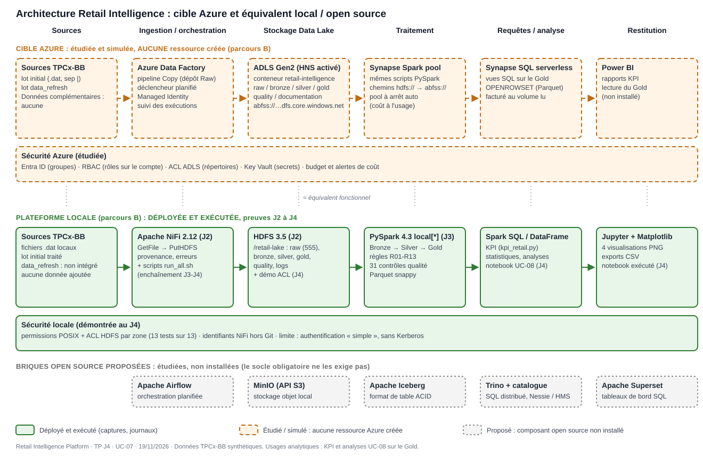

# UC-07 – Architecture Azure et équivalent local / open source

<p class="meta">Retail Intelligence Platform · TP Jour 4 · 19/11/2026 · Livrable J4-07</p>

## 0. Parcours retenu : B (local / open source)

**Choix** : parcours B. Aucune ressource Azure n'a été créée, et aucun moyen de paiement n'a été saisi.

**Raisons** :
- le sujet n'exige pas de déploiement cloud (§9.2.2) ;
- le parcours B évite tout risque de facturation non maîtrisée (§4.8) ;
- la plateforme locale (HDFS, NiFi, Spark) est déjà opérationnelle depuis le J2.

| Statut | Ce que cela recouvre | Preuves |
|---|---|---|
| **Déployé et exécuté** | HDFS, NiFi, PySpark, notebooks, **démonstration des zones, de l'espace de noms hiérarchique et des ACL sur HDFS** (J4) | Journaux `preuves/logs/`, captures `preuves/captures/` |
| **Simulé** | Création d'ADLS Gen2, dépôt d'un fichier, ACL et rôles Azure : commandes écrites, **non exécutées** | `azure/simulation/` |
| **Étudié / proposé** | ADF, Synapse, Power BI, Airflow, MinIO, Iceberg, Trino, Superset | Ce document |

## 1. Schéma d'architecture



*En haut, la cible Azure, étudiée. En bas, la plateforme réellement exécutée. Chaque colonne correspond à une fonction.
Source : `azure/architecture/gen_schema_architecture.py`.*

**Lecture du schéma.**
- Les sources TPCx-BB (lot initial ; `data_refresh` non intégré) sont déposées en zone Raw par un outil d'ingestion.
- Spark les fait passer de Bronze à Silver puis à Gold. Les KPI et les analyses (UC-08) lisent le Gold.
- **Aucune donnée complémentaire** n'a été ajoutée : il n'y a pas de flux séparé à représenter.
- La sécurité est transversale à toutes les étapes.

## 2. Composants Azure et leurs relations (étape 1)

| Composant | Rôle dans le projet |
|---|---|
| **Abonnement** | Cadre de facturation et de quotas. C'est là qu'on pose un **budget** et des **alertes de coût**. Ce n'est pas un serveur |
| **Groupe de ressources** `rg-retail-intelligence-dev` | Regroupe toutes les ressources du projet pour les suivre, leur appliquer des droits, puis **les supprimer d'un coup** à la fin du TP |
| **Compte de stockage** `stretailintel<suffixe>` | Ressource qui porte le Data Lake : StorageV2, redondance LRS (suffisante en TP), accès public interdit, TLS 1.2 minimum |
| **ADLS Gen2** | Le compte de stockage **avec l'espace de noms hiérarchique activé**. Il expose le point d'accès `dfs.core.windows.net` (pilote ABFS : `abfss://`) utilisé par Spark |
| **Hierarchical Namespace (HNS)** | Option **choisie à la création** du compte. Elle transforme les « préfixes » d'objets en vrais répertoires : renommage atomique, ACL par répertoire (voir `adls-organization.md`) |
| **Conteneur** `retail-intelligence` | Espace racine (« file system ») qui contient les zones `raw/`, `bronze/`, `silver/`, `gold/`, `quality/` et `documentation/` |
| **Microsoft Entra ID** | Annuaire des **identités** : utilisateurs, **groupes** (ingestion, data engineering, analystes) et **identités managées** des services (ADF, Synapse). Il authentifie, il n'autorise pas |
| **Azure RBAC** | Attribue des **rôles** à une identité sur un **périmètre** : abonnement, groupe de ressources, compte ou conteneur. Exemple : *Storage Blob Data Reader* |
| **ACL ADLS** | Droits POSIX (`r`, `w`, `x`) **par répertoire et par fichier**, plus fins que le RBAC. Ils ne fonctionnent qu'avec le HNS |

**Relations.**

```
Abonnement ─┬─ Groupe de ressources ─┬─ Compte de stockage (HNS = ADLS Gen2) ── Conteneur ── répertoires ── fichiers
            │                        ├─ Data Factory (identité managée)
            │                        └─ Espace de travail Synapse (identité managée, pools Spark et SQL)
Entra ID (identités, groupes) ──► RBAC : rôle × périmètre (abonnement → groupe de ressources → compte → conteneur)
                              └─► ACL : droits sur un répertoire ou un fichier précis du conteneur
```

Lors d'un accès aux données, Azure **évalue d'abord le RBAC**. Si un rôle donne l'accès, les ACL ne sont pas
consultées. Sinon, ce sont les ACL qui décident (voir `security-matrix.md`).

## 3. Rôle d'ADF et de Synapse (étape 6)

| Service | Responsabilité | Dans notre projet | Ce qu'il n'est pas |
|---|---|---|---|
| **ADLS Gen2** | **Stocker** les données des zones | Remplacerait HDFS | Ni un moteur de calcul, ni un outil d'orchestration |
| **Azure Data Factory** | **Intégrer, déplacer, orchestrer** : pipelines, activité *Copy*, déclencheurs planifiés, suivi des exécutions, réexécution | Remplacerait NiFi et `run_all.sh`. Copierait les `.dat` en Raw, puis lancerait les traitements Spark dans l'ordre. Comme les fichiers sont sur un poste local, il faudrait un *Self-hosted Integration Runtime* (ou un dépôt préalable avec AzCopy) | Ne stocke rien et ne transforme pas lui-même les données à grande échelle |
| **Azure Synapse Analytics** | **Espace d'analyse** qui réunit le calcul Spark, le SQL et l'exploration | Exécuterait les scripts du J3 et le notebook du J4 | Pas un stockage : les données restent dans ADLS |
| Synapse **Studio** | Interface web : notebooks, scripts SQL, pipelines, supervision | Remplacerait JupyterLab | – |
| Synapse **Spark pools** | Spark **managé**, démarré à la demande et arrêté automatiquement après inactivité | `01_bronze.py` à `03_gold.py` et `kpi_retail.py`, presque sans modification (voir §5) | Facturé tant que le pool tourne |
| Synapse **SQL** (serverless) | Requêtes SQL directement sur les fichiers Parquet du lac (`OPENROWSET`), sans les charger | Vues SQL sur le Gold pour Power BI et les analystes | Facturé au volume lu. Pas de transactions ACID sur les fichiers |
| **Power BI** | Restitution interactive | Tableau de bord des KPI | Ne doit pas recalculer les KPI : il lit le Gold |

> Microsoft oriente désormais les nouveaux projets analytiques vers **Microsoft Fabric**. Synapse reste disponible.
> Ce choix serait à revalider au moment d'un déploiement réel, sur la documentation officielle.

## 4. Correspondance Azure / open source : par responsabilités (étapes 8 et 9)

| Fonction | Rôle fonctionnel | Azure (étudié) | **Retenu dans notre parcours B** | Non déployé (proposé) | Limites de l'équivalence |
|---|---|---|---|---|---|
| Stockage Data Lake | Conserver les fichiers par zone, avec droits | ADLS Gen2 + HNS | **HDFS 3.5**, `/retail-lake` (déployé au J2) | MinIO (API S3) | HDFS a déjà un espace de noms hiérarchique et des ACL POSIX, comme ADLS, mais **ni haute disponibilité** (1 nœud, réplication 1), **ni chiffrement**, **ni authentification forte** |
| Tables analytiques | Schéma, transactions, historique | Tables du lakehouse (Delta) | **Parquet** seul (J3) | Apache Iceberg | Parquet est un format de **fichier** : ni ACID, ni historique, ni `UPDATE`. Iceberg ajouterait la couche **table** (étude J3, `UC06_avance_lakehouse.md`) |
| Traitement distribué | Nettoyer, transformer, agréger | Synapse Spark pools | **PySpark 4.3 `local[*]`** (J3, J4) | – | Un seul processus, 12 cœurs : pas de cluster, pas d'élasticité |
| Requêtes SQL | Interroger le Gold en SQL | Synapse SQL serverless | **Spark SQL / DataFrame** (J4) | Trino | Spark SQL demande une session Spark. Trino offrirait un point d'accès SQL partagé, mais il lui faut un catalogue |
| Catalogue / métadonnées | Savoir quelles tables existent, avec quel schéma | Catalogue Synapse / Purview | **Aucun** : chemins écrits en dur dans `kpi_retail.py` | Nessie ou Hive Metastore | Sans catalogue, les tables ne sont trouvables que par leur chemin. C'est la principale lacune de l'équivalence |
| Intégration / orchestration | Ingestion, planification, reprise sur erreur | Azure Data Factory | **NiFi** (ingestion, J2) + **`run_all.sh`** (enchaînement, J3-J4) | Apache Airflow | Pas de planificateur, pas de reprise automatique, pas de suivi centralisé. `cron` + `run_all.sh` serait la version minimale |
| Visualisation | Tableaux de bord | Power BI | **Jupyter + Matplotlib** (J4) | Apache Superset | Graphiques statiques : pas de filtres interactifs |
| Identités et permissions | Authentifier, autoriser | Entra ID, RBAC, ACL | **Permissions POSIX + ACL HDFS** (démontrées au J4) | Kerberos | En mode `simple`, l'identité est **déclarée**, pas prouvée (démontré) : les ACL organisent les droits mais ne protègent pas contre un tricheur |
| Secrets | Stocker les mots de passe et les clés | Key Vault | Identifiants **hors Git** (`.gitignore`), saisis localement | Vault / variables d'environnement | Pas de coffre, pas de rotation |
| Exécution | Où tournent les services | Services managés | **WSL2 Ubuntu** sur un poste Windows | Docker Compose | Une seule machine : la panne du poste arrête tout |

**Pourquoi faut-il plusieurs briques open source pour remplacer Synapse ?** Synapse est un service **intégré** : un
seul produit fournit le calcul Spark, le moteur SQL, le catalogue, l'interface (Studio), la sécurité (Entra ID) et la
supervision. En open source, chaque fonction est un projet distinct, qu'il faut installer, configurer et faire
communiquer :
- Spark pour le calcul ;
- Trino pour le SQL ;
- Iceberg pour le format de table ;
- Nessie ou Hive Metastore pour le catalogue ;
- Airflow pour l'orchestration ;
- Superset pour les tableaux de bord.

**Iceberg n'est pas « le Synapse open source »** : c'est seulement le format de table. On gagne en indépendance et en
coût. On perd l'intégration, qu'il faut alors construire et maintenir soi-même.

## 5. Description des traitements et transposition vers Azure (étude, AV-02)

| Traitement | Entrée | Sortie | Changement nécessaire pour Azure |
|---|---|---|---|
| `J3/.../01_bronze.py` | `raw/tpcxbb/initial/<t>/<t>.dat` | `bronze/tpcxbb/<t>` | Remplacer `HDFS = "hdfs://localhost:9000"` par `abfss://retail-intelligence@<compte>.dfs.core.windows.net`. Le code des transformations ne change pas : les chemins sont centralisés dans `common.py` |
| `02_silver.py`, `03_gold.py`, `04_qualite.py` | Bronze, Silver | Silver, Gold, quality | idem |
| `analytics/scripts/kpi_retail.py` | Silver | CSV de KPI | Variable d'environnement `TP4_HDFS` (déjà prévue) |
| Notebook UC-08 | Silver, Gold | PNG, CSV | Notebook Synapse : les graphiques Matplotlib fonctionnent, mais les exports iraient dans `gold/analyses/` au lieu du disque local |

- **Authentification de Spark sur ADLS** : par l'**identité managée** de l'espace de travail Synapse, à laquelle on
  donne un rôle *Storage Blob Data Contributor* limité au conteneur. **Jamais de clé de compte dans le code.**
- **Contrôles après exécution** : les mêmes que ceux du J3 (`04_qualite.py`), avec la réconciliation Raw = Bronze =
  Silver et Gold = Silver, plus la comparaison des KPI avec `reconciliation_j1_j4.csv`.

## 6. Coûts, quotas et limites

| Risque | Mesure prévue |
|---|---|
| Crédit gratuit épuisé, puis facturation | Parcours B choisi. En parcours A : budget sur l'abonnement, alertes à 50 % et 80 %, aucune ressource sans accord du formateur |
| Pool Spark ou espace Synapse oublié | Arrêt automatique après 15 minutes d'inactivité ; suppression du groupe de ressources à la fin |
| SQL serverless facturé au volume lu | Interroger le **Gold en Parquet partitionné**, jamais le Raw (le J3 a montré que Parquet lit 2 colonnes sur 23) |
| Stockage qui gonfle (le JSON pèse 3,8 fois le `.dat`, cf. J3) | Parquet en Silver et Gold ; cycle de vie : Raw en niveau *cool* après 30 jours |
| Transferts sortants | Calcul dans la même région que le stockage |
| Ressources persistantes (IP publiques, disques) | Aucune n'est nécessaire à cette architecture : tout est en PaaS |

**Limites de notre réalisation.**
- Rien n'a été mesuré sur Azure : les performances et les coûts restent **théoriques**.
- La démonstration locale prouve le **modèle** (zones, HNS, ACL), pas le comportement exact d'ADLS : le RBAC n'a pas
  d'équivalent dans HDFS.
- Les briques open source proposées n'ont pas été installées. Le socle obligatoire ne l'exige pas (§4.7).
