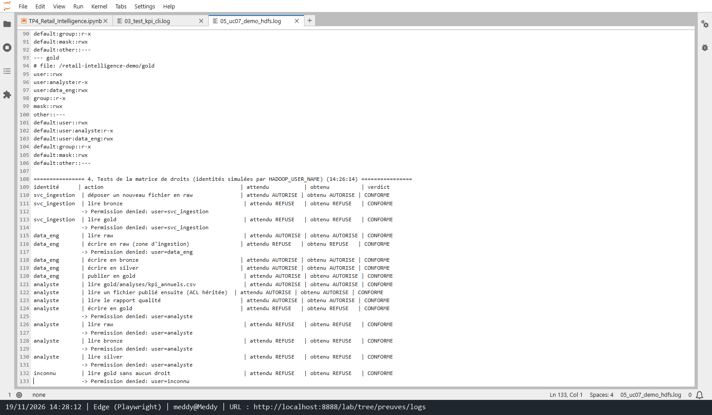

# UC-07 – Matrice des rôles et des permissions

Retail Intelligence Platform · TP Jour 4 · 19/11/2026 · Livrable J4-09

**Principe : moindre privilège.** Chaque profil reçoit uniquement ce dont il a besoin, zone par zone. Les droits sont
donnés à des **groupes**, pas à des personnes. Personne n'écrit dans une zone qu'il ne produit pas.

## 1. Matrice des droits (cible ADLS Gen2, testée en local)

| Profil | Identité Azure (cible) | `raw/` | `bronze/` | `silver/` | `gold/` | `quality/` |
|---|---|---|---|---|---|---|
| **Ingestion** | Identité managée d'**ADF** (en local : compte de service NiFi `svc_ingestion`) | **Écriture** (dépôt de lots) | Aucun | Aucun | Aucun | Aucun |
| **Data Engineering** | Groupe `grp-retail-dataeng` + identité managée de **Synapse** (en local : `data_eng`) | **Lecture** | Lecture / écriture | Lecture / écriture | **Écriture contrôlée** (publication après contrôles) | Lecture / écriture |
| **Analyste métier** | Groupe `grp-retail-analystes` (en local : `analyste`) | Aucun | Aucun | Aucun par défaut, **lecture sur demande** | **Lecture** | Lecture |
| **Restitution** (Power BI) | Identité de service ou de l'utilisateur | Aucun | Aucun | Aucun | Lecture | Aucun |
| **Administrateur** | Groupe `grp-retail-admins`, avec élévation temporaire | Gestion selon habilitation : structure et droits, **pas** de modification des données Raw | idem | idem | idem | idem |
| Tout autre compte | – | Aucun | Aucun | Aucun | Aucun | Aucun |

- **Raw est immuable** : l'ingestion ajoute des lots mais n'en modifie aucun. Dans HDFS, la zone est en lecture seule
  (555) depuis le J2.
- **L'analyste ne voit pas le Silver par défaut.** Le Gold contient les indicateurs validés ; lui donner accès au
  Silver l'exposerait à des données non agrégées, avec des indicateurs `_flag_*` à interpréter.

## 2. Test réel de la matrice (parcours B, HDFS)

`scripts/uc07_demo_hdfs.sh` applique cette matrice avec des **ACL HDFS** sur le bac à sable `/retail-intelligence-demo`,
puis la teste avec chaque identité (journal : `preuves/logs/05_uc07_demo_hdfs.log`).

| Identité | Action | Attendu | Obtenu |
|---|---|---|---|
| svc_ingestion | Déposer un fichier en raw | Autorisé | ✅ Autorisé |
| svc_ingestion | Lire bronze / lire gold | Refusé | ✅ Refusé (`Permission denied`) |
| data_eng | Lire raw | Autorisé | ✅ Autorisé |
| data_eng | Écrire en raw | Refusé | ✅ Refusé |
| data_eng | Écrire en bronze, en silver, publier en gold | Autorisé | ✅ Autorisé |
| analyste | Lire gold ; lire un fichier publié **après** la pose des ACL ; lire le rapport qualité | Autorisé | ✅ Autorisé |
| analyste | Écrire en gold ; lire raw, bronze ou silver | Refusé | ✅ Refusé |
| inconnu | Lire gold | Refusé | ✅ Refusé |

**Bilan : 16 tests, 16 conformes.**

Le fichier publié par `data_eng` après la pose des ACL a bien **hérité** de l'accès en lecture de l'analyste, grâce à
l'**ACL par défaut** du répertoire. Le journal montre aussi le **masque** (`mask`), qui plafonne les droits effectifs
(`#effective:r--`).

## 3. RBAC, ACL, identités, secrets : quatre notions différentes

| Notion | Question à laquelle elle répond | Azure | Notre parcours local |
|---|---|---|---|
| **Identité / authentification** | *Qui es-tu, et le prouves-tu ?* | **Microsoft Entra ID** : utilisateurs, groupes, **identités managées** des services (sans mot de passe à gérer), MFA | Comptes Linux. HDFS en mode `simple` : l'identité est **déclarée** par le client, **sans preuve** |
| **Azure RBAC** | *Quel rôle as-tu, sur quel périmètre de ressources ?* | Rôles sur abonnement, groupe de ressources, compte ou **conteneur**. Plan de contrôle (*Owner*, *Contributor*, *Reader*) et plan de données (*Storage Blob Data Reader / Contributor / Owner*) | Pas d'équivalent. Le super-utilisateur HDFS (celui qui a démarré le NameNode) a tous les droits |
| **ACL** | *Que peux-tu faire sur **ce** répertoire ou **ce** fichier ?* | ACL POSIX d'ADLS (`r`, `w`, `x`, ACL par défaut). Elles ne fonctionnent qu'avec le HNS | **ACL POSIX HDFS**, même modèle (démontré) |
| **Secrets** | *Où sont les mots de passe et les clés ?* | **Key Vault**. Mieux encore : pas de secret du tout, grâce aux identités managées. **Désactiver les clés partagées du compte** | Identifiants NiFi hors Git. Aucun secret dans le dépôt (vérifié). Pas de coffre |

**Comment Azure combine RBAC et ACL.**
1. Le **RBAC est évalué en premier**. Si un rôle de données donne l'accès, l'accès est accordé **sans regarder les
   ACL**.
2. Sinon, ce sont les **ACL** qui décident. Pour lire `gold/retail/g1/x.parquet`, il faut `x` sur **chaque** dossier
   parent et `r` sur le fichier.

Conséquences pour la conception :
- **Ne pas donner de rôle de données RBAC aux analystes.** Le plus petit périmètre RBAC est le **conteneur** : un rôle
  *Storage Blob Data Reader* leur ouvrirait aussi `raw/` et `silver/`. On leur donne seulement des ACL sur `gold/`
  et `quality/`.
- **Ne pas donner *Contributor* (plan de contrôle) par facilité.** Ce rôle permet de lire les clés du compte, donc
  d'accéder à **toutes** les données en contournant RBAC et ACL. D'où la désactivation des clés partagées.
- **Alternative** : un conteneur par zone (`raw`, `bronze`, `silver`, `gold`). Le RBAC suffit alors, avec moins
  d'ACL à gérer, mais le renommage d'un conteneur à l'autre n'est plus atomique. Nous gardons **un conteneur et des
  ACL**, cohérents avec HDFS.
- Une ACL est **limitée en nombre d'entrées** (32 par fichier ou répertoire) : on n'y met que des **groupes**.

## 4. Mécanismes de sécurité locaux (parcours B, étape 8)

| Mécanisme | Mise en place | État |
|---|---|---|
| Comptes | Compte Linux `meddy` (administrateur HDFS). Identités de démonstration `svc_ingestion`, `data_eng`, `analyste` | Démontré |
| Permissions du système de fichiers | `chmod` POSIX : Raw en 555 (J2) ; zones de démonstration en 750, sans aucun droit « others » | Déployé |
| ACL | `hdfs dfs -setfacl` par zone, avec ACL par défaut pour l'héritage | Démontré (16 tests) |
| Secrets | Identifiants NiFi jamais versionnés. `.gitignore`. Aucun mot de passe sur les captures | Appliqué depuis le J2 |
| Séparation des environnements | Bac à sable `/retail-intelligence-demo` distinct de `/retail-lake` | Appliqué |
| **Limite** | Mode `simple` : `HADOOP_USER_NAME=meddy` suffit pour se faire passer pour l'administrateur (démontré, section 5 du journal). En production, il faudrait **Kerberos** en local, ou **Entra ID** dans Azure | **Documentée, non corrigée** |

## 5. Recommandations de gouvernance (CO-05, en complément)

- **Séparer les environnements** : un groupe de ressources et un compte de stockage pour `dev`, et d'autres pour
  `prod`. Pas de données de production en développement.
- **Séparer les responsabilités** : celui qui ingère ne publie pas, et celui qui publie ne modifie pas le Raw.
- **Classer les données** : TPCx-BB est synthétique, donc non sensible. Les clés client (`ss_customer_sk`) seraient en
  revanche des **données personnelles** dans un cas réel : pseudonymisation dès le Silver.
- **Journaliser les accès** : journaux de diagnostic du compte de stockage (lectures, écritures, suppressions) envoyés
  vers Azure Monitor. En local, journal d'audit du NameNode (`hdfs-audit.log`).
- **Revoir les droits** chaque trimestre, et accorder les droits d'administration de façon temporaire.

## Captures (19/11/2026, Edge piloté par script, bandeau date et URL)

*ACL de la zone gold (accès et par défaut), puis début des tests de la matrice.*

*Tests de la matrice : 16 sur 16 conformes, refus `Permission denied` attendus, et ACL héritée par un fichier publié ensuite (`#effective:r--`).*

*Preuve inattendue : l'interface web du NameNode lit HDFS sous l'utilisateur anonyme `dr.who`. L'accès à `gold/` lui est refusé : les droits s'appliquent aussi à cette interface.*

*Limite du mode `simple` : se déclarer `meddy` suffit pour lire raw. Correspondance des chemins `hdfs://` → `abfss://`.*
